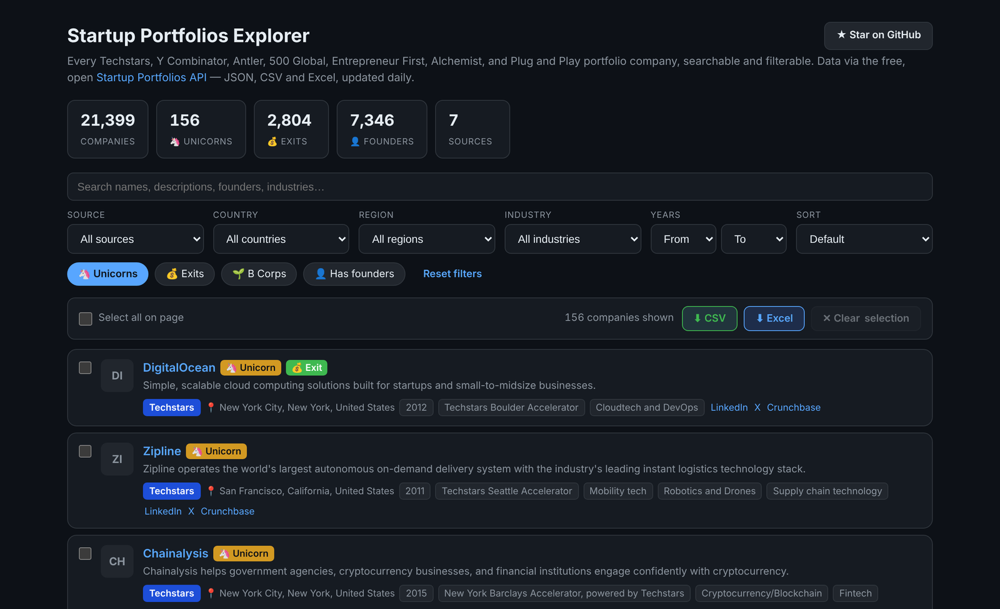

<h1 align="center">Startup Portfolios API</h1>

<p align="center">
  <b>The free, open API for 23,170 startups funded by the world's top accelerators.</b><br>
  Y Combinator · Techstars · 500 Global · Antler · Plug and Play · Entrepreneur First · Alchemist<br>
  JSON, CSV and Excel — with founders, industries, countries and exits. Refreshed daily. No key, no rate limits.
</p>

<p align="center">
  <a href="https://cdn.jsdelivr.net/gh/yigitmeteozcan/startups@main/data/all.json"></a>
  <a href="https://cdn.jsdelivr.net/gh/yigitmeteozcan/startups@main/data/all.json"></a>
  <a href="STATS.md"></a>
  <a href="https://github.com/yigitmeteozcan/startups/stargazers"></a>
  <a href="https://github.com/yigitmeteozcan/startups/actions/workflows/test.yml"></a>
  <a href="LICENSE"></a>
</p>

<p align="center">
  <a href="https://yigitmeteozcan.github.io/startups/"><b>🔎 Open the live explorer</b></a> ·
  <a href="#-quick-start">Quick start</a> ·
  <a href="#-apis">All endpoints</a> ·
  <a href="#-schema">Schema</a> ·
  <a href="#rest-api-server">REST server</a>
</p>

<p align="center">
  <a href="https://yigitmeteozcan.github.io/startups/"></a>
</p>

> ⭐ **Find this useful? [Star the repo](https://github.com/yigitmeteozcan/startups)** — it's how other founders, investors and researchers discover it.

## ✨ Why this exists

Accelerator portfolios are scattered across seven different websites, each with its own format, filters and gaps. This project pulls them all into **one clean, consistent dataset** every day and serves it as static files on a CDN, so you can:

- **Build lead lists** — every YC, Techstars or Antler company in a country or industry, with founder names and LinkedIn profiles.
- **Research markets and investors** — which accelerators back which sectors, how cohorts have shifted year by year, who exited.
- **Ship apps and dashboards** — a free, stable JSON API with no key, no rate limits and no scraping on your side.
- **Train and evaluate models** — a labelled dataset of real companies with descriptions, industries and outcomes (companies in several portfolios are linked via `alsoIn`).

**Sources:** [Plug and Play](https://www.plugandplaytechcenter.com/innovation-services/startups/our-startups) (7,185) · [Y Combinator](https://www.ycombinator.com/companies) (6,398) · [Techstars](https://www.techstars.com/portfolio) (5,199) · [500 Global](https://500.co/portfolio) (2,243) · [Antler](https://www.antler.co/portfolio) (1,086) · [Entrepreneur First](https://www.joinef.com/portfolio/) (545) · [Alchemist](https://www.alchemistaccelerator.com/portfolio) (514)

## ℹ️ Metadata

> Last updated: **2026-11-18**

- **23,170** companies across **7** portfolio sources
- **343** accelerator programs / cohorts
- **465** industry verticals
- **119** countries · **104** world regions, across **23** cohort years
- 🦄 **167** unicorns · 💰 **2,932** exits · 🌱 **29** B Corps · 👤 **7,354** founder profiles
- 📦 **1,551** companies no longer listed by their source are kept (`listed: false`) — nothing is ever deleted

### Source freshness

| Source | Companies | Status | Last live fetch |
|---|---|---|---|
| [Plug and Play](https://www.plugandplaytechcenter.com/innovation-services/startups/our-startups) | 7,185 | ✅ live | 2026-11-18 |
| [Y Combinator](https://www.ycombinator.com/companies) | 6,398 | ✅ live | 2026-11-18 |
| [Techstars](https://www.techstars.com/portfolio) | 5,199 | ✅ live | 2026-11-18 |
| [500 Global](https://500.co/portfolio) | 2,243 | ✅ live | 2026-11-18 |
| [Antler](https://www.antler.co/portfolio) | 1,086 | ✅ live | 2026-11-18 |
| [Entrepreneur First](https://www.joinef.com/portfolio/) | 545 | ✅ live | 2026-11-18 |
| [Alchemist](https://www.alchemistaccelerator.com/portfolio) | 514 | ✅ live | 2026-11-18 |

_"cached" means the last live fetch failed or looked broken, so the previously committed records were kept rather than dropped._

## 🚀 Quick start

```bash
# everything
curl https://cdn.jsdelivr.net/gh/yigitmeteozcan/startups@main/data/all.json

# just the unicorns
curl https://cdn.jsdelivr.net/gh/yigitmeteozcan/startups@main/data/unicorns.json
```

```python
import requests
companies = requests.get("https://cdn.jsdelivr.net/gh/yigitmeteozcan/startups@main/data/all.json").json()
print(len(companies), "companies")
```

```javascript
const companies = await fetch("https://cdn.jsdelivr.net/gh/yigitmeteozcan/startups@main/data/all.json").then((r) => r.json());
```

### Recipes

```python
import requests

base = "https://cdn.jsdelivr.net/gh/yigitmeteozcan/startups@main/data"

# Fintech unicorns
unicorns = requests.get(f"{base}/unicorns.json").json()
fintech = [c for c in unicorns if "Fintech" in c["tags"]]

# Every company from a single program
boulder = requests.get(f"{base}/by-program/techstars-boulder-accelerator.json").json()

# Founders with LinkedIn profiles, e.g. for outreach
companies = requests.get(f"{base}/all.json").json()
founders = [(c["name"], f["name"], f["linkedin"]) for c in companies for f in c["founders"] if f["linkedin"]]

# Every startup in one country
germany = requests.get(f"{base}/by-country/germany.json").json()

# Discover every endpoint and its count
meta = requests.get(f"{base}/meta.json").json()
print(meta["collections"]["by-industry"][:3])
```

## 💻 APIs

The base URL for every endpoint is:

```
https://cdn.jsdelivr.net/gh/yigitmeteozcan/startups@main/data/
```

### 🏢 Companies

| Description | API |
|---|---|
| All companies | [`all.json`](https://cdn.jsdelivr.net/gh/yigitmeteozcan/startups@main/data/all.json) |
| All companies (CSV) | [`all.csv`](https://cdn.jsdelivr.net/gh/yigitmeteozcan/startups@main/data/all.csv) |
| All companies (Excel, refreshed weekly) | [`all.xlsx`](https://cdn.jsdelivr.net/gh/yigitmeteozcan/startups@main/data/all.xlsx) |
| Unicorns (valued $1B+) | [`unicorns.json`](https://cdn.jsdelivr.net/gh/yigitmeteozcan/startups@main/data/unicorns.json) |
| Exited companies | [`exits.json`](https://cdn.jsdelivr.net/gh/yigitmeteozcan/startups@main/data/exits.json) |
| Certified B Corps | [`b-corps.json`](https://cdn.jsdelivr.net/gh/yigitmeteozcan/startups@main/data/b-corps.json) |
| Current accelerator session | [`current.json`](https://cdn.jsdelivr.net/gh/yigitmeteozcan/startups@main/data/current.json) |
| Aggregate stats | [`stats.json`](https://cdn.jsdelivr.net/gh/yigitmeteozcan/startups@main/data/stats.json) |
| **Catalog of every endpoint** | [`meta.json`](https://cdn.jsdelivr.net/gh/yigitmeteozcan/startups@main/data/meta.json) |

### 🏛️ By source

<details open>
<summary>7 portfolio sources — <a href="https://cdn.jsdelivr.net/gh/yigitmeteozcan/startups@main/data/by-source/index.json">index.json</a></summary>

| Source | Companies | API |
|---|---|---|
| plugandplay | 7185 | [`by-source/plugandplay.json`](https://cdn.jsdelivr.net/gh/yigitmeteozcan/startups@main/data/by-source/plugandplay.json) |
| yc | 6398 | [`by-source/yc.json`](https://cdn.jsdelivr.net/gh/yigitmeteozcan/startups@main/data/by-source/yc.json) |
| techstars | 5199 | [`by-source/techstars.json`](https://cdn.jsdelivr.net/gh/yigitmeteozcan/startups@main/data/by-source/techstars.json) |
| 500 | 2243 | [`by-source/500.json`](https://cdn.jsdelivr.net/gh/yigitmeteozcan/startups@main/data/by-source/500.json) |
| antler | 1086 | [`by-source/antler.json`](https://cdn.jsdelivr.net/gh/yigitmeteozcan/startups@main/data/by-source/antler.json) |
| ef | 545 | [`by-source/ef.json`](https://cdn.jsdelivr.net/gh/yigitmeteozcan/startups@main/data/by-source/ef.json) |
| alchemist | 514 | [`by-source/alchemist.json`](https://cdn.jsdelivr.net/gh/yigitmeteozcan/startups@main/data/by-source/alchemist.json) |

</details>

### 🎓 By year

<details>
<summary>23 cohort years — <a href="https://cdn.jsdelivr.net/gh/yigitmeteozcan/startups@main/data/by-year/index.json">index.json</a></summary>

| Year | Companies | API |
|---|---|---|
| 2027 | 15 | [`by-year/2027.json`](https://cdn.jsdelivr.net/gh/yigitmeteozcan/startups@main/data/by-year/2027.json) |
| 2026 | 1071 | [`by-year/2026.json`](https://cdn.jsdelivr.net/gh/yigitmeteozcan/startups@main/data/by-year/2026.json) |
| 2025 | 1048 | [`by-year/2025.json`](https://cdn.jsdelivr.net/gh/yigitmeteozcan/startups@main/data/by-year/2025.json) |
| 2024 | 1452 | [`by-year/2024.json`](https://cdn.jsdelivr.net/gh/yigitmeteozcan/startups@main/data/by-year/2024.json) |
| 2023 | 1495 | [`by-year/2023.json`](https://cdn.jsdelivr.net/gh/yigitmeteozcan/startups@main/data/by-year/2023.json) |
| 2022 | 1456 | [`by-year/2022.json`](https://cdn.jsdelivr.net/gh/yigitmeteozcan/startups@main/data/by-year/2022.json) |
| 2021 | 1383 | [`by-year/2021.json`](https://cdn.jsdelivr.net/gh/yigitmeteozcan/startups@main/data/by-year/2021.json) |
| 2020 | 1062 | [`by-year/2020.json`](https://cdn.jsdelivr.net/gh/yigitmeteozcan/startups@main/data/by-year/2020.json) |
| 2019 | 1030 | [`by-year/2019.json`](https://cdn.jsdelivr.net/gh/yigitmeteozcan/startups@main/data/by-year/2019.json) |
| 2018 | 863 | [`by-year/2018.json`](https://cdn.jsdelivr.net/gh/yigitmeteozcan/startups@main/data/by-year/2018.json) |
| 2017 | 816 | [`by-year/2017.json`](https://cdn.jsdelivr.net/gh/yigitmeteozcan/startups@main/data/by-year/2017.json) |
| 2016 | 724 | [`by-year/2016.json`](https://cdn.jsdelivr.net/gh/yigitmeteozcan/startups@main/data/by-year/2016.json) |
| 2015 | 682 | [`by-year/2015.json`](https://cdn.jsdelivr.net/gh/yigitmeteozcan/startups@main/data/by-year/2015.json) |
| 2014 | 470 | [`by-year/2014.json`](https://cdn.jsdelivr.net/gh/yigitmeteozcan/startups@main/data/by-year/2014.json) |
| 2013 | 341 | [`by-year/2013.json`](https://cdn.jsdelivr.net/gh/yigitmeteozcan/startups@main/data/by-year/2013.json) |
| 2012 | 361 | [`by-year/2012.json`](https://cdn.jsdelivr.net/gh/yigitmeteozcan/startups@main/data/by-year/2012.json) |
| 2011 | 253 | [`by-year/2011.json`](https://cdn.jsdelivr.net/gh/yigitmeteozcan/startups@main/data/by-year/2011.json) |
| 2010 | 149 | [`by-year/2010.json`](https://cdn.jsdelivr.net/gh/yigitmeteozcan/startups@main/data/by-year/2010.json) |
| 2009 | 63 | [`by-year/2009.json`](https://cdn.jsdelivr.net/gh/yigitmeteozcan/startups@main/data/by-year/2009.json) |
| 2008 | 53 | [`by-year/2008.json`](https://cdn.jsdelivr.net/gh/yigitmeteozcan/startups@main/data/by-year/2008.json) |
| 2007 | 43 | [`by-year/2007.json`](https://cdn.jsdelivr.net/gh/yigitmeteozcan/startups@main/data/by-year/2007.json) |
| 2006 | 17 | [`by-year/2006.json`](https://cdn.jsdelivr.net/gh/yigitmeteozcan/startups@main/data/by-year/2006.json) |
| 2005 | 8 | [`by-year/2005.json`](https://cdn.jsdelivr.net/gh/yigitmeteozcan/startups@main/data/by-year/2005.json) |

</details>

### 🏭 By industry

<details>
<summary>465 industry verticals — <a href="https://cdn.jsdelivr.net/gh/yigitmeteozcan/startups@main/data/by-industry/index.json">index.json</a></summary>

| Industry | Companies | API |
|---|---|---|
| Fintech | 3029 | [`by-industry/fintech.json`](https://cdn.jsdelivr.net/gh/yigitmeteozcan/startups@main/data/by-industry/fintech.json) |
| AI | 1900 | [`by-industry/ai.json`](https://cdn.jsdelivr.net/gh/yigitmeteozcan/startups@main/data/by-industry/ai.json) |
| SaaS | 1701 | [`by-industry/saas.json`](https://cdn.jsdelivr.net/gh/yigitmeteozcan/startups@main/data/by-industry/saas.json) |
| Artificial intelligence and machine learning | 1667 | [`by-industry/artificial-intelligence-and-machine-learning.json`](https://cdn.jsdelivr.net/gh/yigitmeteozcan/startups@main/data/by-industry/artificial-intelligence-and-machine-learning.json) |
| Mobile | 1163 | [`by-industry/mobile.json`](https://cdn.jsdelivr.net/gh/yigitmeteozcan/startups@main/data/by-industry/mobile.json) |
| Consumer | 1075 | [`by-industry/consumer.json`](https://cdn.jsdelivr.net/gh/yigitmeteozcan/startups@main/data/by-industry/consumer.json) |
| Healthcare | 833 | [`by-industry/healthcare.json`](https://cdn.jsdelivr.net/gh/yigitmeteozcan/startups@main/data/by-industry/healthcare.json) |
| Infrastructure | 756 | [`by-industry/infrastructure.json`](https://cdn.jsdelivr.net/gh/yigitmeteozcan/startups@main/data/by-industry/infrastructure.json) |
| Developer Tools | 747 | [`by-industry/developer-tools.json`](https://cdn.jsdelivr.net/gh/yigitmeteozcan/startups@main/data/by-industry/developer-tools.json) |
| Industrials | 694 | [`by-industry/industrials.json`](https://cdn.jsdelivr.net/gh/yigitmeteozcan/startups@main/data/by-industry/industrials.json) |
| Health & Longevity | 691 | [`by-industry/health-longevity.json`](https://cdn.jsdelivr.net/gh/yigitmeteozcan/startups@main/data/by-industry/health-longevity.json) |
| Insurtech | 687 | [`by-industry/insurtech.json`](https://cdn.jsdelivr.net/gh/yigitmeteozcan/startups@main/data/by-industry/insurtech.json) |
| Health | 663 | [`by-industry/health.json`](https://cdn.jsdelivr.net/gh/yigitmeteozcan/startups@main/data/by-industry/health.json) |
| Engineering, Product and Design | 635 | [`by-industry/engineering-product-and-design.json`](https://cdn.jsdelivr.net/gh/yigitmeteozcan/startups@main/data/by-industry/engineering-product-and-design.json) |
| Deeptech | 634 | [`by-industry/deeptech.json`](https://cdn.jsdelivr.net/gh/yigitmeteozcan/startups@main/data/by-industry/deeptech.json) |
| Brand & Retail | 593 | [`by-industry/brand-retail.json`](https://cdn.jsdelivr.net/gh/yigitmeteozcan/startups@main/data/by-industry/brand-retail.json) |
| Energy | 579 | [`by-industry/energy.json`](https://cdn.jsdelivr.net/gh/yigitmeteozcan/startups@main/data/by-industry/energy.json) |
| Mobility & Physical AI | 552 | [`by-industry/mobility-physical-ai.json`](https://cdn.jsdelivr.net/gh/yigitmeteozcan/startups@main/data/by-industry/mobility-physical-ai.json) |
| Healthtech | 483 | [`by-industry/healthtech.json`](https://cdn.jsdelivr.net/gh/yigitmeteozcan/startups@main/data/by-industry/healthtech.json) |
| Supply Chain | 474 | [`by-industry/supply-chain.json`](https://cdn.jsdelivr.net/gh/yigitmeteozcan/startups@main/data/by-industry/supply-chain.json) |
| Climate tech | 403 | [`by-industry/climate-tech.json`](https://cdn.jsdelivr.net/gh/yigitmeteozcan/startups@main/data/by-industry/climate-tech.json) |
| Internet of Things | 402 | [`by-industry/internet-of-things.json`](https://cdn.jsdelivr.net/gh/yigitmeteozcan/startups@main/data/by-industry/internet-of-things.json) |
| Productivity | 391 | [`by-industry/productivity.json`](https://cdn.jsdelivr.net/gh/yigitmeteozcan/startups@main/data/by-industry/productivity.json) |
| Lifestyles of Health and Sustainability and wellness | 390 | [`by-industry/lifestyles-of-health-and-sustainability-and-wellness.json`](https://cdn.jsdelivr.net/gh/yigitmeteozcan/startups@main/data/by-industry/lifestyles-of-health-and-sustainability-and-wellness.json) |
| Enterprise Software & SaaS | 383 | [`by-industry/enterprise-software-saas.json`](https://cdn.jsdelivr.net/gh/yigitmeteozcan/startups@main/data/by-industry/enterprise-software-saas.json) |
| E-commerce | 379 | [`by-industry/e-commerce.json`](https://cdn.jsdelivr.net/gh/yigitmeteozcan/startups@main/data/by-industry/e-commerce.json) |
| Media & Advertising | 364 | [`by-industry/media-advertising.json`](https://cdn.jsdelivr.net/gh/yigitmeteozcan/startups@main/data/by-industry/media-advertising.json) |
| Cleantech | 363 | [`by-industry/cleantech.json`](https://cdn.jsdelivr.net/gh/yigitmeteozcan/startups@main/data/by-industry/cleantech.json) |
| Digital health | 361 | [`by-industry/digital-health.json`](https://cdn.jsdelivr.net/gh/yigitmeteozcan/startups@main/data/by-industry/digital-health.json) |
| Marketplace | 355 | [`by-industry/marketplace.json`](https://cdn.jsdelivr.net/gh/yigitmeteozcan/startups@main/data/by-industry/marketplace.json) |
| Big Data | 354 | [`by-industry/big-data.json`](https://cdn.jsdelivr.net/gh/yigitmeteozcan/startups@main/data/by-industry/big-data.json) |
| HRtech | 348 | [`by-industry/hrtech.json`](https://cdn.jsdelivr.net/gh/yigitmeteozcan/startups@main/data/by-industry/hrtech.json) |
| Gaming | 337 | [`by-industry/gaming.json`](https://cdn.jsdelivr.net/gh/yigitmeteozcan/startups@main/data/by-industry/gaming.json) |
| Technology, media and telecommunications | 334 | [`by-industry/technology-media-and-telecommunications.json`](https://cdn.jsdelivr.net/gh/yigitmeteozcan/startups@main/data/by-industry/technology-media-and-telecommunications.json) |
| Manufacturing | 331 | [`by-industry/manufacturing.json`](https://cdn.jsdelivr.net/gh/yigitmeteozcan/startups@main/data/by-industry/manufacturing.json) |
| Sustainability | 324 | [`by-industry/sustainability.json`](https://cdn.jsdelivr.net/gh/yigitmeteozcan/startups@main/data/by-industry/sustainability.json) |
| Food & Beverage | 302 | [`by-industry/food-beverage.json`](https://cdn.jsdelivr.net/gh/yigitmeteozcan/startups@main/data/by-industry/food-beverage.json) |
| Enterprise & AI | 281 | [`by-industry/enterprise-ai.json`](https://cdn.jsdelivr.net/gh/yigitmeteozcan/startups@main/data/by-industry/enterprise-ai.json) |
| Education | 280 | [`by-industry/education.json`](https://cdn.jsdelivr.net/gh/yigitmeteozcan/startups@main/data/by-industry/education.json) |
| Content | 279 | [`by-industry/content.json`](https://cdn.jsdelivr.net/gh/yigitmeteozcan/startups@main/data/by-industry/content.json) |
| Edtech | 272 | [`by-industry/edtech.json`](https://cdn.jsdelivr.net/gh/yigitmeteozcan/startups@main/data/by-industry/edtech.json) |
| Cryptocurrency/Blockchain | 264 | [`by-industry/cryptocurrency-blockchain.json`](https://cdn.jsdelivr.net/gh/yigitmeteozcan/startups@main/data/by-industry/cryptocurrency-blockchain.json) |
| Generative AI | 261 | [`by-industry/generative-ai.json`](https://cdn.jsdelivr.net/gh/yigitmeteozcan/startups@main/data/by-industry/generative-ai.json) |
| Payments | 256 | [`by-industry/payments.json`](https://cdn.jsdelivr.net/gh/yigitmeteozcan/startups@main/data/by-industry/payments.json) |
| Machine Learning | 254 | [`by-industry/machine-learning.json`](https://cdn.jsdelivr.net/gh/yigitmeteozcan/startups@main/data/by-industry/machine-learning.json) |
| Analytics | 248 | [`by-industry/analytics.json`](https://cdn.jsdelivr.net/gh/yigitmeteozcan/startups@main/data/by-industry/analytics.json) |
| Health Tech | 245 | [`by-industry/health-tech.json`](https://cdn.jsdelivr.net/gh/yigitmeteozcan/startups@main/data/by-industry/health-tech.json) |
| Marketing | 238 | [`by-industry/marketing.json`](https://cdn.jsdelivr.net/gh/yigitmeteozcan/startups@main/data/by-industry/marketing.json) |
| Cybersecurity | 226 | [`by-industry/cybersecurity.json`](https://cdn.jsdelivr.net/gh/yigitmeteozcan/startups@main/data/by-industry/cybersecurity.json) |
| Marketing tech | 218 | [`by-industry/marketing-tech.json`](https://cdn.jsdelivr.net/gh/yigitmeteozcan/startups@main/data/by-industry/marketing-tech.json) |
| Robotics and Drones | 209 | [`by-industry/robotics-and-drones.json`](https://cdn.jsdelivr.net/gh/yigitmeteozcan/startups@main/data/by-industry/robotics-and-drones.json) |
| Supply chain technology | 202 | [`by-industry/supply-chain-technology.json`](https://cdn.jsdelivr.net/gh/yigitmeteozcan/startups@main/data/by-industry/supply-chain-technology.json) |
| Hardware | 198 | [`by-industry/hardware.json`](https://cdn.jsdelivr.net/gh/yigitmeteozcan/startups@main/data/by-industry/hardware.json) |
| Real estate tech | 195 | [`by-industry/real-estate-tech.json`](https://cdn.jsdelivr.net/gh/yigitmeteozcan/startups@main/data/by-industry/real-estate-tech.json) |
| Sales | 190 | [`by-industry/sales.json`](https://cdn.jsdelivr.net/gh/yigitmeteozcan/startups@main/data/by-industry/sales.json) |
| Real Estate | 185 | [`by-industry/real-estate.json`](https://cdn.jsdelivr.net/gh/yigitmeteozcan/startups@main/data/by-industry/real-estate.json) |
| Operations | 185 | [`by-industry/operations.json`](https://cdn.jsdelivr.net/gh/yigitmeteozcan/startups@main/data/by-industry/operations.json) |
| Open Source | 183 | [`by-industry/open-source.json`](https://cdn.jsdelivr.net/gh/yigitmeteozcan/startups@main/data/by-industry/open-source.json) |
| HR Tech | 182 | [`by-industry/hr-tech.json`](https://cdn.jsdelivr.net/gh/yigitmeteozcan/startups@main/data/by-industry/hr-tech.json) |
| Agtech | 179 | [`by-industry/agtech.json`](https://cdn.jsdelivr.net/gh/yigitmeteozcan/startups@main/data/by-industry/agtech.json) |
| Robotics | 179 | [`by-industry/robotics.json`](https://cdn.jsdelivr.net/gh/yigitmeteozcan/startups@main/data/by-industry/robotics.json) |
| ConsumerTech | 177 | [`by-industry/consumertech.json`](https://cdn.jsdelivr.net/gh/yigitmeteozcan/startups@main/data/by-industry/consumertech.json) |
| Travel & Hospitality | 172 | [`by-industry/travel-hospitality.json`](https://cdn.jsdelivr.net/gh/yigitmeteozcan/startups@main/data/by-industry/travel-hospitality.json) |
| Manufacturing and Robotics | 171 | [`by-industry/manufacturing-and-robotics.json`](https://cdn.jsdelivr.net/gh/yigitmeteozcan/startups@main/data/by-industry/manufacturing-and-robotics.json) |
| Smart Cities | 169 | [`by-industry/smart-cities.json`](https://cdn.jsdelivr.net/gh/yigitmeteozcan/startups@main/data/by-industry/smart-cities.json) |
| AI Assistant | 168 | [`by-industry/ai-assistant.json`](https://cdn.jsdelivr.net/gh/yigitmeteozcan/startups@main/data/by-industry/ai-assistant.json) |
| Real Estate and Construction | 167 | [`by-industry/real-estate-and-construction.json`](https://cdn.jsdelivr.net/gh/yigitmeteozcan/startups@main/data/by-industry/real-estate-and-construction.json) |
| Retail | 166 | [`by-industry/retail.json`](https://cdn.jsdelivr.net/gh/yigitmeteozcan/startups@main/data/by-industry/retail.json) |
| Logistics | 163 | [`by-industry/logistics.json`](https://cdn.jsdelivr.net/gh/yigitmeteozcan/startups@main/data/by-industry/logistics.json) |
| Security | 160 | [`by-industry/security.json`](https://cdn.jsdelivr.net/gh/yigitmeteozcan/startups@main/data/by-industry/security.json) |
| Mobility tech | 159 | [`by-industry/mobility-tech.json`](https://cdn.jsdelivr.net/gh/yigitmeteozcan/startups@main/data/by-industry/mobility-tech.json) |
| Climate | 159 | [`by-industry/climate.json`](https://cdn.jsdelivr.net/gh/yigitmeteozcan/startups@main/data/by-industry/climate.json) |
| Healthcare IT | 157 | [`by-industry/healthcare-it.json`](https://cdn.jsdelivr.net/gh/yigitmeteozcan/startups@main/data/by-industry/healthcare-it.json) |
| Social | 156 | [`by-industry/social.json`](https://cdn.jsdelivr.net/gh/yigitmeteozcan/startups@main/data/by-industry/social.json) |
| Hard Tech | 152 | [`by-industry/hard-tech.json`](https://cdn.jsdelivr.net/gh/yigitmeteozcan/startups@main/data/by-industry/hard-tech.json) |
| Biotech | 152 | [`by-industry/biotech.json`](https://cdn.jsdelivr.net/gh/yigitmeteozcan/startups@main/data/by-industry/biotech.json) |
| Virtual reality | 149 | [`by-industry/virtual-reality.json`](https://cdn.jsdelivr.net/gh/yigitmeteozcan/startups@main/data/by-industry/virtual-reality.json) |
| API | 149 | [`by-industry/api.json`](https://cdn.jsdelivr.net/gh/yigitmeteozcan/startups@main/data/by-industry/api.json) |
| Enterprise Software | 144 | [`by-industry/enterprise-software.json`](https://cdn.jsdelivr.net/gh/yigitmeteozcan/startups@main/data/by-industry/enterprise-software.json) |
| Supply Chain and Logistics | 143 | [`by-industry/supply-chain-and-logistics.json`](https://cdn.jsdelivr.net/gh/yigitmeteozcan/startups@main/data/by-industry/supply-chain-and-logistics.json) |
| Finance and Accounting | 141 | [`by-industry/finance-and-accounting.json`](https://cdn.jsdelivr.net/gh/yigitmeteozcan/startups@main/data/by-industry/finance-and-accounting.json) |
| New Materials & Packaging | 141 | [`by-industry/new-materials-packaging.json`](https://cdn.jsdelivr.net/gh/yigitmeteozcan/startups@main/data/by-industry/new-materials-packaging.json) |
| AI/Machine Learning | 140 | [`by-industry/ai-machine-learning.json`](https://cdn.jsdelivr.net/gh/yigitmeteozcan/startups@main/data/by-industry/ai-machine-learning.json) |
| Enterprise | 137 | [`by-industry/enterprise.json`](https://cdn.jsdelivr.net/gh/yigitmeteozcan/startups@main/data/by-industry/enterprise.json) |
| Cloudtech and DevOps | 130 | [`by-industry/cloudtech-and-devops.json`](https://cdn.jsdelivr.net/gh/yigitmeteozcan/startups@main/data/by-industry/cloudtech-and-devops.json) |
| Home and Personal | 124 | [`by-industry/home-and-personal.json`](https://cdn.jsdelivr.net/gh/yigitmeteozcan/startups@main/data/by-industry/home-and-personal.json) |
| Foodtech | 123 | [`by-industry/foodtech.json`](https://cdn.jsdelivr.net/gh/yigitmeteozcan/startups@main/data/by-industry/foodtech.json) |
| Consumer Health and Wellness | 121 | [`by-industry/consumer-health-and-wellness.json`](https://cdn.jsdelivr.net/gh/yigitmeteozcan/startups@main/data/by-industry/consumer-health-and-wellness.json) |
| Impact investing | 116 | [`by-industry/impact-investing.json`](https://cdn.jsdelivr.net/gh/yigitmeteozcan/startups@main/data/by-industry/impact-investing.json) |
| HealthTech & Biotech | 116 | [`by-industry/healthtech-biotech.json`](https://cdn.jsdelivr.net/gh/yigitmeteozcan/startups@main/data/by-industry/healthtech-biotech.json) |
| Medtech | 114 | [`by-industry/medtech.json`](https://cdn.jsdelivr.net/gh/yigitmeteozcan/startups@main/data/by-industry/medtech.json) |
| Adtech | 113 | [`by-industry/adtech.json`](https://cdn.jsdelivr.net/gh/yigitmeteozcan/startups@main/data/by-industry/adtech.json) |
| Consumer Finance | 113 | [`by-industry/consumer-finance.json`](https://cdn.jsdelivr.net/gh/yigitmeteozcan/startups@main/data/by-industry/consumer-finance.json) |
| Insurance | 113 | [`by-industry/insurance.json`](https://cdn.jsdelivr.net/gh/yigitmeteozcan/startups@main/data/by-industry/insurance.json) |
| Data Engineering | 111 | [`by-industry/data-engineering.json`](https://cdn.jsdelivr.net/gh/yigitmeteozcan/startups@main/data/by-industry/data-engineering.json) |
| Data & Analytics | 111 | [`by-industry/data-analytics.json`](https://cdn.jsdelivr.net/gh/yigitmeteozcan/startups@main/data/by-industry/data-analytics.json) |
| Consumer Health Services | 108 | [`by-industry/consumer-health-services.json`](https://cdn.jsdelivr.net/gh/yigitmeteozcan/startups@main/data/by-industry/consumer-health-services.json) |
| Construction | 106 | [`by-industry/construction.json`](https://cdn.jsdelivr.net/gh/yigitmeteozcan/startups@main/data/by-industry/construction.json) |
| Finance | 105 | [`by-industry/finance.json`](https://cdn.jsdelivr.net/gh/yigitmeteozcan/startups@main/data/by-industry/finance.json) |
| Automation | 103 | [`by-industry/automation.json`](https://cdn.jsdelivr.net/gh/yigitmeteozcan/startups@main/data/by-industry/automation.json) |
| Proptech | 103 | [`by-industry/proptech.json`](https://cdn.jsdelivr.net/gh/yigitmeteozcan/startups@main/data/by-industry/proptech.json) |
| Legal | 101 | [`by-industry/legal.json`](https://cdn.jsdelivr.net/gh/yigitmeteozcan/startups@main/data/by-industry/legal.json) |
| Global Overseas Acceleration & Learning (GOAL) | 98 | [`by-industry/global-overseas-acceleration-learning-goal.json`](https://cdn.jsdelivr.net/gh/yigitmeteozcan/startups@main/data/by-industry/global-overseas-acceleration-learning-goal.json) |
| B2A | 94 | [`by-industry/b2a.json`](https://cdn.jsdelivr.net/gh/yigitmeteozcan/startups@main/data/by-industry/b2a.json) |
| Social Media | 93 | [`by-industry/social-media.json`](https://cdn.jsdelivr.net/gh/yigitmeteozcan/startups@main/data/by-industry/social-media.json) |
| Food and Beverage | 93 | [`by-industry/food-and-beverage.json`](https://cdn.jsdelivr.net/gh/yigitmeteozcan/startups@main/data/by-industry/food-and-beverage.json) |
| Video | 92 | [`by-industry/video.json`](https://cdn.jsdelivr.net/gh/yigitmeteozcan/startups@main/data/by-industry/video.json) |
| Crypto / Web3 | 92 | [`by-industry/crypto-web3.json`](https://cdn.jsdelivr.net/gh/yigitmeteozcan/startups@main/data/by-industry/crypto-web3.json) |
| Human Resources | 90 | [`by-industry/human-resources.json`](https://cdn.jsdelivr.net/gh/yigitmeteozcan/startups@main/data/by-industry/human-resources.json) |
| Fashion | 89 | [`by-industry/fashion.json`](https://cdn.jsdelivr.net/gh/yigitmeteozcan/startups@main/data/by-industry/fashion.json) |
| Space tech | 88 | [`by-industry/space-tech.json`](https://cdn.jsdelivr.net/gh/yigitmeteozcan/startups@main/data/by-industry/space-tech.json) |
| Mobile commerce | 86 | [`by-industry/mobile-commerce.json`](https://cdn.jsdelivr.net/gh/yigitmeteozcan/startups@main/data/by-industry/mobile-commerce.json) |
| Housing and Real Estate | 86 | [`by-industry/housing-and-real-estate.json`](https://cdn.jsdelivr.net/gh/yigitmeteozcan/startups@main/data/by-industry/housing-and-real-estate.json) |
| Mobility | 84 | [`by-industry/mobility.json`](https://cdn.jsdelivr.net/gh/yigitmeteozcan/startups@main/data/by-industry/mobility.json) |
| Therapeutics | 83 | [`by-industry/therapeutics.json`](https://cdn.jsdelivr.net/gh/yigitmeteozcan/startups@main/data/by-industry/therapeutics.json) |
| Social Impact | 83 | [`by-industry/social-impact.json`](https://cdn.jsdelivr.net/gh/yigitmeteozcan/startups@main/data/by-industry/social-impact.json) |
| Computer Vision | 82 | [`by-industry/computer-vision.json`](https://cdn.jsdelivr.net/gh/yigitmeteozcan/startups@main/data/by-industry/computer-vision.json) |
| Workflow Automation | 81 | [`by-industry/workflow-automation.json`](https://cdn.jsdelivr.net/gh/yigitmeteozcan/startups@main/data/by-industry/workflow-automation.json) |
| Femtech | 77 | [`by-industry/femtech.json`](https://cdn.jsdelivr.net/gh/yigitmeteozcan/startups@main/data/by-industry/femtech.json) |
| Recruiting and Talent | 77 | [`by-industry/recruiting-and-talent.json`](https://cdn.jsdelivr.net/gh/yigitmeteozcan/startups@main/data/by-industry/recruiting-and-talent.json) |
| Compliance | 77 | [`by-industry/compliance.json`](https://cdn.jsdelivr.net/gh/yigitmeteozcan/startups@main/data/by-industry/compliance.json) |
| Credit and Lending | 76 | [`by-industry/credit-and-lending.json`](https://cdn.jsdelivr.net/gh/yigitmeteozcan/startups@main/data/by-industry/credit-and-lending.json) |
| Oil and gas | 74 | [`by-industry/oil-and-gas.json`](https://cdn.jsdelivr.net/gh/yigitmeteozcan/startups@main/data/by-industry/oil-and-gas.json) |
| Healthcare Services | 74 | [`by-industry/healthcare-services.json`](https://cdn.jsdelivr.net/gh/yigitmeteozcan/startups@main/data/by-industry/healthcare-services.json) |
| Banking and Exchange | 74 | [`by-industry/banking-and-exchange.json`](https://cdn.jsdelivr.net/gh/yigitmeteozcan/startups@main/data/by-industry/banking-and-exchange.json) |
| Medical Devices | 74 | [`by-industry/medical-devices.json`](https://cdn.jsdelivr.net/gh/yigitmeteozcan/startups@main/data/by-industry/medical-devices.json) |
| Legal tech | 73 | [`by-industry/legal-tech.json`](https://cdn.jsdelivr.net/gh/yigitmeteozcan/startups@main/data/by-industry/legal-tech.json) |
| Recruiting | 69 | [`by-industry/recruiting.json`](https://cdn.jsdelivr.net/gh/yigitmeteozcan/startups@main/data/by-industry/recruiting.json) |
| Diagnostics | 69 | [`by-industry/diagnostics.json`](https://cdn.jsdelivr.net/gh/yigitmeteozcan/startups@main/data/by-industry/diagnostics.json) |
| Aviation and Space | 69 | [`by-industry/aviation-and-space.json`](https://cdn.jsdelivr.net/gh/yigitmeteozcan/startups@main/data/by-industry/aviation-and-space.json) |
| AIOps | 68 | [`by-industry/aiops.json`](https://cdn.jsdelivr.net/gh/yigitmeteozcan/startups@main/data/by-industry/aiops.json) |
| Energy & ClimateTech | 68 | [`by-industry/energy-climatetech.json`](https://cdn.jsdelivr.net/gh/yigitmeteozcan/startups@main/data/by-industry/energy-climatetech.json) |
| Ecommerce | 68 | [`by-industry/ecommerce.json`](https://cdn.jsdelivr.net/gh/yigitmeteozcan/startups@main/data/by-industry/ecommerce.json) |
| Investing | 67 | [`by-industry/investing.json`](https://cdn.jsdelivr.net/gh/yigitmeteozcan/startups@main/data/by-industry/investing.json) |
| Crypto & Digital Assets | 67 | [`by-industry/crypto-digital-assets.json`](https://cdn.jsdelivr.net/gh/yigitmeteozcan/startups@main/data/by-industry/crypto-digital-assets.json) |
| Augmented reality | 66 | [`by-industry/augmented-reality.json`](https://cdn.jsdelivr.net/gh/yigitmeteozcan/startups@main/data/by-industry/augmented-reality.json) |
| Automotive | 64 | [`by-industry/automotive.json`](https://cdn.jsdelivr.net/gh/yigitmeteozcan/startups@main/data/by-industry/automotive.json) |
| Real Estate & Construction | 64 | [`by-industry/real-estate-construction.json`](https://cdn.jsdelivr.net/gh/yigitmeteozcan/startups@main/data/by-industry/real-estate-construction.json) |
| Beauty | 63 | [`by-industry/beauty.json`](https://cdn.jsdelivr.net/gh/yigitmeteozcan/startups@main/data/by-industry/beauty.json) |
| LegalTech | 63 | [`by-industry/legaltech.json`](https://cdn.jsdelivr.net/gh/yigitmeteozcan/startups@main/data/by-industry/legaltech.json) |
| Cloud Computing | 62 | [`by-industry/cloud-computing.json`](https://cdn.jsdelivr.net/gh/yigitmeteozcan/startups@main/data/by-industry/cloud-computing.json) |
| Government | 61 | [`by-industry/government.json`](https://cdn.jsdelivr.net/gh/yigitmeteozcan/startups@main/data/by-industry/government.json) |
| Drug Discovery and Delivery | 61 | [`by-industry/drug-discovery-and-delivery.json`](https://cdn.jsdelivr.net/gh/yigitmeteozcan/startups@main/data/by-industry/drug-discovery-and-delivery.json) |
| Design Tools | 60 | [`by-industry/design-tools.json`](https://cdn.jsdelivr.net/gh/yigitmeteozcan/startups@main/data/by-industry/design-tools.json) |
| Community | 59 | [`by-industry/community.json`](https://cdn.jsdelivr.net/gh/yigitmeteozcan/startups@main/data/by-industry/community.json) |
| Real Estate & PropTech | 59 | [`by-industry/real-estate-proptech.json`](https://cdn.jsdelivr.net/gh/yigitmeteozcan/startups@main/data/by-industry/real-estate-proptech.json) |
| Asset Management | 58 | [`by-industry/asset-management.json`](https://cdn.jsdelivr.net/gh/yigitmeteozcan/startups@main/data/by-industry/asset-management.json) |
| GovTech | 58 | [`by-industry/govtech.json`](https://cdn.jsdelivr.net/gh/yigitmeteozcan/startups@main/data/by-industry/govtech.json) |
| Aerospace & Defense | 57 | [`by-industry/aerospace-defense.json`](https://cdn.jsdelivr.net/gh/yigitmeteozcan/startups@main/data/by-industry/aerospace-defense.json) |
| Entertainment | 56 | [`by-industry/entertainment.json`](https://cdn.jsdelivr.net/gh/yigitmeteozcan/startups@main/data/by-industry/entertainment.json) |
| DevOps | 54 | [`by-industry/devops.json`](https://cdn.jsdelivr.net/gh/yigitmeteozcan/startups@main/data/by-industry/devops.json) |
| Delivery | 54 | [`by-industry/delivery.json`](https://cdn.jsdelivr.net/gh/yigitmeteozcan/startups@main/data/by-industry/delivery.json) |
| Aerospace | 54 | [`by-industry/aerospace.json`](https://cdn.jsdelivr.net/gh/yigitmeteozcan/startups@main/data/by-industry/aerospace.json) |
| Defense | 53 | [`by-industry/defense.json`](https://cdn.jsdelivr.net/gh/yigitmeteozcan/startups@main/data/by-industry/defense.json) |
| Health & Wellness | 53 | [`by-industry/health-wellness.json`](https://cdn.jsdelivr.net/gh/yigitmeteozcan/startups@main/data/by-industry/health-wellness.json) |
| eLearning | 53 | [`by-industry/elearning.json`](https://cdn.jsdelivr.net/gh/yigitmeteozcan/startups@main/data/by-industry/elearning.json) |
| Neobank | 53 | [`by-industry/neobank.json`](https://cdn.jsdelivr.net/gh/yigitmeteozcan/startups@main/data/by-industry/neobank.json) |
| Reinforcement Learning | 53 | [`by-industry/reinforcement-learning.json`](https://cdn.jsdelivr.net/gh/yigitmeteozcan/startups@main/data/by-industry/reinforcement-learning.json) |
| Travel & Tourism | 53 | [`by-industry/travel-tourism.json`](https://cdn.jsdelivr.net/gh/yigitmeteozcan/startups@main/data/by-industry/travel-tourism.json) |
| Audiotech | 52 | [`by-industry/audiotech.json`](https://cdn.jsdelivr.net/gh/yigitmeteozcan/startups@main/data/by-industry/audiotech.json) |
| Entertainment / Media | 52 | [`by-industry/entertainment-media.json`](https://cdn.jsdelivr.net/gh/yigitmeteozcan/startups@main/data/by-industry/entertainment-media.json) |
| Travel | 51 | [`by-industry/travel.json`](https://cdn.jsdelivr.net/gh/yigitmeteozcan/startups@main/data/by-industry/travel.json) |
| IoT | 51 | [`by-industry/iot.json`](https://cdn.jsdelivr.net/gh/yigitmeteozcan/startups@main/data/by-industry/iot.json) |
| Advertising | 51 | [`by-industry/advertising.json`](https://cdn.jsdelivr.net/gh/yigitmeteozcan/startups@main/data/by-industry/advertising.json) |
| Consumer Electronics | 51 | [`by-industry/consumer-electronics.json`](https://cdn.jsdelivr.net/gh/yigitmeteozcan/startups@main/data/by-industry/consumer-electronics.json) |
| Creator Economy | 51 | [`by-industry/creator-economy.json`](https://cdn.jsdelivr.net/gh/yigitmeteozcan/startups@main/data/by-industry/creator-economy.json) |
| Conversational AI | 50 | [`by-industry/conversational-ai.json`](https://cdn.jsdelivr.net/gh/yigitmeteozcan/startups@main/data/by-industry/conversational-ai.json) |
| 3D printing | 49 | [`by-industry/3d-printing.json`](https://cdn.jsdelivr.net/gh/yigitmeteozcan/startups@main/data/by-industry/3d-printing.json) |
| Apparel and Cosmetics | 49 | [`by-industry/apparel-and-cosmetics.json`](https://cdn.jsdelivr.net/gh/yigitmeteozcan/startups@main/data/by-industry/apparel-and-cosmetics.json) |
| Collaboration | 48 | [`by-industry/collaboration.json`](https://cdn.jsdelivr.net/gh/yigitmeteozcan/startups@main/data/by-industry/collaboration.json) |
| Food Tech | 48 | [`by-industry/food-tech.json`](https://cdn.jsdelivr.net/gh/yigitmeteozcan/startups@main/data/by-industry/food-tech.json) |
| Drones | 48 | [`by-industry/drones.json`](https://cdn.jsdelivr.net/gh/yigitmeteozcan/startups@main/data/by-industry/drones.json) |
| Deep Learning | 48 | [`by-industry/deep-learning.json`](https://cdn.jsdelivr.net/gh/yigitmeteozcan/startups@main/data/by-industry/deep-learning.json) |
| Industrial | 48 | [`by-industry/industrial.json`](https://cdn.jsdelivr.net/gh/yigitmeteozcan/startups@main/data/by-industry/industrial.json) |
| Advanced Manufacturing | 47 | [`by-industry/advanced-manufacturing.json`](https://cdn.jsdelivr.net/gh/yigitmeteozcan/startups@main/data/by-industry/advanced-manufacturing.json) |
| AI-Enhanced Learning | 47 | [`by-industry/ai-enhanced-learning.json`](https://cdn.jsdelivr.net/gh/yigitmeteozcan/startups@main/data/by-industry/ai-enhanced-learning.json) |
| Food | 46 | [`by-industry/food.json`](https://cdn.jsdelivr.net/gh/yigitmeteozcan/startups@main/data/by-industry/food.json) |
| Oncology | 44 | [`by-industry/oncology.json`](https://cdn.jsdelivr.net/gh/yigitmeteozcan/startups@main/data/by-industry/oncology.json) |
| Messaging | 44 | [`by-industry/messaging.json`](https://cdn.jsdelivr.net/gh/yigitmeteozcan/startups@main/data/by-industry/messaging.json) |
| Agriculture | 44 | [`by-industry/agriculture.json`](https://cdn.jsdelivr.net/gh/yigitmeteozcan/startups@main/data/by-industry/agriculture.json) |
| Media | 44 | [`by-industry/media.json`](https://cdn.jsdelivr.net/gh/yigitmeteozcan/startups@main/data/by-industry/media.json) |
| Credit & Lending | 44 | [`by-industry/credit-lending.json`](https://cdn.jsdelivr.net/gh/yigitmeteozcan/startups@main/data/by-industry/credit-lending.json) |
| Sales Enablement | 43 | [`by-industry/sales-enablement.json`](https://cdn.jsdelivr.net/gh/yigitmeteozcan/startups@main/data/by-industry/sales-enablement.json) |
| AI-powered Drug Discovery | 40 | [`by-industry/ai-powered-drug-discovery.json`](https://cdn.jsdelivr.net/gh/yigitmeteozcan/startups@main/data/by-industry/ai-powered-drug-discovery.json) |
| Transportation | 39 | [`by-industry/transportation.json`](https://cdn.jsdelivr.net/gh/yigitmeteozcan/startups@main/data/by-industry/transportation.json) |
| No-code | 38 | [`by-industry/no-code.json`](https://cdn.jsdelivr.net/gh/yigitmeteozcan/startups@main/data/by-industry/no-code.json) |
| Telecommunications | 38 | [`by-industry/telecommunications.json`](https://cdn.jsdelivr.net/gh/yigitmeteozcan/startups@main/data/by-industry/telecommunications.json) |
| DevSecOps | 38 | [`by-industry/devsecops.json`](https://cdn.jsdelivr.net/gh/yigitmeteozcan/startups@main/data/by-industry/devsecops.json) |
| Subscriptions | 37 | [`by-industry/subscriptions.json`](https://cdn.jsdelivr.net/gh/yigitmeteozcan/startups@main/data/by-industry/subscriptions.json) |
| Wellness | 37 | [`by-industry/wellness.json`](https://cdn.jsdelivr.net/gh/yigitmeteozcan/startups@main/data/by-industry/wellness.json) |
| Mental Health Tech | 36 | [`by-industry/mental-health-tech.json`](https://cdn.jsdelivr.net/gh/yigitmeteozcan/startups@main/data/by-industry/mental-health-tech.json) |
| Design | 35 | [`by-industry/design.json`](https://cdn.jsdelivr.net/gh/yigitmeteozcan/startups@main/data/by-industry/design.json) |
| Travel, Leisure and Tourism | 35 | [`by-industry/travel-leisure-and-tourism.json`](https://cdn.jsdelivr.net/gh/yigitmeteozcan/startups@main/data/by-industry/travel-leisure-and-tourism.json) |
| Drug discovery | 35 | [`by-industry/drug-discovery.json`](https://cdn.jsdelivr.net/gh/yigitmeteozcan/startups@main/data/by-industry/drug-discovery.json) |
| Robotic Process Automation | 35 | [`by-industry/robotic-process-automation.json`](https://cdn.jsdelivr.net/gh/yigitmeteozcan/startups@main/data/by-industry/robotic-process-automation.json) |
| Documents | 34 | [`by-industry/documents.json`](https://cdn.jsdelivr.net/gh/yigitmeteozcan/startups@main/data/by-industry/documents.json) |
| Industrial Bio | 34 | [`by-industry/industrial-bio.json`](https://cdn.jsdelivr.net/gh/yigitmeteozcan/startups@main/data/by-industry/industrial-bio.json) |
| Synthetic Biology | 34 | [`by-industry/synthetic-biology.json`](https://cdn.jsdelivr.net/gh/yigitmeteozcan/startups@main/data/by-industry/synthetic-biology.json) |
| Grocery | 33 | [`by-industry/grocery.json`](https://cdn.jsdelivr.net/gh/yigitmeteozcan/startups@main/data/by-industry/grocery.json) |
| Data Science | 33 | [`by-industry/data-science.json`](https://cdn.jsdelivr.net/gh/yigitmeteozcan/startups@main/data/by-industry/data-science.json) |
| FinOps | 33 | [`by-industry/finops.json`](https://cdn.jsdelivr.net/gh/yigitmeteozcan/startups@main/data/by-industry/finops.json) |
| ClimateTech | 32 | [`by-industry/climatetech.json`](https://cdn.jsdelivr.net/gh/yigitmeteozcan/startups@main/data/by-industry/climatetech.json) |
| Animal Health | 31 | [`by-industry/animal-health.json`](https://cdn.jsdelivr.net/gh/yigitmeteozcan/startups@main/data/by-industry/animal-health.json) |
| Health Insurance | 30 | [`by-industry/health-insurance.json`](https://cdn.jsdelivr.net/gh/yigitmeteozcan/startups@main/data/by-industry/health-insurance.json) |
| Telemedicine | 30 | [`by-industry/telemedicine.json`](https://cdn.jsdelivr.net/gh/yigitmeteozcan/startups@main/data/by-industry/telemedicine.json) |
| Telehealth | 30 | [`by-industry/telehealth.json`](https://cdn.jsdelivr.net/gh/yigitmeteozcan/startups@main/data/by-industry/telehealth.json) |
| Pet tech | 29 | [`by-industry/pet-tech.json`](https://cdn.jsdelivr.net/gh/yigitmeteozcan/startups@main/data/by-industry/pet-tech.json) |
| Nanotechnology | 29 | [`by-industry/nanotechnology.json`](https://cdn.jsdelivr.net/gh/yigitmeteozcan/startups@main/data/by-industry/nanotechnology.json) |
| Data Visualization | 29 | [`by-industry/data-visualization.json`](https://cdn.jsdelivr.net/gh/yigitmeteozcan/startups@main/data/by-industry/data-visualization.json) |
| CRM | 28 | [`by-industry/crm.json`](https://cdn.jsdelivr.net/gh/yigitmeteozcan/startups@main/data/by-industry/crm.json) |
| Genomics | 28 | [`by-industry/genomics.json`](https://cdn.jsdelivr.net/gh/yigitmeteozcan/startups@main/data/by-industry/genomics.json) |
| Customer Support | 28 | [`by-industry/customer-support.json`](https://cdn.jsdelivr.net/gh/yigitmeteozcan/startups@main/data/by-industry/customer-support.json) |
| Data Labeling | 28 | [`by-industry/data-labeling.json`](https://cdn.jsdelivr.net/gh/yigitmeteozcan/startups@main/data/by-industry/data-labeling.json) |
| eSports | 27 | [`by-industry/esports.json`](https://cdn.jsdelivr.net/gh/yigitmeteozcan/startups@main/data/by-industry/esports.json) |
| Transportation Services | 27 | [`by-industry/transportation-services.json`](https://cdn.jsdelivr.net/gh/yigitmeteozcan/startups@main/data/by-industry/transportation-services.json) |
| Email | 27 | [`by-industry/email.json`](https://cdn.jsdelivr.net/gh/yigitmeteozcan/startups@main/data/by-industry/email.json) |
| Nonprofit | 27 | [`by-industry/nonprofit.json`](https://cdn.jsdelivr.net/gh/yigitmeteozcan/startups@main/data/by-industry/nonprofit.json) |
| Semiconductors | 27 | [`by-industry/semiconductors.json`](https://cdn.jsdelivr.net/gh/yigitmeteozcan/startups@main/data/by-industry/semiconductors.json) |
| Crypto | 27 | [`by-industry/crypto.json`](https://cdn.jsdelivr.net/gh/yigitmeteozcan/startups@main/data/by-industry/crypto.json) |
| Future of work | 26 | [`by-industry/future-of-work.json`](https://cdn.jsdelivr.net/gh/yigitmeteozcan/startups@main/data/by-industry/future-of-work.json) |
| Banking as a Service | 26 | [`by-industry/banking-as-a-service.json`](https://cdn.jsdelivr.net/gh/yigitmeteozcan/startups@main/data/by-industry/banking-as-a-service.json) |
| Customer Success | 26 | [`by-industry/customer-success.json`](https://cdn.jsdelivr.net/gh/yigitmeteozcan/startups@main/data/by-industry/customer-success.json) |
| Databases | 25 | [`by-industry/databases.json`](https://cdn.jsdelivr.net/gh/yigitmeteozcan/startups@main/data/by-industry/databases.json) |
| Office Management | 25 | [`by-industry/office-management.json`](https://cdn.jsdelivr.net/gh/yigitmeteozcan/startups@main/data/by-industry/office-management.json) |
| Electric Vehicles | 25 | [`by-industry/electric-vehicles.json`](https://cdn.jsdelivr.net/gh/yigitmeteozcan/startups@main/data/by-industry/electric-vehicles.json) |
| Housing | 25 | [`by-industry/housing.json`](https://cdn.jsdelivr.net/gh/yigitmeteozcan/startups@main/data/by-industry/housing.json) |
| Customer Service | 24 | [`by-industry/customer-service.json`](https://cdn.jsdelivr.net/gh/yigitmeteozcan/startups@main/data/by-industry/customer-service.json) |
| Satellites | 24 | [`by-industry/satellites.json`](https://cdn.jsdelivr.net/gh/yigitmeteozcan/startups@main/data/by-industry/satellites.json) |
| Biotechnology | 23 | [`by-industry/biotechnology.json`](https://cdn.jsdelivr.net/gh/yigitmeteozcan/startups@main/data/by-industry/biotechnology.json) |
| Solar Power | 23 | [`by-industry/solar-power.json`](https://cdn.jsdelivr.net/gh/yigitmeteozcan/startups@main/data/by-industry/solar-power.json) |
| Web Development | 22 | [`by-industry/web-development.json`](https://cdn.jsdelivr.net/gh/yigitmeteozcan/startups@main/data/by-industry/web-development.json) |
| Music | 22 | [`by-industry/music.json`](https://cdn.jsdelivr.net/gh/yigitmeteozcan/startups@main/data/by-industry/music.json) |
| Trading | 22 | [`by-industry/trading.json`](https://cdn.jsdelivr.net/gh/yigitmeteozcan/startups@main/data/by-industry/trading.json) |
| B2B Marketplaces | 22 | [`by-industry/b2b-marketplaces.json`](https://cdn.jsdelivr.net/gh/yigitmeteozcan/startups@main/data/by-industry/b2b-marketplaces.json) |
| SMB | 21 | [`by-industry/smb.json`](https://cdn.jsdelivr.net/gh/yigitmeteozcan/startups@main/data/by-industry/smb.json) |
| Social Network | 21 | [`by-industry/social-network.json`](https://cdn.jsdelivr.net/gh/yigitmeteozcan/startups@main/data/by-industry/social-network.json) |
| Privacy | 21 | [`by-industry/privacy.json`](https://cdn.jsdelivr.net/gh/yigitmeteozcan/startups@main/data/by-industry/privacy.json) |
| Neurotechnology | 21 | [`by-industry/neurotechnology.json`](https://cdn.jsdelivr.net/gh/yigitmeteozcan/startups@main/data/by-industry/neurotechnology.json) |
| Renewable Energy | 21 | [`by-industry/renewable-energy.json`](https://cdn.jsdelivr.net/gh/yigitmeteozcan/startups@main/data/by-industry/renewable-energy.json) |
| Space Exploration | 21 | [`by-industry/space-exploration.json`](https://cdn.jsdelivr.net/gh/yigitmeteozcan/startups@main/data/by-industry/space-exploration.json) |
| Home Services | 21 | [`by-industry/home-services.json`](https://cdn.jsdelivr.net/gh/yigitmeteozcan/startups@main/data/by-industry/home-services.json) |
| Virtual and Augmented Reality | 20 | [`by-industry/virtual-and-augmented-reality.json`](https://cdn.jsdelivr.net/gh/yigitmeteozcan/startups@main/data/by-industry/virtual-and-augmented-reality.json) |
| Fitness | 20 | [`by-industry/fitness.json`](https://cdn.jsdelivr.net/gh/yigitmeteozcan/startups@main/data/by-industry/fitness.json) |
| Market Research | 20 | [`by-industry/market-research.json`](https://cdn.jsdelivr.net/gh/yigitmeteozcan/startups@main/data/by-industry/market-research.json) |
| NLP | 20 | [`by-industry/nlp.json`](https://cdn.jsdelivr.net/gh/yigitmeteozcan/startups@main/data/by-industry/nlp.json) |
| Blockchain | 20 | [`by-industry/blockchain.json`](https://cdn.jsdelivr.net/gh/yigitmeteozcan/startups@main/data/by-industry/blockchain.json) |
| Micromobility | 19 | [`by-industry/micromobility.json`](https://cdn.jsdelivr.net/gh/yigitmeteozcan/startups@main/data/by-industry/micromobility.json) |
| Retail Tech | 19 | [`by-industry/retail-tech.json`](https://cdn.jsdelivr.net/gh/yigitmeteozcan/startups@main/data/by-industry/retail-tech.json) |
| Job and Career Services | 19 | [`by-industry/job-and-career-services.json`](https://cdn.jsdelivr.net/gh/yigitmeteozcan/startups@main/data/by-industry/job-and-career-services.json) |
| Regtech | 19 | [`by-industry/regtech.json`](https://cdn.jsdelivr.net/gh/yigitmeteozcan/startups@main/data/by-industry/regtech.json) |
| Search | 19 | [`by-industry/search.json`](https://cdn.jsdelivr.net/gh/yigitmeteozcan/startups@main/data/by-industry/search.json) |
| Lending | 18 | [`by-industry/lending.json`](https://cdn.jsdelivr.net/gh/yigitmeteozcan/startups@main/data/by-industry/lending.json) |
| ML | 18 | [`by-industry/ml.json`](https://cdn.jsdelivr.net/gh/yigitmeteozcan/startups@main/data/by-industry/ml.json) |
| Restaurant Tech | 17 | [`by-industry/restaurant-tech.json`](https://cdn.jsdelivr.net/gh/yigitmeteozcan/startups@main/data/by-industry/restaurant-tech.json) |
| Monitoring | 17 | [`by-industry/monitoring.json`](https://cdn.jsdelivr.net/gh/yigitmeteozcan/startups@main/data/by-industry/monitoring.json) |
| Electronics | 17 | [`by-industry/electronics.json`](https://cdn.jsdelivr.net/gh/yigitmeteozcan/startups@main/data/by-industry/electronics.json) |
| Identity | 17 | [`by-industry/identity.json`](https://cdn.jsdelivr.net/gh/yigitmeteozcan/startups@main/data/by-industry/identity.json) |
| Sports Tech | 17 | [`by-industry/sports-tech.json`](https://cdn.jsdelivr.net/gh/yigitmeteozcan/startups@main/data/by-industry/sports-tech.json) |
| Payroll | 15 | [`by-industry/payroll.json`](https://cdn.jsdelivr.net/gh/yigitmeteozcan/startups@main/data/by-industry/payroll.json) |
| Remote Work | 15 | [`by-industry/remote-work.json`](https://cdn.jsdelivr.net/gh/yigitmeteozcan/startups@main/data/by-industry/remote-work.json) |
| Gene Therapy | 15 | [`by-industry/gene-therapy.json`](https://cdn.jsdelivr.net/gh/yigitmeteozcan/startups@main/data/by-industry/gene-therapy.json) |
| Aviation | 15 | [`by-industry/aviation.json`](https://cdn.jsdelivr.net/gh/yigitmeteozcan/startups@main/data/by-industry/aviation.json) |
| BioTech & Life Sciences | 15 | [`by-industry/biotech-life-sciences.json`](https://cdn.jsdelivr.net/gh/yigitmeteozcan/startups@main/data/by-industry/biotech-life-sciences.json) |
| Web 3 | 15 | [`by-industry/web-3.json`](https://cdn.jsdelivr.net/gh/yigitmeteozcan/startups@main/data/by-industry/web-3.json) |
| Lifetech | 15 | [`by-industry/lifetech.json`](https://cdn.jsdelivr.net/gh/yigitmeteozcan/startups@main/data/by-industry/lifetech.json) |
| Sportstech | 15 | [`by-industry/sportstech.json`](https://cdn.jsdelivr.net/gh/yigitmeteozcan/startups@main/data/by-industry/sportstech.json) |
| Women's Health | 14 | [`by-industry/women-s-health.json`](https://cdn.jsdelivr.net/gh/yigitmeteozcan/startups@main/data/by-industry/women-s-health.json) |
| Personalization | 14 | [`by-industry/personalization.json`](https://cdn.jsdelivr.net/gh/yigitmeteozcan/startups@main/data/by-industry/personalization.json) |
| Team Collaboration | 14 | [`by-industry/team-collaboration.json`](https://cdn.jsdelivr.net/gh/yigitmeteozcan/startups@main/data/by-industry/team-collaboration.json) |
| Energy Storage | 14 | [`by-industry/energy-storage.json`](https://cdn.jsdelivr.net/gh/yigitmeteozcan/startups@main/data/by-industry/energy-storage.json) |
| Procurement | 14 | [`by-industry/procurement.json`](https://cdn.jsdelivr.net/gh/yigitmeteozcan/startups@main/data/by-industry/procurement.json) |
| Consumer Products | 14 | [`by-industry/consumer-products.json`](https://cdn.jsdelivr.net/gh/yigitmeteozcan/startups@main/data/by-industry/consumer-products.json) |
| Warehouse Management Tech | 14 | [`by-industry/warehouse-management-tech.json`](https://cdn.jsdelivr.net/gh/yigitmeteozcan/startups@main/data/by-industry/warehouse-management-tech.json) |
| Maritime | 14 | [`by-industry/maritime.json`](https://cdn.jsdelivr.net/gh/yigitmeteozcan/startups@main/data/by-industry/maritime.json) |
| Defence & Dual-Use | 14 | [`by-industry/defence-dual-use.json`](https://cdn.jsdelivr.net/gh/yigitmeteozcan/startups@main/data/by-industry/defence-dual-use.json) |
| App | 14 | [`by-industry/app.json`](https://cdn.jsdelivr.net/gh/yigitmeteozcan/startups@main/data/by-industry/app.json) |
| Kubernetes | 13 | [`by-industry/kubernetes.json`](https://cdn.jsdelivr.net/gh/yigitmeteozcan/startups@main/data/by-industry/kubernetes.json) |
| Carbon Capture and Removal | 13 | [`by-industry/carbon-capture-and-removal.json`](https://cdn.jsdelivr.net/gh/yigitmeteozcan/startups@main/data/by-industry/carbon-capture-and-removal.json) |
| Airplanes | 13 | [`by-industry/airplanes.json`](https://cdn.jsdelivr.net/gh/yigitmeteozcan/startups@main/data/by-industry/airplanes.json) |
| Subscription | 13 | [`by-industry/subscription.json`](https://cdn.jsdelivr.net/gh/yigitmeteozcan/startups@main/data/by-industry/subscription.json) |
| Crowdfunding | 12 | [`by-industry/crowdfunding.json`](https://cdn.jsdelivr.net/gh/yigitmeteozcan/startups@main/data/by-industry/crowdfunding.json) |
| APIs | 12 | [`by-industry/apis.json`](https://cdn.jsdelivr.net/gh/yigitmeteozcan/startups@main/data/by-industry/apis.json) |
| Scheduling | 12 | [`by-industry/scheduling.json`](https://cdn.jsdelivr.net/gh/yigitmeteozcan/startups@main/data/by-industry/scheduling.json) |
| DeFi | 12 | [`by-industry/defi.json`](https://cdn.jsdelivr.net/gh/yigitmeteozcan/startups@main/data/by-industry/defi.json) |
| Impact | 12 | [`by-industry/impact.json`](https://cdn.jsdelivr.net/gh/yigitmeteozcan/startups@main/data/by-industry/impact.json) |
| Work | 12 | [`by-industry/work.json`](https://cdn.jsdelivr.net/gh/yigitmeteozcan/startups@main/data/by-industry/work.json) |
| Ridesharing | 11 | [`by-industry/ridesharing.json`](https://cdn.jsdelivr.net/gh/yigitmeteozcan/startups@main/data/by-industry/ridesharing.json) |
| Fraud Detection | 11 | [`by-industry/fraud-detection.json`](https://cdn.jsdelivr.net/gh/yigitmeteozcan/startups@main/data/by-industry/fraud-detection.json) |
| Autonomous Trucking | 11 | [`by-industry/autonomous-trucking.json`](https://cdn.jsdelivr.net/gh/yigitmeteozcan/startups@main/data/by-industry/autonomous-trucking.json) |
| Cryptocurrency | 11 | [`by-industry/cryptocurrency.json`](https://cdn.jsdelivr.net/gh/yigitmeteozcan/startups@main/data/by-industry/cryptocurrency.json) |
| Ghost Kitchens | 11 | [`by-industry/ghost-kitchens.json`](https://cdn.jsdelivr.net/gh/yigitmeteozcan/startups@main/data/by-industry/ghost-kitchens.json) |
| SME Solution | 11 | [`by-industry/sme-solution.json`](https://cdn.jsdelivr.net/gh/yigitmeteozcan/startups@main/data/by-industry/sme-solution.json) |
| Artificial Intelligence / Machine Learning | 11 | [`by-industry/artificial-intelligence-machine-learning.json`](https://cdn.jsdelivr.net/gh/yigitmeteozcan/startups@main/data/by-industry/artificial-intelligence-machine-learning.json) |
| Food Service Robots & Machines | 10 | [`by-industry/food-service-robots-machines.json`](https://cdn.jsdelivr.net/gh/yigitmeteozcan/startups@main/data/by-industry/food-service-robots-machines.json) |
| Autonomous Delivery | 10 | [`by-industry/autonomous-delivery.json`](https://cdn.jsdelivr.net/gh/yigitmeteozcan/startups@main/data/by-industry/autonomous-delivery.json) |
| Advanced Materials | 10 | [`by-industry/advanced-materials.json`](https://cdn.jsdelivr.net/gh/yigitmeteozcan/startups@main/data/by-industry/advanced-materials.json) |
| CloudTech | 10 | [`by-industry/cloudtech.json`](https://cdn.jsdelivr.net/gh/yigitmeteozcan/startups@main/data/by-industry/cloudtech.json) |
| Kids | 9 | [`by-industry/kids.json`](https://cdn.jsdelivr.net/gh/yigitmeteozcan/startups@main/data/by-industry/kids.json) |
| Sleep Tech | 9 | [`by-industry/sleep-tech.json`](https://cdn.jsdelivr.net/gh/yigitmeteozcan/startups@main/data/by-industry/sleep-tech.json) |
| Mental Health | 9 | [`by-industry/mental-health.json`](https://cdn.jsdelivr.net/gh/yigitmeteozcan/startups@main/data/by-industry/mental-health.json) |
| Emerging Markets | 9 | [`by-industry/emerging-markets.json`](https://cdn.jsdelivr.net/gh/yigitmeteozcan/startups@main/data/by-industry/emerging-markets.json) |
| Chatbot | 9 | [`by-industry/chatbot.json`](https://cdn.jsdelivr.net/gh/yigitmeteozcan/startups@main/data/by-industry/chatbot.json) |
| Investments | 9 | [`by-industry/investments.json`](https://cdn.jsdelivr.net/gh/yigitmeteozcan/startups@main/data/by-industry/investments.json) |
| Call Center | 9 | [`by-industry/call-center.json`](https://cdn.jsdelivr.net/gh/yigitmeteozcan/startups@main/data/by-industry/call-center.json) |
| Commerce | 9 | [`by-industry/commerce.json`](https://cdn.jsdelivr.net/gh/yigitmeteozcan/startups@main/data/by-industry/commerce.json) |
| Accounting | 9 | [`by-industry/accounting.json`](https://cdn.jsdelivr.net/gh/yigitmeteozcan/startups@main/data/by-industry/accounting.json) |
| Deep Tech | 9 | [`by-industry/deep-tech.json`](https://cdn.jsdelivr.net/gh/yigitmeteozcan/startups@main/data/by-industry/deep-tech.json) |
| Fund | 9 | [`by-industry/fund.json`](https://cdn.jsdelivr.net/gh/yigitmeteozcan/startups@main/data/by-industry/fund.json) |
| Primary Care | 8 | [`by-industry/primary-care.json`](https://cdn.jsdelivr.net/gh/yigitmeteozcan/startups@main/data/by-industry/primary-care.json) |
| Civic Tech | 8 | [`by-industry/civic-tech.json`](https://cdn.jsdelivr.net/gh/yigitmeteozcan/startups@main/data/by-industry/civic-tech.json) |
| Metaverse | 8 | [`by-industry/metaverse.json`](https://cdn.jsdelivr.net/gh/yigitmeteozcan/startups@main/data/by-industry/metaverse.json) |
| Sustainable Fashion | 8 | [`by-industry/sustainable-fashion.json`](https://cdn.jsdelivr.net/gh/yigitmeteozcan/startups@main/data/by-industry/sustainable-fashion.json) |
| Fertility Tech | 8 | [`by-industry/fertility-tech.json`](https://cdn.jsdelivr.net/gh/yigitmeteozcan/startups@main/data/by-industry/fertility-tech.json) |
| Anti-Aging | 8 | [`by-industry/anti-aging.json`](https://cdn.jsdelivr.net/gh/yigitmeteozcan/startups@main/data/by-industry/anti-aging.json) |
| CPG (Consumer packaged goods) | 8 | [`by-industry/cpg-consumer-packaged-goods.json`](https://cdn.jsdelivr.net/gh/yigitmeteozcan/startups@main/data/by-industry/cpg-consumer-packaged-goods.json) |
| Agnostic (all) | 8 | [`by-industry/agnostic-all.json`](https://cdn.jsdelivr.net/gh/yigitmeteozcan/startups@main/data/by-industry/agnostic-all.json) |
| Creative Industry | 8 | [`by-industry/creative-industry.json`](https://cdn.jsdelivr.net/gh/yigitmeteozcan/startups@main/data/by-industry/creative-industry.json) |
| Augmented Reality / Virtual Reality | 8 | [`by-industry/augmented-reality-virtual-reality.json`](https://cdn.jsdelivr.net/gh/yigitmeteozcan/startups@main/data/by-industry/augmented-reality-virtual-reality.json) |
| Stocks | 7 | [`by-industry/stocks.json`](https://cdn.jsdelivr.net/gh/yigitmeteozcan/startups@main/data/by-industry/stocks.json) |
| Talent Acquisition | 7 | [`by-industry/talent-acquisition.json`](https://cdn.jsdelivr.net/gh/yigitmeteozcan/startups@main/data/by-industry/talent-acquisition.json) |
| SMS | 7 | [`by-industry/sms.json`](https://cdn.jsdelivr.net/gh/yigitmeteozcan/startups@main/data/by-industry/sms.json) |
| Smart Home Assistants | 7 | [`by-industry/smart-home-assistants.json`](https://cdn.jsdelivr.net/gh/yigitmeteozcan/startups@main/data/by-industry/smart-home-assistants.json) |
| Cellular Agriculture | 7 | [`by-industry/cellular-agriculture.json`](https://cdn.jsdelivr.net/gh/yigitmeteozcan/startups@main/data/by-industry/cellular-agriculture.json) |
| Cannabis | 7 | [`by-industry/cannabis.json`](https://cdn.jsdelivr.net/gh/yigitmeteozcan/startups@main/data/by-industry/cannabis.json) |
| AR | 7 | [`by-industry/ar.json`](https://cdn.jsdelivr.net/gh/yigitmeteozcan/startups@main/data/by-industry/ar.json) |
| Podcasts | 7 | [`by-industry/podcasts.json`](https://cdn.jsdelivr.net/gh/yigitmeteozcan/startups@main/data/by-industry/podcasts.json) |
| Speech Recognition | 7 | [`by-industry/speech-recognition.json`](https://cdn.jsdelivr.net/gh/yigitmeteozcan/startups@main/data/by-industry/speech-recognition.json) |
| Drug Delivery | 7 | [`by-industry/drug-delivery.json`](https://cdn.jsdelivr.net/gh/yigitmeteozcan/startups@main/data/by-industry/drug-delivery.json) |
| Commercial Space Launch | 7 | [`by-industry/commercial-space-launch.json`](https://cdn.jsdelivr.net/gh/yigitmeteozcan/startups@main/data/by-industry/commercial-space-launch.json) |
| Direct to Consumer | 7 | [`by-industry/direct-to-consumer.json`](https://cdn.jsdelivr.net/gh/yigitmeteozcan/startups@main/data/by-industry/direct-to-consumer.json) |
| Dating | 6 | [`by-industry/dating.json`](https://cdn.jsdelivr.net/gh/yigitmeteozcan/startups@main/data/by-industry/dating.json) |
| SEO | 6 | [`by-industry/seo.json`](https://cdn.jsdelivr.net/gh/yigitmeteozcan/startups@main/data/by-industry/seo.json) |
| Chat | 6 | [`by-industry/chat.json`](https://cdn.jsdelivr.net/gh/yigitmeteozcan/startups@main/data/by-industry/chat.json) |
| Calendar | 6 | [`by-industry/calendar.json`](https://cdn.jsdelivr.net/gh/yigitmeteozcan/startups@main/data/by-industry/calendar.json) |
| Biometrics | 6 | [`by-industry/biometrics.json`](https://cdn.jsdelivr.net/gh/yigitmeteozcan/startups@main/data/by-industry/biometrics.json) |
| Immigration | 6 | [`by-industry/immigration.json`](https://cdn.jsdelivr.net/gh/yigitmeteozcan/startups@main/data/by-industry/immigration.json) |
| Feedback | 6 | [`by-industry/feedback.json`](https://cdn.jsdelivr.net/gh/yigitmeteozcan/startups@main/data/by-industry/feedback.json) |
| Furniture | 6 | [`by-industry/furniture.json`](https://cdn.jsdelivr.net/gh/yigitmeteozcan/startups@main/data/by-industry/furniture.json) |
| Self-Driving Vehicles | 6 | [`by-industry/self-driving-vehicles.json`](https://cdn.jsdelivr.net/gh/yigitmeteozcan/startups@main/data/by-industry/self-driving-vehicles.json) |
| International | 6 | [`by-industry/international.json`](https://cdn.jsdelivr.net/gh/yigitmeteozcan/startups@main/data/by-industry/international.json) |
| Fraud Prevention | 6 | [`by-industry/fraud-prevention.json`](https://cdn.jsdelivr.net/gh/yigitmeteozcan/startups@main/data/by-industry/fraud-prevention.json) |
| Live | 6 | [`by-industry/live.json`](https://cdn.jsdelivr.net/gh/yigitmeteozcan/startups@main/data/by-industry/live.json) |
| Auto Commerce | 6 | [`by-industry/auto-commerce.json`](https://cdn.jsdelivr.net/gh/yigitmeteozcan/startups@main/data/by-industry/auto-commerce.json) |
| Assistive Tech | 6 | [`by-industry/assistive-tech.json`](https://cdn.jsdelivr.net/gh/yigitmeteozcan/startups@main/data/by-industry/assistive-tech.json) |
| Remittances | 6 | [`by-industry/remittances.json`](https://cdn.jsdelivr.net/gh/yigitmeteozcan/startups@main/data/by-industry/remittances.json) |
| Crowdsourcing | 6 | [`by-industry/crowdsourcing.json`](https://cdn.jsdelivr.net/gh/yigitmeteozcan/startups@main/data/by-industry/crowdsourcing.json) |
| Mining | 6 | [`by-industry/mining.json`](https://cdn.jsdelivr.net/gh/yigitmeteozcan/startups@main/data/by-industry/mining.json) |
| Geographic Information System | 6 | [`by-industry/geographic-information-system.json`](https://cdn.jsdelivr.net/gh/yigitmeteozcan/startups@main/data/by-industry/geographic-information-system.json) |
| Billing | 6 | [`by-industry/billing.json`](https://cdn.jsdelivr.net/gh/yigitmeteozcan/startups@main/data/by-industry/billing.json) |
| Sports | 6 | [`by-industry/sports.json`](https://cdn.jsdelivr.net/gh/yigitmeteozcan/startups@main/data/by-industry/sports.json) |
| FemTech (women's health) | 6 | [`by-industry/femtech-women-s-health.json`](https://cdn.jsdelivr.net/gh/yigitmeteozcan/startups@main/data/by-industry/femtech-women-s-health.json) |
| Hospitality | 6 | [`by-industry/hospitality.json`](https://cdn.jsdelivr.net/gh/yigitmeteozcan/startups@main/data/by-industry/hospitality.json) |
| AI Center of Excellence | 6 | [`by-industry/ai-center-of-excellence.json`](https://cdn.jsdelivr.net/gh/yigitmeteozcan/startups@main/data/by-industry/ai-center-of-excellence.json) |
| Carsharing | 5 | [`by-industry/carsharing.json`](https://cdn.jsdelivr.net/gh/yigitmeteozcan/startups@main/data/by-industry/carsharing.json) |
| Cloud Workload Protection | 5 | [`by-industry/cloud-workload-protection.json`](https://cdn.jsdelivr.net/gh/yigitmeteozcan/startups@main/data/by-industry/cloud-workload-protection.json) |
| Next-gen Network Security | 5 | [`by-industry/next-gen-network-security.json`](https://cdn.jsdelivr.net/gh/yigitmeteozcan/startups@main/data/by-industry/next-gen-network-security.json) |
| Cashierless Checkout | 5 | [`by-industry/cashierless-checkout.json`](https://cdn.jsdelivr.net/gh/yigitmeteozcan/startups@main/data/by-industry/cashierless-checkout.json) |
| Note-taking | 5 | [`by-industry/note-taking.json`](https://cdn.jsdelivr.net/gh/yigitmeteozcan/startups@main/data/by-industry/note-taking.json) |
| Nanomedicine | 5 | [`by-industry/nanomedicine.json`](https://cdn.jsdelivr.net/gh/yigitmeteozcan/startups@main/data/by-industry/nanomedicine.json) |
| Air Taxis | 5 | [`by-industry/air-taxis.json`](https://cdn.jsdelivr.net/gh/yigitmeteozcan/startups@main/data/by-industry/air-taxis.json) |
| Navigation | 5 | [`by-industry/navigation.json`](https://cdn.jsdelivr.net/gh/yigitmeteozcan/startups@main/data/by-industry/navigation.json) |
| Unmanned Vehicle | 5 | [`by-industry/unmanned-vehicle.json`](https://cdn.jsdelivr.net/gh/yigitmeteozcan/startups@main/data/by-industry/unmanned-vehicle.json) |
| Smart Clothing | 5 | [`by-industry/smart-clothing.json`](https://cdn.jsdelivr.net/gh/yigitmeteozcan/startups@main/data/by-industry/smart-clothing.json) |
| Nanosensors | 5 | [`by-industry/nanosensors.json`](https://cdn.jsdelivr.net/gh/yigitmeteozcan/startups@main/data/by-industry/nanosensors.json) |
| Microfluidics | 5 | [`by-industry/microfluidics.json`](https://cdn.jsdelivr.net/gh/yigitmeteozcan/startups@main/data/by-industry/microfluidics.json) |
| Cell Therapy | 5 | [`by-industry/cell-therapy.json`](https://cdn.jsdelivr.net/gh/yigitmeteozcan/startups@main/data/by-industry/cell-therapy.json) |
| Careers | 5 | [`by-industry/careers.json`](https://cdn.jsdelivr.net/gh/yigitmeteozcan/startups@main/data/by-industry/careers.json) |
| Dental | 5 | [`by-industry/dental.json`](https://cdn.jsdelivr.net/gh/yigitmeteozcan/startups@main/data/by-industry/dental.json) |
| Medical Robotics | 5 | [`by-industry/medical-robotics.json`](https://cdn.jsdelivr.net/gh/yigitmeteozcan/startups@main/data/by-industry/medical-robotics.json) |
| CRISPR | 5 | [`by-industry/crispr.json`](https://cdn.jsdelivr.net/gh/yigitmeteozcan/startups@main/data/by-industry/crispr.json) |
| Edge Computing Semiconductors | 5 | [`by-industry/edge-computing-semiconductors.json`](https://cdn.jsdelivr.net/gh/yigitmeteozcan/startups@main/data/by-industry/edge-computing-semiconductors.json) |
| Swarm AI | 5 | [`by-industry/swarm-ai.json`](https://cdn.jsdelivr.net/gh/yigitmeteozcan/startups@main/data/by-industry/swarm-ai.json) |
| Leisure & Entretainment | 5 | [`by-industry/leisure-entretainment.json`](https://cdn.jsdelivr.net/gh/yigitmeteozcan/startups@main/data/by-industry/leisure-entretainment.json) |
| Life sciences | 4 | [`by-industry/life-sciences.json`](https://cdn.jsdelivr.net/gh/yigitmeteozcan/startups@main/data/by-industry/life-sciences.json) |
| B2B payments | 4 | [`by-industry/b2b-payments.json`](https://cdn.jsdelivr.net/gh/yigitmeteozcan/startups@main/data/by-industry/b2b-payments.json) |
| Construction technology | 4 | [`by-industry/construction-technology.json`](https://cdn.jsdelivr.net/gh/yigitmeteozcan/startups@main/data/by-industry/construction-technology.json) |
| Recommendation System | 4 | [`by-industry/recommendation-system.json`](https://cdn.jsdelivr.net/gh/yigitmeteozcan/startups@main/data/by-industry/recommendation-system.json) |
| Airlines | 4 | [`by-industry/airlines.json`](https://cdn.jsdelivr.net/gh/yigitmeteozcan/startups@main/data/by-industry/airlines.json) |
| Apparel | 4 | [`by-industry/apparel.json`](https://cdn.jsdelivr.net/gh/yigitmeteozcan/startups@main/data/by-industry/apparel.json) |
| Ticketing | 4 | [`by-industry/ticketing.json`](https://cdn.jsdelivr.net/gh/yigitmeteozcan/startups@main/data/by-industry/ticketing.json) |
| Networks | 4 | [`by-industry/networks.json`](https://cdn.jsdelivr.net/gh/yigitmeteozcan/startups@main/data/by-industry/networks.json) |
| Genetic Engineering | 4 | [`by-industry/genetic-engineering.json`](https://cdn.jsdelivr.net/gh/yigitmeteozcan/startups@main/data/by-industry/genetic-engineering.json) |
| Quantum Computing | 4 | [`by-industry/quantum-computing.json`](https://cdn.jsdelivr.net/gh/yigitmeteozcan/startups@main/data/by-industry/quantum-computing.json) |
| Sustainable Agriculture | 4 | [`by-industry/sustainable-agriculture.json`](https://cdn.jsdelivr.net/gh/yigitmeteozcan/startups@main/data/by-industry/sustainable-agriculture.json) |
| Home Automation | 4 | [`by-industry/home-automation.json`](https://cdn.jsdelivr.net/gh/yigitmeteozcan/startups@main/data/by-industry/home-automation.json) |
| Industrial Workplace Safety | 4 | [`by-industry/industrial-workplace-safety.json`](https://cdn.jsdelivr.net/gh/yigitmeteozcan/startups@main/data/by-industry/industrial-workplace-safety.json) |
| Rocketry | 4 | [`by-industry/rocketry.json`](https://cdn.jsdelivr.net/gh/yigitmeteozcan/startups@main/data/by-industry/rocketry.json) |
| COVID-19 | 4 | [`by-industry/covid-19.json`](https://cdn.jsdelivr.net/gh/yigitmeteozcan/startups@main/data/by-industry/covid-19.json) |
| Income Share Agreements | 4 | [`by-industry/income-share-agreements.json`](https://cdn.jsdelivr.net/gh/yigitmeteozcan/startups@main/data/by-industry/income-share-agreements.json) |
| Robotic Surgery | 4 | [`by-industry/robotic-surgery.json`](https://cdn.jsdelivr.net/gh/yigitmeteozcan/startups@main/data/by-industry/robotic-surgery.json) |
| NFT | 4 | [`by-industry/nft.json`](https://cdn.jsdelivr.net/gh/yigitmeteozcan/startups@main/data/by-industry/nft.json) |
| Digital Freight Brokerage | 4 | [`by-industry/digital-freight-brokerage.json`](https://cdn.jsdelivr.net/gh/yigitmeteozcan/startups@main/data/by-industry/digital-freight-brokerage.json) |
| Architecture | 4 | [`by-industry/architecture.json`](https://cdn.jsdelivr.net/gh/yigitmeteozcan/startups@main/data/by-industry/architecture.json) |
| Hydrogen Energy | 4 | [`by-industry/hydrogen-energy.json`](https://cdn.jsdelivr.net/gh/yigitmeteozcan/startups@main/data/by-industry/hydrogen-energy.json) |
| Swarm Robotics | 4 | [`by-industry/swarm-robotics.json`](https://cdn.jsdelivr.net/gh/yigitmeteozcan/startups@main/data/by-industry/swarm-robotics.json) |
| Utilities (energy, water, waste) | 4 | [`by-industry/utilities-energy-water-waste.json`](https://cdn.jsdelivr.net/gh/yigitmeteozcan/startups@main/data/by-industry/utilities-energy-water-waste.json) |
| Gambling | 4 | [`by-industry/gambling.json`](https://cdn.jsdelivr.net/gh/yigitmeteozcan/startups@main/data/by-industry/gambling.json) |
| Wearables and quantified self | 3 | [`by-industry/wearables-and-quantified-self.json`](https://cdn.jsdelivr.net/gh/yigitmeteozcan/startups@main/data/by-industry/wearables-and-quantified-self.json) |
| Fundraising | 3 | [`by-industry/fundraising.json`](https://cdn.jsdelivr.net/gh/yigitmeteozcan/startups@main/data/by-industry/fundraising.json) |
| GraphQL | 3 | [`by-industry/graphql.json`](https://cdn.jsdelivr.net/gh/yigitmeteozcan/startups@main/data/by-industry/graphql.json) |
| Location-based | 3 | [`by-industry/location-based.json`](https://cdn.jsdelivr.net/gh/yigitmeteozcan/startups@main/data/by-industry/location-based.json) |
| Reviews | 3 | [`by-industry/reviews.json`](https://cdn.jsdelivr.net/gh/yigitmeteozcan/startups@main/data/by-industry/reviews.json) |
| Sustainable Tourism | 3 | [`by-industry/sustainable-tourism.json`](https://cdn.jsdelivr.net/gh/yigitmeteozcan/startups@main/data/by-industry/sustainable-tourism.json) |
| Time Series | 3 | [`by-industry/time-series.json`](https://cdn.jsdelivr.net/gh/yigitmeteozcan/startups@main/data/by-industry/time-series.json) |
| Fusion Energy | 3 | [`by-industry/fusion-energy.json`](https://cdn.jsdelivr.net/gh/yigitmeteozcan/startups@main/data/by-industry/fusion-energy.json) |
| Bioplastic | 3 | [`by-industry/bioplastic.json`](https://cdn.jsdelivr.net/gh/yigitmeteozcan/startups@main/data/by-industry/bioplastic.json) |
| Chatbots | 3 | [`by-industry/chatbots.json`](https://cdn.jsdelivr.net/gh/yigitmeteozcan/startups@main/data/by-industry/chatbots.json) |
| Diversity & Inclusion | 3 | [`by-industry/diversity-inclusion.json`](https://cdn.jsdelivr.net/gh/yigitmeteozcan/startups@main/data/by-industry/diversity-inclusion.json) |
| Cryptography | 3 | [`by-industry/cryptography.json`](https://cdn.jsdelivr.net/gh/yigitmeteozcan/startups@main/data/by-industry/cryptography.json) |
| Microinsurance | 3 | [`by-industry/microinsurance.json`](https://cdn.jsdelivr.net/gh/yigitmeteozcan/startups@main/data/by-industry/microinsurance.json) |
| Radar | 3 | [`by-industry/radar.json`](https://cdn.jsdelivr.net/gh/yigitmeteozcan/startups@main/data/by-industry/radar.json) |
| Pediatrics | 3 | [`by-industry/pediatrics.json`](https://cdn.jsdelivr.net/gh/yigitmeteozcan/startups@main/data/by-industry/pediatrics.json) |
| Culture | 3 | [`by-industry/culture.json`](https://cdn.jsdelivr.net/gh/yigitmeteozcan/startups@main/data/by-industry/culture.json) |
| Alternative Fuels | 3 | [`by-industry/alternative-fuels.json`](https://cdn.jsdelivr.net/gh/yigitmeteozcan/startups@main/data/by-industry/alternative-fuels.json) |
| Weather | 3 | [`by-industry/weather.json`](https://cdn.jsdelivr.net/gh/yigitmeteozcan/startups@main/data/by-industry/weather.json) |
| Cultured Meat | 3 | [`by-industry/cultured-meat.json`](https://cdn.jsdelivr.net/gh/yigitmeteozcan/startups@main/data/by-industry/cultured-meat.json) |
| Trust & Safety | 3 | [`by-industry/trust-safety.json`](https://cdn.jsdelivr.net/gh/yigitmeteozcan/startups@main/data/by-industry/trust-safety.json) |
| Banking & Exchange | 3 | [`by-industry/banking-exchange.json`](https://cdn.jsdelivr.net/gh/yigitmeteozcan/startups@main/data/by-industry/banking-exchange.json) |
| Talent Management | 3 | [`by-industry/talent-management.json`](https://cdn.jsdelivr.net/gh/yigitmeteozcan/startups@main/data/by-industry/talent-management.json) |
| Gig Economy | 3 | [`by-industry/gig-economy.json`](https://cdn.jsdelivr.net/gh/yigitmeteozcan/startups@main/data/by-industry/gig-economy.json) |
| Coding Bootcamps | 2 | [`by-industry/coding-bootcamps.json`](https://cdn.jsdelivr.net/gh/yigitmeteozcan/startups@main/data/by-industry/coding-bootcamps.json) |
| Referrals | 2 | [`by-industry/referrals.json`](https://cdn.jsdelivr.net/gh/yigitmeteozcan/startups@main/data/by-industry/referrals.json) |
| Customization | 2 | [`by-industry/customization.json`](https://cdn.jsdelivr.net/gh/yigitmeteozcan/startups@main/data/by-industry/customization.json) |
| Booking | 2 | [`by-industry/booking.json`](https://cdn.jsdelivr.net/gh/yigitmeteozcan/startups@main/data/by-industry/booking.json) |
| Indoor Mapping | 2 | [`by-industry/indoor-mapping.json`](https://cdn.jsdelivr.net/gh/yigitmeteozcan/startups@main/data/by-industry/indoor-mapping.json) |
| Notifications | 2 | [`by-industry/notifications.json`](https://cdn.jsdelivr.net/gh/yigitmeteozcan/startups@main/data/by-industry/notifications.json) |
| Small Modular Reactors | 2 | [`by-industry/small-modular-reactors.json`](https://cdn.jsdelivr.net/gh/yigitmeteozcan/startups@main/data/by-industry/small-modular-reactors.json) |
| Conversational Banking | 2 | [`by-industry/conversational-banking.json`](https://cdn.jsdelivr.net/gh/yigitmeteozcan/startups@main/data/by-industry/conversational-banking.json) |
| Cloud Gaming | 2 | [`by-industry/cloud-gaming.json`](https://cdn.jsdelivr.net/gh/yigitmeteozcan/startups@main/data/by-industry/cloud-gaming.json) |
| Vertical Farming | 2 | [`by-industry/vertical-farming.json`](https://cdn.jsdelivr.net/gh/yigitmeteozcan/startups@main/data/by-industry/vertical-farming.json) |
| VR Health | 2 | [`by-industry/vr-health.json`](https://cdn.jsdelivr.net/gh/yigitmeteozcan/startups@main/data/by-industry/vr-health.json) |
| Alternative Battery Tech | 2 | [`by-industry/alternative-battery-tech.json`](https://cdn.jsdelivr.net/gh/yigitmeteozcan/startups@main/data/by-industry/alternative-battery-tech.json) |
| Plant-based Meat | 2 | [`by-industry/plant-based-meat.json`](https://cdn.jsdelivr.net/gh/yigitmeteozcan/startups@main/data/by-industry/plant-based-meat.json) |
| Cultivated Meat | 2 | [`by-industry/cultivated-meat.json`](https://cdn.jsdelivr.net/gh/yigitmeteozcan/startups@main/data/by-industry/cultivated-meat.json) |
| Election Tech | 2 | [`by-industry/election-tech.json`](https://cdn.jsdelivr.net/gh/yigitmeteozcan/startups@main/data/by-industry/election-tech.json) |
| IoT Security | 2 | [`by-industry/iot-security.json`](https://cdn.jsdelivr.net/gh/yigitmeteozcan/startups@main/data/by-industry/iot-security.json) |
| Security Orchestration, Automation and Response (SOAR) | 2 | [`by-industry/security-orchestration-automation-and-response-soar.json`](https://cdn.jsdelivr.net/gh/yigitmeteozcan/startups@main/data/by-industry/security-orchestration-automation-and-response-soar.json) |
| Autonomous Shipping | 2 | [`by-industry/autonomous-shipping.json`](https://cdn.jsdelivr.net/gh/yigitmeteozcan/startups@main/data/by-industry/autonomous-shipping.json) |
| DAO | 2 | [`by-industry/dao.json`](https://cdn.jsdelivr.net/gh/yigitmeteozcan/startups@main/data/by-industry/dao.json) |
| Skincare | 2 | [`by-industry/skincare.json`](https://cdn.jsdelivr.net/gh/yigitmeteozcan/startups@main/data/by-industry/skincare.json) |
| Network Effects | 2 | [`by-industry/network-effects.json`](https://cdn.jsdelivr.net/gh/yigitmeteozcan/startups@main/data/by-industry/network-effects.json) |
| Female Founders | 2 | [`by-industry/female-founders.json`](https://cdn.jsdelivr.net/gh/yigitmeteozcan/startups@main/data/by-industry/female-founders.json) |
| Web 3.0/Crypto/Blockchain | 1 | [`by-industry/web-3-0-crypto-blockchain.json`](https://cdn.jsdelivr.net/gh/yigitmeteozcan/startups@main/data/by-industry/web-3-0-crypto-blockchain.json) |
| Autonomous cars | 1 | [`by-industry/autonomous-cars.json`](https://cdn.jsdelivr.net/gh/yigitmeteozcan/startups@main/data/by-industry/autonomous-cars.json) |
| Smart Locks | 1 | [`by-industry/smart-locks.json`](https://cdn.jsdelivr.net/gh/yigitmeteozcan/startups@main/data/by-industry/smart-locks.json) |
| Cyber Insurance | 1 | [`by-industry/cyber-insurance.json`](https://cdn.jsdelivr.net/gh/yigitmeteozcan/startups@main/data/by-industry/cyber-insurance.json) |
| 3D Printed Foods | 1 | [`by-industry/3d-printed-foods.json`](https://cdn.jsdelivr.net/gh/yigitmeteozcan/startups@main/data/by-industry/3d-printed-foods.json) |
| Lab-on-a-chip | 1 | [`by-industry/lab-on-a-chip.json`](https://cdn.jsdelivr.net/gh/yigitmeteozcan/startups@main/data/by-industry/lab-on-a-chip.json) |
| Computational Storage | 1 | [`by-industry/computational-storage.json`](https://cdn.jsdelivr.net/gh/yigitmeteozcan/startups@main/data/by-industry/computational-storage.json) |
| Batteryless IoT Sensors | 1 | [`by-industry/batteryless-iot-sensors.json`](https://cdn.jsdelivr.net/gh/yigitmeteozcan/startups@main/data/by-industry/batteryless-iot-sensors.json) |
| Psychedelics | 1 | [`by-industry/psychedelics.json`](https://cdn.jsdelivr.net/gh/yigitmeteozcan/startups@main/data/by-industry/psychedelics.json) |
| Gardening | 1 | [`by-industry/gardening.json`](https://cdn.jsdelivr.net/gh/yigitmeteozcan/startups@main/data/by-industry/gardening.json) |
| Art Trading Platforms | 1 | [`by-industry/art-trading-platforms.json`](https://cdn.jsdelivr.net/gh/yigitmeteozcan/startups@main/data/by-industry/art-trading-platforms.json) |
| Clean Meat | 1 | [`by-industry/clean-meat.json`](https://cdn.jsdelivr.net/gh/yigitmeteozcan/startups@main/data/by-industry/clean-meat.json) |
| Deepfake Detection | 1 | [`by-industry/deepfake-detection.json`](https://cdn.jsdelivr.net/gh/yigitmeteozcan/startups@main/data/by-industry/deepfake-detection.json) |
| Lidar | 1 | [`by-industry/lidar.json`](https://cdn.jsdelivr.net/gh/yigitmeteozcan/startups@main/data/by-industry/lidar.json) |
| Livestock Health | 1 | [`by-industry/livestock-health.json`](https://cdn.jsdelivr.net/gh/yigitmeteozcan/startups@main/data/by-industry/livestock-health.json) |
| Smart Waste Management | 1 | [`by-industry/smart-waste-management.json`](https://cdn.jsdelivr.net/gh/yigitmeteozcan/startups@main/data/by-industry/smart-waste-management.json) |
| Vaccines | 1 | [`by-industry/vaccines.json`](https://cdn.jsdelivr.net/gh/yigitmeteozcan/startups@main/data/by-industry/vaccines.json) |
| Exascale Computing | 1 | [`by-industry/exascale-computing.json`](https://cdn.jsdelivr.net/gh/yigitmeteozcan/startups@main/data/by-industry/exascale-computing.json) |
| Neuroinformatics | 1 | [`by-industry/neuroinformatics.json`](https://cdn.jsdelivr.net/gh/yigitmeteozcan/startups@main/data/by-industry/neuroinformatics.json) |
| Smart Grid | 1 | [`by-industry/smart-grid.json`](https://cdn.jsdelivr.net/gh/yigitmeteozcan/startups@main/data/by-industry/smart-grid.json) |
| Debt | 1 | [`by-industry/debt.json`](https://cdn.jsdelivr.net/gh/yigitmeteozcan/startups@main/data/by-industry/debt.json) |
| CivicTech | 1 | [`by-industry/civictech.json`](https://cdn.jsdelivr.net/gh/yigitmeteozcan/startups@main/data/by-industry/civictech.json) |
| VR/AR | 1 | [`by-industry/vr-ar.json`](https://cdn.jsdelivr.net/gh/yigitmeteozcan/startups@main/data/by-industry/vr-ar.json) |

</details>

### 🌍 By region

<details>
<summary>104 world regions — <a href="https://cdn.jsdelivr.net/gh/yigitmeteozcan/startups@main/data/by-region/index.json">index.json</a></summary>

| Region | Companies | API |
|---|---|---|
| Americas | 6293 | [`by-region/americas.json`](https://cdn.jsdelivr.net/gh/yigitmeteozcan/startups@main/data/by-region/americas.json) |
| United States of America | 4772 | [`by-region/united-states-of-america.json`](https://cdn.jsdelivr.net/gh/yigitmeteozcan/startups@main/data/by-region/united-states-of-america.json) |
| Asia | 3763 | [`by-region/asia.json`](https://cdn.jsdelivr.net/gh/yigitmeteozcan/startups@main/data/by-region/asia.json) |
| EMEA | 1084 | [`by-region/emea.json`](https://cdn.jsdelivr.net/gh/yigitmeteozcan/startups@main/data/by-region/emea.json) |
| Europe | 1028 | [`by-region/europe.json`](https://cdn.jsdelivr.net/gh/yigitmeteozcan/startups@main/data/by-region/europe.json) |
| North America | 902 | [`by-region/north-america.json`](https://cdn.jsdelivr.net/gh/yigitmeteozcan/startups@main/data/by-region/north-america.json) |
| Middle East & Africa | 284 | [`by-region/middle-east-africa.json`](https://cdn.jsdelivr.net/gh/yigitmeteozcan/startups@main/data/by-region/middle-east-africa.json) |
| South Asia | 264 | [`by-region/south-asia.json`](https://cdn.jsdelivr.net/gh/yigitmeteozcan/startups@main/data/by-region/south-asia.json) |
| United Kingdom | 220 | [`by-region/united-kingdom.json`](https://cdn.jsdelivr.net/gh/yigitmeteozcan/startups@main/data/by-region/united-kingdom.json) |
| Canada | 219 | [`by-region/canada.json`](https://cdn.jsdelivr.net/gh/yigitmeteozcan/startups@main/data/by-region/canada.json) |
| India | 219 | [`by-region/india.json`](https://cdn.jsdelivr.net/gh/yigitmeteozcan/startups@main/data/by-region/india.json) |
| Latin America | 163 | [`by-region/latin-america.json`](https://cdn.jsdelivr.net/gh/yigitmeteozcan/startups@main/data/by-region/latin-america.json) |
| Middle East | 158 | [`by-region/middle-east.json`](https://cdn.jsdelivr.net/gh/yigitmeteozcan/startups@main/data/by-region/middle-east.json) |
| Unspecified | 119 | [`by-region/unspecified.json`](https://cdn.jsdelivr.net/gh/yigitmeteozcan/startups@main/data/by-region/unspecified.json) |
| North Asia | 110 | [`by-region/north-asia.json`](https://cdn.jsdelivr.net/gh/yigitmeteozcan/startups@main/data/by-region/north-asia.json) |
| Africa | 107 | [`by-region/africa.json`](https://cdn.jsdelivr.net/gh/yigitmeteozcan/startups@main/data/by-region/africa.json) |
| Southeast Asia | 93 | [`by-region/southeast-asia.json`](https://cdn.jsdelivr.net/gh/yigitmeteozcan/startups@main/data/by-region/southeast-asia.json) |
| France | 81 | [`by-region/france.json`](https://cdn.jsdelivr.net/gh/yigitmeteozcan/startups@main/data/by-region/france.json) |
| Mexico | 77 | [`by-region/mexico.json`](https://cdn.jsdelivr.net/gh/yigitmeteozcan/startups@main/data/by-region/mexico.json) |
| Oceania | 75 | [`by-region/oceania.json`](https://cdn.jsdelivr.net/gh/yigitmeteozcan/startups@main/data/by-region/oceania.json) |
| Germany | 75 | [`by-region/germany.json`](https://cdn.jsdelivr.net/gh/yigitmeteozcan/startups@main/data/by-region/germany.json) |
| Remote | 72 | [`by-region/remote.json`](https://cdn.jsdelivr.net/gh/yigitmeteozcan/startups@main/data/by-region/remote.json) |
| Brazil | 69 | [`by-region/brazil.json`](https://cdn.jsdelivr.net/gh/yigitmeteozcan/startups@main/data/by-region/brazil.json) |
| Singapore | 51 | [`by-region/singapore.json`](https://cdn.jsdelivr.net/gh/yigitmeteozcan/startups@main/data/by-region/singapore.json) |
| Nigeria | 46 | [`by-region/nigeria.json`](https://cdn.jsdelivr.net/gh/yigitmeteozcan/startups@main/data/by-region/nigeria.json) |
| Israel | 35 | [`by-region/israel.json`](https://cdn.jsdelivr.net/gh/yigitmeteozcan/startups@main/data/by-region/israel.json) |
| Indonesia | 30 | [`by-region/indonesia.json`](https://cdn.jsdelivr.net/gh/yigitmeteozcan/startups@main/data/by-region/indonesia.json) |
| Colombia | 29 | [`by-region/colombia.json`](https://cdn.jsdelivr.net/gh/yigitmeteozcan/startups@main/data/by-region/colombia.json) |
| Spain | 21 | [`by-region/spain.json`](https://cdn.jsdelivr.net/gh/yigitmeteozcan/startups@main/data/by-region/spain.json) |
| Sweden | 19 | [`by-region/sweden.json`](https://cdn.jsdelivr.net/gh/yigitmeteozcan/startups@main/data/by-region/sweden.json) |
| Argentina | 19 | [`by-region/argentina.json`](https://cdn.jsdelivr.net/gh/yigitmeteozcan/startups@main/data/by-region/argentina.json) |
| Netherlands | 17 | [`by-region/netherlands.json`](https://cdn.jsdelivr.net/gh/yigitmeteozcan/startups@main/data/by-region/netherlands.json) |
| Australia | 17 | [`by-region/australia.json`](https://cdn.jsdelivr.net/gh/yigitmeteozcan/startups@main/data/by-region/australia.json) |
| United Arab Emirates | 16 | [`by-region/united-arab-emirates.json`](https://cdn.jsdelivr.net/gh/yigitmeteozcan/startups@main/data/by-region/united-arab-emirates.json) |
| Chile | 16 | [`by-region/chile.json`](https://cdn.jsdelivr.net/gh/yigitmeteozcan/startups@main/data/by-region/chile.json) |
| Denmark | 14 | [`by-region/denmark.json`](https://cdn.jsdelivr.net/gh/yigitmeteozcan/startups@main/data/by-region/denmark.json) |
| South Korea | 13 | [`by-region/south-korea.json`](https://cdn.jsdelivr.net/gh/yigitmeteozcan/startups@main/data/by-region/south-korea.json) |
| Egypt | 13 | [`by-region/egypt.json`](https://cdn.jsdelivr.net/gh/yigitmeteozcan/startups@main/data/by-region/egypt.json) |
| Switzerland | 13 | [`by-region/switzerland.json`](https://cdn.jsdelivr.net/gh/yigitmeteozcan/startups@main/data/by-region/switzerland.json) |
| Australia & NZ | 13 | [`by-region/australia-nz.json`](https://cdn.jsdelivr.net/gh/yigitmeteozcan/startups@main/data/by-region/australia-nz.json) |
| Pakistan | 11 | [`by-region/pakistan.json`](https://cdn.jsdelivr.net/gh/yigitmeteozcan/startups@main/data/by-region/pakistan.json) |
| Kenya | 10 | [`by-region/kenya.json`](https://cdn.jsdelivr.net/gh/yigitmeteozcan/startups@main/data/by-region/kenya.json) |
| Norway | 9 | [`by-region/norway.json`](https://cdn.jsdelivr.net/gh/yigitmeteozcan/startups@main/data/by-region/norway.json) |
| Ireland | 8 | [`by-region/ireland.json`](https://cdn.jsdelivr.net/gh/yigitmeteozcan/startups@main/data/by-region/ireland.json) |
| Philippines | 8 | [`by-region/philippines.json`](https://cdn.jsdelivr.net/gh/yigitmeteozcan/startups@main/data/by-region/philippines.json) |
| Malaysia | 8 | [`by-region/malaysia.json`](https://cdn.jsdelivr.net/gh/yigitmeteozcan/startups@main/data/by-region/malaysia.json) |
| Peru | 8 | [`by-region/peru.json`](https://cdn.jsdelivr.net/gh/yigitmeteozcan/startups@main/data/by-region/peru.json) |
| Hong Kong | 7 | [`by-region/hong-kong.json`](https://cdn.jsdelivr.net/gh/yigitmeteozcan/startups@main/data/by-region/hong-kong.json) |
| Poland | 7 | [`by-region/poland.json`](https://cdn.jsdelivr.net/gh/yigitmeteozcan/startups@main/data/by-region/poland.json) |
| China | 6 | [`by-region/china.json`](https://cdn.jsdelivr.net/gh/yigitmeteozcan/startups@main/data/by-region/china.json) |
| Slovenia | 6 | [`by-region/slovenia.json`](https://cdn.jsdelivr.net/gh/yigitmeteozcan/startups@main/data/by-region/slovenia.json) |
| Vietnam | 6 | [`by-region/vietnam.json`](https://cdn.jsdelivr.net/gh/yigitmeteozcan/startups@main/data/by-region/vietnam.json) |
| Austria | 5 | [`by-region/austria.json`](https://cdn.jsdelivr.net/gh/yigitmeteozcan/startups@main/data/by-region/austria.json) |
| Turkey | 5 | [`by-region/turkey.json`](https://cdn.jsdelivr.net/gh/yigitmeteozcan/startups@main/data/by-region/turkey.json) |
| Panama | 5 | [`by-region/panama.json`](https://cdn.jsdelivr.net/gh/yigitmeteozcan/startups@main/data/by-region/panama.json) |
| Saudi Arabia | 4 | [`by-region/saudi-arabia.json`](https://cdn.jsdelivr.net/gh/yigitmeteozcan/startups@main/data/by-region/saudi-arabia.json) |
| Portugal | 3 | [`by-region/portugal.json`](https://cdn.jsdelivr.net/gh/yigitmeteozcan/startups@main/data/by-region/portugal.json) |
| Czechia | 3 | [`by-region/czechia.json`](https://cdn.jsdelivr.net/gh/yigitmeteozcan/startups@main/data/by-region/czechia.json) |
| Ghana | 3 | [`by-region/ghana.json`](https://cdn.jsdelivr.net/gh/yigitmeteozcan/startups@main/data/by-region/ghana.json) |
| Morocco | 3 | [`by-region/morocco.json`](https://cdn.jsdelivr.net/gh/yigitmeteozcan/startups@main/data/by-region/morocco.json) |
| South Africa | 3 | [`by-region/south-africa.json`](https://cdn.jsdelivr.net/gh/yigitmeteozcan/startups@main/data/by-region/south-africa.json) |
| New Zealand | 3 | [`by-region/new-zealand.json`](https://cdn.jsdelivr.net/gh/yigitmeteozcan/startups@main/data/by-region/new-zealand.json) |
| Estonia | 3 | [`by-region/estonia.json`](https://cdn.jsdelivr.net/gh/yigitmeteozcan/startups@main/data/by-region/estonia.json) |
| Belgium | 3 | [`by-region/belgium.json`](https://cdn.jsdelivr.net/gh/yigitmeteozcan/startups@main/data/by-region/belgium.json) |
| Finland | 3 | [`by-region/finland.json`](https://cdn.jsdelivr.net/gh/yigitmeteozcan/startups@main/data/by-region/finland.json) |
| East Asia | 3 | [`by-region/east-asia.json`](https://cdn.jsdelivr.net/gh/yigitmeteozcan/startups@main/data/by-region/east-asia.json) |
| Japan | 2 | [`by-region/japan.json`](https://cdn.jsdelivr.net/gh/yigitmeteozcan/startups@main/data/by-region/japan.json) |
| Senegal | 2 | [`by-region/senegal.json`](https://cdn.jsdelivr.net/gh/yigitmeteozcan/startups@main/data/by-region/senegal.json) |
| Greece | 2 | [`by-region/greece.json`](https://cdn.jsdelivr.net/gh/yigitmeteozcan/startups@main/data/by-region/greece.json) |
| Ukraine | 2 | [`by-region/ukraine.json`](https://cdn.jsdelivr.net/gh/yigitmeteozcan/startups@main/data/by-region/ukraine.json) |
| Croatia | 2 | [`by-region/croatia.json`](https://cdn.jsdelivr.net/gh/yigitmeteozcan/startups@main/data/by-region/croatia.json) |
| Italy | 2 | [`by-region/italy.json`](https://cdn.jsdelivr.net/gh/yigitmeteozcan/startups@main/data/by-region/italy.json) |
| Romania | 2 | [`by-region/romania.json`](https://cdn.jsdelivr.net/gh/yigitmeteozcan/startups@main/data/by-region/romania.json) |
| Bulgaria | 2 | [`by-region/bulgaria.json`](https://cdn.jsdelivr.net/gh/yigitmeteozcan/startups@main/data/by-region/bulgaria.json) |
| Georgia | 2 | [`by-region/georgia.json`](https://cdn.jsdelivr.net/gh/yigitmeteozcan/startups@main/data/by-region/georgia.json) |
| Jordan | 2 | [`by-region/jordan.json`](https://cdn.jsdelivr.net/gh/yigitmeteozcan/startups@main/data/by-region/jordan.json) |
| Thailand | 1 | [`by-region/thailand.json`](https://cdn.jsdelivr.net/gh/yigitmeteozcan/startups@main/data/by-region/thailand.json) |
| Nepal | 1 | [`by-region/nepal.json`](https://cdn.jsdelivr.net/gh/yigitmeteozcan/startups@main/data/by-region/nepal.json) |
| Bangladesh | 1 | [`by-region/bangladesh.json`](https://cdn.jsdelivr.net/gh/yigitmeteozcan/startups@main/data/by-region/bangladesh.json) |
| Russia | 1 | [`by-region/russia.json`](https://cdn.jsdelivr.net/gh/yigitmeteozcan/startups@main/data/by-region/russia.json) |
| Hungary | 1 | [`by-region/hungary.json`](https://cdn.jsdelivr.net/gh/yigitmeteozcan/startups@main/data/by-region/hungary.json) |
| Latvia | 1 | [`by-region/latvia.json`](https://cdn.jsdelivr.net/gh/yigitmeteozcan/startups@main/data/by-region/latvia.json) |
| Puerto Rico | 1 | [`by-region/puerto-rico.json`](https://cdn.jsdelivr.net/gh/yigitmeteozcan/startups@main/data/by-region/puerto-rico.json) |
| Iceland | 1 | [`by-region/iceland.json`](https://cdn.jsdelivr.net/gh/yigitmeteozcan/startups@main/data/by-region/iceland.json) |
| Iraq | 1 | [`by-region/iraq.json`](https://cdn.jsdelivr.net/gh/yigitmeteozcan/startups@main/data/by-region/iraq.json) |
| Kyrgyzstan | 1 | [`by-region/kyrgyzstan.json`](https://cdn.jsdelivr.net/gh/yigitmeteozcan/startups@main/data/by-region/kyrgyzstan.json) |
| Tanzania | 1 | [`by-region/tanzania.json`](https://cdn.jsdelivr.net/gh/yigitmeteozcan/startups@main/data/by-region/tanzania.json) |
| Algeria | 1 | [`by-region/algeria.json`](https://cdn.jsdelivr.net/gh/yigitmeteozcan/startups@main/data/by-region/algeria.json) |
| Lithuania | 1 | [`by-region/lithuania.json`](https://cdn.jsdelivr.net/gh/yigitmeteozcan/startups@main/data/by-region/lithuania.json) |
| Ivory Coast | 1 | [`by-region/ivory-coast.json`](https://cdn.jsdelivr.net/gh/yigitmeteozcan/startups@main/data/by-region/ivory-coast.json) |
| Zambia | 1 | [`by-region/zambia.json`](https://cdn.jsdelivr.net/gh/yigitmeteozcan/startups@main/data/by-region/zambia.json) |
| Ecuador | 1 | [`by-region/ecuador.json`](https://cdn.jsdelivr.net/gh/yigitmeteozcan/startups@main/data/by-region/ecuador.json) |
| Cyprus | 1 | [`by-region/cyprus.json`](https://cdn.jsdelivr.net/gh/yigitmeteozcan/startups@main/data/by-region/cyprus.json) |
| Costa Rica | 1 | [`by-region/costa-rica.json`](https://cdn.jsdelivr.net/gh/yigitmeteozcan/startups@main/data/by-region/costa-rica.json) |
| Uganda | 1 | [`by-region/uganda.json`](https://cdn.jsdelivr.net/gh/yigitmeteozcan/startups@main/data/by-region/uganda.json) |
| Bahrain | 1 | [`by-region/bahrain.json`](https://cdn.jsdelivr.net/gh/yigitmeteozcan/startups@main/data/by-region/bahrain.json) |
| Venezuela | 1 | [`by-region/venezuela.json`](https://cdn.jsdelivr.net/gh/yigitmeteozcan/startups@main/data/by-region/venezuela.json) |
| Ethiopia | 1 | [`by-region/ethiopia.json`](https://cdn.jsdelivr.net/gh/yigitmeteozcan/startups@main/data/by-region/ethiopia.json) |
| Taiwan | 1 | [`by-region/taiwan.json`](https://cdn.jsdelivr.net/gh/yigitmeteozcan/startups@main/data/by-region/taiwan.json) |
| Uruguay | 1 | [`by-region/uruguay.json`](https://cdn.jsdelivr.net/gh/yigitmeteozcan/startups@main/data/by-region/uruguay.json) |
| Democratic Republic of the Congo | 1 | [`by-region/democratic-republic-of-the-congo.json`](https://cdn.jsdelivr.net/gh/yigitmeteozcan/startups@main/data/by-region/democratic-republic-of-the-congo.json) |
| Cayman Islands | 1 | [`by-region/cayman-islands.json`](https://cdn.jsdelivr.net/gh/yigitmeteozcan/startups@main/data/by-region/cayman-islands.json) |
| Americas - United States | 1 | [`by-region/americas-united-states.json`](https://cdn.jsdelivr.net/gh/yigitmeteozcan/startups@main/data/by-region/americas-united-states.json) |
| Global | 1 | [`by-region/global.json`](https://cdn.jsdelivr.net/gh/yigitmeteozcan/startups@main/data/by-region/global.json) |

</details>

### 🗺️ By country

<details>
<summary>119 countries — <a href="https://cdn.jsdelivr.net/gh/yigitmeteozcan/startups@main/data/by-country/index.json">index.json</a></summary>

| Country | Companies | API |
|---|---|---|
| United States | 11754 | [`by-country/united-states.json`](https://cdn.jsdelivr.net/gh/yigitmeteozcan/startups@main/data/by-country/united-states.json) |
| Japan | 3415 | [`by-country/japan.json`](https://cdn.jsdelivr.net/gh/yigitmeteozcan/startups@main/data/by-country/japan.json) |
| United Kingdom | 895 | [`by-country/united-kingdom.json`](https://cdn.jsdelivr.net/gh/yigitmeteozcan/startups@main/data/by-country/united-kingdom.json) |
| Canada | 782 | [`by-country/canada.json`](https://cdn.jsdelivr.net/gh/yigitmeteozcan/startups@main/data/by-country/canada.json) |
| Germany | 369 | [`by-country/germany.json`](https://cdn.jsdelivr.net/gh/yigitmeteozcan/startups@main/data/by-country/germany.json) |
| India | 346 | [`by-country/india.json`](https://cdn.jsdelivr.net/gh/yigitmeteozcan/startups@main/data/by-country/india.json) |
| France | 287 | [`by-country/france.json`](https://cdn.jsdelivr.net/gh/yigitmeteozcan/startups@main/data/by-country/france.json) |
| Singapore | 256 | [`by-country/singapore.json`](https://cdn.jsdelivr.net/gh/yigitmeteozcan/startups@main/data/by-country/singapore.json) |
| Israel | 243 | [`by-country/israel.json`](https://cdn.jsdelivr.net/gh/yigitmeteozcan/startups@main/data/by-country/israel.json) |
| Mexico | 229 | [`by-country/mexico.json`](https://cdn.jsdelivr.net/gh/yigitmeteozcan/startups@main/data/by-country/mexico.json) |
| United Arab Emirates | 153 | [`by-country/united-arab-emirates.json`](https://cdn.jsdelivr.net/gh/yigitmeteozcan/startups@main/data/by-country/united-arab-emirates.json) |
| Italy | 153 | [`by-country/italy.json`](https://cdn.jsdelivr.net/gh/yigitmeteozcan/startups@main/data/by-country/italy.json) |
| South Korea | 152 | [`by-country/south-korea.json`](https://cdn.jsdelivr.net/gh/yigitmeteozcan/startups@main/data/by-country/south-korea.json) |
| Nigeria | 123 | [`by-country/nigeria.json`](https://cdn.jsdelivr.net/gh/yigitmeteozcan/startups@main/data/by-country/nigeria.json) |
| Spain | 122 | [`by-country/spain.json`](https://cdn.jsdelivr.net/gh/yigitmeteozcan/startups@main/data/by-country/spain.json) |
| Australia | 118 | [`by-country/australia.json`](https://cdn.jsdelivr.net/gh/yigitmeteozcan/startups@main/data/by-country/australia.json) |
| Brazil | 105 | [`by-country/brazil.json`](https://cdn.jsdelivr.net/gh/yigitmeteozcan/startups@main/data/by-country/brazil.json) |
| Netherlands | 103 | [`by-country/netherlands.json`](https://cdn.jsdelivr.net/gh/yigitmeteozcan/startups@main/data/by-country/netherlands.json) |
| China | 96 | [`by-country/china.json`](https://cdn.jsdelivr.net/gh/yigitmeteozcan/startups@main/data/by-country/china.json) |
| Saudi Arabia | 94 | [`by-country/saudi-arabia.json`](https://cdn.jsdelivr.net/gh/yigitmeteozcan/startups@main/data/by-country/saudi-arabia.json) |
| Indonesia | 89 | [`by-country/indonesia.json`](https://cdn.jsdelivr.net/gh/yigitmeteozcan/startups@main/data/by-country/indonesia.json) |
| Egypt | 78 | [`by-country/egypt.json`](https://cdn.jsdelivr.net/gh/yigitmeteozcan/startups@main/data/by-country/egypt.json) |
| Colombia | 74 | [`by-country/colombia.json`](https://cdn.jsdelivr.net/gh/yigitmeteozcan/startups@main/data/by-country/colombia.json) |
| Malaysia | 72 | [`by-country/malaysia.json`](https://cdn.jsdelivr.net/gh/yigitmeteozcan/startups@main/data/by-country/malaysia.json) |
| Sweden | 65 | [`by-country/sweden.json`](https://cdn.jsdelivr.net/gh/yigitmeteozcan/startups@main/data/by-country/sweden.json) |
| Switzerland | 64 | [`by-country/switzerland.json`](https://cdn.jsdelivr.net/gh/yigitmeteozcan/startups@main/data/by-country/switzerland.json) |
| Ireland | 62 | [`by-country/ireland.json`](https://cdn.jsdelivr.net/gh/yigitmeteozcan/startups@main/data/by-country/ireland.json) |
| Argentina | 57 | [`by-country/argentina.json`](https://cdn.jsdelivr.net/gh/yigitmeteozcan/startups@main/data/by-country/argentina.json) |
| Taiwan | 49 | [`by-country/taiwan.json`](https://cdn.jsdelivr.net/gh/yigitmeteozcan/startups@main/data/by-country/taiwan.json) |
| Chile | 48 | [`by-country/chile.json`](https://cdn.jsdelivr.net/gh/yigitmeteozcan/startups@main/data/by-country/chile.json) |
| Denmark | 46 | [`by-country/denmark.json`](https://cdn.jsdelivr.net/gh/yigitmeteozcan/startups@main/data/by-country/denmark.json) |
| Norway | 45 | [`by-country/norway.json`](https://cdn.jsdelivr.net/gh/yigitmeteozcan/startups@main/data/by-country/norway.json) |
| Thailand | 45 | [`by-country/thailand.json`](https://cdn.jsdelivr.net/gh/yigitmeteozcan/startups@main/data/by-country/thailand.json) |
| Hong Kong | 42 | [`by-country/hong-kong.json`](https://cdn.jsdelivr.net/gh/yigitmeteozcan/startups@main/data/by-country/hong-kong.json) |
| Estonia | 37 | [`by-country/estonia.json`](https://cdn.jsdelivr.net/gh/yigitmeteozcan/startups@main/data/by-country/estonia.json) |
| Portugal | 37 | [`by-country/portugal.json`](https://cdn.jsdelivr.net/gh/yigitmeteozcan/startups@main/data/by-country/portugal.json) |
| Turkey | 37 | [`by-country/turkey.json`](https://cdn.jsdelivr.net/gh/yigitmeteozcan/startups@main/data/by-country/turkey.json) |
| Kenya | 32 | [`by-country/kenya.json`](https://cdn.jsdelivr.net/gh/yigitmeteozcan/startups@main/data/by-country/kenya.json) |
| Finland | 31 | [`by-country/finland.json`](https://cdn.jsdelivr.net/gh/yigitmeteozcan/startups@main/data/by-country/finland.json) |
| Poland | 26 | [`by-country/poland.json`](https://cdn.jsdelivr.net/gh/yigitmeteozcan/startups@main/data/by-country/poland.json) |
| South Africa | 25 | [`by-country/south-africa.json`](https://cdn.jsdelivr.net/gh/yigitmeteozcan/startups@main/data/by-country/south-africa.json) |
| Philippines | 25 | [`by-country/philippines.json`](https://cdn.jsdelivr.net/gh/yigitmeteozcan/startups@main/data/by-country/philippines.json) |
| Peru | 24 | [`by-country/peru.json`](https://cdn.jsdelivr.net/gh/yigitmeteozcan/startups@main/data/by-country/peru.json) |
| Pakistan | 24 | [`by-country/pakistan.json`](https://cdn.jsdelivr.net/gh/yigitmeteozcan/startups@main/data/by-country/pakistan.json) |
| Belgium | 23 | [`by-country/belgium.json`](https://cdn.jsdelivr.net/gh/yigitmeteozcan/startups@main/data/by-country/belgium.json) |
| Austria | 18 | [`by-country/austria.json`](https://cdn.jsdelivr.net/gh/yigitmeteozcan/startups@main/data/by-country/austria.json) |
| Vietnam | 17 | [`by-country/vietnam.json`](https://cdn.jsdelivr.net/gh/yigitmeteozcan/startups@main/data/by-country/vietnam.json) |
| Cayman Islands | 17 | [`by-country/cayman-islands.json`](https://cdn.jsdelivr.net/gh/yigitmeteozcan/startups@main/data/by-country/cayman-islands.json) |
| Jordan | 16 | [`by-country/jordan.json`](https://cdn.jsdelivr.net/gh/yigitmeteozcan/startups@main/data/by-country/jordan.json) |
| Lithuania | 16 | [`by-country/lithuania.json`](https://cdn.jsdelivr.net/gh/yigitmeteozcan/startups@main/data/by-country/lithuania.json) |
| Ghana | 13 | [`by-country/ghana.json`](https://cdn.jsdelivr.net/gh/yigitmeteozcan/startups@main/data/by-country/ghana.json) |
| New Zealand | 13 | [`by-country/new-zealand.json`](https://cdn.jsdelivr.net/gh/yigitmeteozcan/startups@main/data/by-country/new-zealand.json) |
| Slovenia | 12 | [`by-country/slovenia.json`](https://cdn.jsdelivr.net/gh/yigitmeteozcan/startups@main/data/by-country/slovenia.json) |
| Morocco | 12 | [`by-country/morocco.json`](https://cdn.jsdelivr.net/gh/yigitmeteozcan/startups@main/data/by-country/morocco.json) |
| Georgia | 11 | [`by-country/georgia.json`](https://cdn.jsdelivr.net/gh/yigitmeteozcan/startups@main/data/by-country/georgia.json) |
| Hungary | 9 | [`by-country/hungary.json`](https://cdn.jsdelivr.net/gh/yigitmeteozcan/startups@main/data/by-country/hungary.json) |
| Czechia | 9 | [`by-country/czechia.json`](https://cdn.jsdelivr.net/gh/yigitmeteozcan/startups@main/data/by-country/czechia.json) |
| Romania | 9 | [`by-country/romania.json`](https://cdn.jsdelivr.net/gh/yigitmeteozcan/startups@main/data/by-country/romania.json) |
| Ukraine | 8 | [`by-country/ukraine.json`](https://cdn.jsdelivr.net/gh/yigitmeteozcan/startups@main/data/by-country/ukraine.json) |
| Croatia | 8 | [`by-country/croatia.json`](https://cdn.jsdelivr.net/gh/yigitmeteozcan/startups@main/data/by-country/croatia.json) |
| Armenia | 8 | [`by-country/armenia.json`](https://cdn.jsdelivr.net/gh/yigitmeteozcan/startups@main/data/by-country/armenia.json) |
| Greece | 8 | [`by-country/greece.json`](https://cdn.jsdelivr.net/gh/yigitmeteozcan/startups@main/data/by-country/greece.json) |
| Azerbaijan | 8 | [`by-country/azerbaijan.json`](https://cdn.jsdelivr.net/gh/yigitmeteozcan/startups@main/data/by-country/azerbaijan.json) |
| Ecuador | 7 | [`by-country/ecuador.json`](https://cdn.jsdelivr.net/gh/yigitmeteozcan/startups@main/data/by-country/ecuador.json) |
| Latvia | 7 | [`by-country/latvia.json`](https://cdn.jsdelivr.net/gh/yigitmeteozcan/startups@main/data/by-country/latvia.json) |
| Bahrain | 7 | [`by-country/bahrain.json`](https://cdn.jsdelivr.net/gh/yigitmeteozcan/startups@main/data/by-country/bahrain.json) |
| British Virgin Islands | 6 | [`by-country/british-virgin-islands.json`](https://cdn.jsdelivr.net/gh/yigitmeteozcan/startups@main/data/by-country/british-virgin-islands.json) |
| Uruguay | 5 | [`by-country/uruguay.json`](https://cdn.jsdelivr.net/gh/yigitmeteozcan/startups@main/data/by-country/uruguay.json) |
| Lebanon | 5 | [`by-country/lebanon.json`](https://cdn.jsdelivr.net/gh/yigitmeteozcan/startups@main/data/by-country/lebanon.json) |
| Panama | 5 | [`by-country/panama.json`](https://cdn.jsdelivr.net/gh/yigitmeteozcan/startups@main/data/by-country/panama.json) |
| Kuwait | 5 | [`by-country/kuwait.json`](https://cdn.jsdelivr.net/gh/yigitmeteozcan/startups@main/data/by-country/kuwait.json) |
| Bulgaria | 4 | [`by-country/bulgaria.json`](https://cdn.jsdelivr.net/gh/yigitmeteozcan/startups@main/data/by-country/bulgaria.json) |
| Uganda | 4 | [`by-country/uganda.json`](https://cdn.jsdelivr.net/gh/yigitmeteozcan/startups@main/data/by-country/uganda.json) |
| Bangladesh | 4 | [`by-country/bangladesh.json`](https://cdn.jsdelivr.net/gh/yigitmeteozcan/startups@main/data/by-country/bangladesh.json) |
| Jamaica | 4 | [`by-country/jamaica.json`](https://cdn.jsdelivr.net/gh/yigitmeteozcan/startups@main/data/by-country/jamaica.json) |
| Cameroon | 4 | [`by-country/cameroon.json`](https://cdn.jsdelivr.net/gh/yigitmeteozcan/startups@main/data/by-country/cameroon.json) |
| Puerto Rico | 4 | [`by-country/puerto-rico.json`](https://cdn.jsdelivr.net/gh/yigitmeteozcan/startups@main/data/by-country/puerto-rico.json) |
| Russia | 4 | [`by-country/russia.json`](https://cdn.jsdelivr.net/gh/yigitmeteozcan/startups@main/data/by-country/russia.json) |
| Kazakhstan | 4 | [`by-country/kazakhstan.json`](https://cdn.jsdelivr.net/gh/yigitmeteozcan/startups@main/data/by-country/kazakhstan.json) |
| Iceland | 3 | [`by-country/iceland.json`](https://cdn.jsdelivr.net/gh/yigitmeteozcan/startups@main/data/by-country/iceland.json) |
| Luxembourg | 3 | [`by-country/luxembourg.json`](https://cdn.jsdelivr.net/gh/yigitmeteozcan/startups@main/data/by-country/luxembourg.json) |
| Trinidad and Tobago | 3 | [`by-country/trinidad-and-tobago.json`](https://cdn.jsdelivr.net/gh/yigitmeteozcan/startups@main/data/by-country/trinidad-and-tobago.json) |
| Tanzania | 3 | [`by-country/tanzania.json`](https://cdn.jsdelivr.net/gh/yigitmeteozcan/startups@main/data/by-country/tanzania.json) |
| Senegal | 3 | [`by-country/senegal.json`](https://cdn.jsdelivr.net/gh/yigitmeteozcan/startups@main/data/by-country/senegal.json) |
| Cyprus | 3 | [`by-country/cyprus.json`](https://cdn.jsdelivr.net/gh/yigitmeteozcan/startups@main/data/by-country/cyprus.json) |
| Bolivia | 2 | [`by-country/bolivia.json`](https://cdn.jsdelivr.net/gh/yigitmeteozcan/startups@main/data/by-country/bolivia.json) |
| North Macedonia | 2 | [`by-country/north-macedonia.json`](https://cdn.jsdelivr.net/gh/yigitmeteozcan/startups@main/data/by-country/north-macedonia.json) |
| Ethiopia | 2 | [`by-country/ethiopia.json`](https://cdn.jsdelivr.net/gh/yigitmeteozcan/startups@main/data/by-country/ethiopia.json) |
| Ivory Coast | 2 | [`by-country/ivory-coast.json`](https://cdn.jsdelivr.net/gh/yigitmeteozcan/startups@main/data/by-country/ivory-coast.json) |
| Costa Rica | 2 | [`by-country/costa-rica.json`](https://cdn.jsdelivr.net/gh/yigitmeteozcan/startups@main/data/by-country/costa-rica.json) |
| Serbia | 2 | [`by-country/serbia.json`](https://cdn.jsdelivr.net/gh/yigitmeteozcan/startups@main/data/by-country/serbia.json) |
| Oman | 2 | [`by-country/oman.json`](https://cdn.jsdelivr.net/gh/yigitmeteozcan/startups@main/data/by-country/oman.json) |
| Tunisia | 2 | [`by-country/tunisia.json`](https://cdn.jsdelivr.net/gh/yigitmeteozcan/startups@main/data/by-country/tunisia.json) |
| Uzbekistan | 2 | [`by-country/uzbekistan.json`](https://cdn.jsdelivr.net/gh/yigitmeteozcan/startups@main/data/by-country/uzbekistan.json) |
| Togo | 2 | [`by-country/togo.json`](https://cdn.jsdelivr.net/gh/yigitmeteozcan/startups@main/data/by-country/togo.json) |
| Mongolia | 1 | [`by-country/mongolia.json`](https://cdn.jsdelivr.net/gh/yigitmeteozcan/startups@main/data/by-country/mongolia.json) |
| Sri Lanka | 1 | [`by-country/sri-lanka.json`](https://cdn.jsdelivr.net/gh/yigitmeteozcan/startups@main/data/by-country/sri-lanka.json) |
| Kosovo | 1 | [`by-country/kosovo.json`](https://cdn.jsdelivr.net/gh/yigitmeteozcan/startups@main/data/by-country/kosovo.json) |
| Slovakia | 1 | [`by-country/slovakia.json`](https://cdn.jsdelivr.net/gh/yigitmeteozcan/startups@main/data/by-country/slovakia.json) |
| Montenegro | 1 | [`by-country/montenegro.json`](https://cdn.jsdelivr.net/gh/yigitmeteozcan/startups@main/data/by-country/montenegro.json) |
| Benin | 1 | [`by-country/benin.json`](https://cdn.jsdelivr.net/gh/yigitmeteozcan/startups@main/data/by-country/benin.json) |
| Guernsey | 1 | [`by-country/guernsey.json`](https://cdn.jsdelivr.net/gh/yigitmeteozcan/startups@main/data/by-country/guernsey.json) |
| Nepal | 1 | [`by-country/nepal.json`](https://cdn.jsdelivr.net/gh/yigitmeteozcan/startups@main/data/by-country/nepal.json) |
| Iraq | 1 | [`by-country/iraq.json`](https://cdn.jsdelivr.net/gh/yigitmeteozcan/startups@main/data/by-country/iraq.json) |
| Kyrgyzstan | 1 | [`by-country/kyrgyzstan.json`](https://cdn.jsdelivr.net/gh/yigitmeteozcan/startups@main/data/by-country/kyrgyzstan.json) |
| Algeria | 1 | [`by-country/algeria.json`](https://cdn.jsdelivr.net/gh/yigitmeteozcan/startups@main/data/by-country/algeria.json) |
| Zambia | 1 | [`by-country/zambia.json`](https://cdn.jsdelivr.net/gh/yigitmeteozcan/startups@main/data/by-country/zambia.json) |
| Venezuela | 1 | [`by-country/venezuela.json`](https://cdn.jsdelivr.net/gh/yigitmeteozcan/startups@main/data/by-country/venezuela.json) |
| Democratic Republic of the Congo | 1 | [`by-country/democratic-republic-of-the-congo.json`](https://cdn.jsdelivr.net/gh/yigitmeteozcan/startups@main/data/by-country/democratic-republic-of-the-congo.json) |
| Dominican Republic | 1 | [`by-country/dominican-republic.json`](https://cdn.jsdelivr.net/gh/yigitmeteozcan/startups@main/data/by-country/dominican-republic.json) |
| Qatar | 1 | [`by-country/qatar.json`](https://cdn.jsdelivr.net/gh/yigitmeteozcan/startups@main/data/by-country/qatar.json) |
| Palestine | 1 | [`by-country/palestine.json`](https://cdn.jsdelivr.net/gh/yigitmeteozcan/startups@main/data/by-country/palestine.json) |
| Cambodia | 1 | [`by-country/cambodia.json`](https://cdn.jsdelivr.net/gh/yigitmeteozcan/startups@main/data/by-country/cambodia.json) |
| Myanmar | 1 | [`by-country/myanmar.json`](https://cdn.jsdelivr.net/gh/yigitmeteozcan/startups@main/data/by-country/myanmar.json) |
| Bahamas | 1 | [`by-country/bahamas.json`](https://cdn.jsdelivr.net/gh/yigitmeteozcan/startups@main/data/by-country/bahamas.json) |
| Mauritius | 1 | [`by-country/mauritius.json`](https://cdn.jsdelivr.net/gh/yigitmeteozcan/startups@main/data/by-country/mauritius.json) |
| El Salvador | 1 | [`by-country/el-salvador.json`](https://cdn.jsdelivr.net/gh/yigitmeteozcan/startups@main/data/by-country/el-salvador.json) |
| Bermuda | 1 | [`by-country/bermuda.json`](https://cdn.jsdelivr.net/gh/yigitmeteozcan/startups@main/data/by-country/bermuda.json) |
| Isle of Man | 1 | [`by-country/isle-of-man.json`](https://cdn.jsdelivr.net/gh/yigitmeteozcan/startups@main/data/by-country/isle-of-man.json) |

</details>

### 🏷️ By program

<details>
<summary>343 accelerator programs — <a href="https://cdn.jsdelivr.net/gh/yigitmeteozcan/startups@main/data/by-program/index.json">index.json</a></summary>

| Program | Companies | API |
|---|---|---|
| Plug and Play | 7185 | [`by-program/plug-and-play.json`](https://cdn.jsdelivr.net/gh/yigitmeteozcan/startups@main/data/by-program/plug-and-play.json) |
| 500 Global | 1403 | [`by-program/500-global.json`](https://cdn.jsdelivr.net/gh/yigitmeteozcan/startups@main/data/by-program/500-global.json) |
| Antler | 1086 | [`by-program/antler.json`](https://cdn.jsdelivr.net/gh/yigitmeteozcan/startups@main/data/by-program/antler.json) |
| Entrepreneur First | 545 | [`by-program/entrepreneur-first.json`](https://cdn.jsdelivr.net/gh/yigitmeteozcan/startups@main/data/by-program/entrepreneur-first.json) |
| YC Winter 2022 | 398 | [`by-program/yc-winter-2022.json`](https://cdn.jsdelivr.net/gh/yigitmeteozcan/startups@main/data/by-program/yc-winter-2022.json) |
| YC Summer 2021 | 390 | [`by-program/yc-summer-2021.json`](https://cdn.jsdelivr.net/gh/yigitmeteozcan/startups@main/data/by-program/yc-summer-2021.json) |
| YC Winter 2021 | 335 | [`by-program/yc-winter-2021.json`](https://cdn.jsdelivr.net/gh/yigitmeteozcan/startups@main/data/by-program/yc-winter-2021.json) |
| Techstars New York City Accelerator | 279 | [`by-program/techstars-new-york-city-accelerator.json`](https://cdn.jsdelivr.net/gh/yigitmeteozcan/startups@main/data/by-program/techstars-new-york-city-accelerator.json) |
| YC Winter 2023 | 274 | [`by-program/yc-winter-2023.json`](https://cdn.jsdelivr.net/gh/yigitmeteozcan/startups@main/data/by-program/yc-winter-2023.json) |
| YC Winter 2024 | 248 | [`by-program/yc-winter-2024.json`](https://cdn.jsdelivr.net/gh/yigitmeteozcan/startups@main/data/by-program/yc-winter-2024.json) |
| YC Summer 2024 | 248 | [`by-program/yc-summer-2024.json`](https://cdn.jsdelivr.net/gh/yigitmeteozcan/startups@main/data/by-program/yc-summer-2024.json) |
| Techstars Boston Accelerator | 239 | [`by-program/techstars-boston-accelerator.json`](https://cdn.jsdelivr.net/gh/yigitmeteozcan/startups@main/data/by-program/techstars-boston-accelerator.json) |
| YC Fall 2026 | 236 | [`by-program/yc-fall-2026.json`](https://cdn.jsdelivr.net/gh/yigitmeteozcan/startups@main/data/by-program/yc-fall-2026.json) |
| YC Summer 2022 | 233 | [`by-program/yc-summer-2022.json`](https://cdn.jsdelivr.net/gh/yigitmeteozcan/startups@main/data/by-program/yc-summer-2022.json) |
| YC Winter 2020 | 229 | [`by-program/yc-winter-2020.json`](https://cdn.jsdelivr.net/gh/yigitmeteozcan/startups@main/data/by-program/yc-winter-2020.json) |
| YC Summer 2026 | 226 | [`by-program/yc-summer-2026.json`](https://cdn.jsdelivr.net/gh/yigitmeteozcan/startups@main/data/by-program/yc-summer-2026.json) |
| YC Summer 2023 | 220 | [`by-program/yc-summer-2023.json`](https://cdn.jsdelivr.net/gh/yigitmeteozcan/startups@main/data/by-program/yc-summer-2023.json) |
| Techstars Boulder Accelerator | 216 | [`by-program/techstars-boulder-accelerator.json`](https://cdn.jsdelivr.net/gh/yigitmeteozcan/startups@main/data/by-program/techstars-boulder-accelerator.json) |
| YC Summer 2020 | 209 | [`by-program/yc-summer-2020.json`](https://cdn.jsdelivr.net/gh/yigitmeteozcan/startups@main/data/by-program/yc-summer-2020.json) |
| YC Winter 2026 | 198 | [`by-program/yc-winter-2026.json`](https://cdn.jsdelivr.net/gh/yigitmeteozcan/startups@main/data/by-program/yc-winter-2026.json) |
| YC Winter 2019 | 194 | [`by-program/yc-winter-2019.json`](https://cdn.jsdelivr.net/gh/yigitmeteozcan/startups@main/data/by-program/yc-winter-2019.json) |
| YC Spring 2026 | 191 | [`by-program/yc-spring-2026.json`](https://cdn.jsdelivr.net/gh/yigitmeteozcan/startups@main/data/by-program/yc-spring-2026.json) |
| Techstars London Accelerator | 177 | [`by-program/techstars-london-accelerator.json`](https://cdn.jsdelivr.net/gh/yigitmeteozcan/startups@main/data/by-program/techstars-london-accelerator.json) |
| YC Summer 2019 | 174 | [`by-program/yc-summer-2019.json`](https://cdn.jsdelivr.net/gh/yigitmeteozcan/startups@main/data/by-program/yc-summer-2019.json) |
| YC Summer 2025 | 166 | [`by-program/yc-summer-2025.json`](https://cdn.jsdelivr.net/gh/yigitmeteozcan/startups@main/data/by-program/yc-summer-2025.json) |
| Techstars Seattle Accelerator | 165 | [`by-program/techstars-seattle-accelerator.json`](https://cdn.jsdelivr.net/gh/yigitmeteozcan/startups@main/data/by-program/techstars-seattle-accelerator.json) |
| YC Winter 2025 | 164 | [`by-program/yc-winter-2025.json`](https://cdn.jsdelivr.net/gh/yigitmeteozcan/startups@main/data/by-program/yc-winter-2025.json) |
| YC Winter 2018 | 146 | [`by-program/yc-winter-2018.json`](https://cdn.jsdelivr.net/gh/yigitmeteozcan/startups@main/data/by-program/yc-winter-2018.json) |
| YC Fall 2025 | 145 | [`by-program/yc-fall-2025.json`](https://cdn.jsdelivr.net/gh/yigitmeteozcan/startups@main/data/by-program/yc-fall-2025.json) |
| YC Spring 2025 | 144 | [`by-program/yc-spring-2025.json`](https://cdn.jsdelivr.net/gh/yigitmeteozcan/startups@main/data/by-program/yc-spring-2025.json) |
| Techstars Austin Accelerator | 138 | [`by-program/techstars-austin-accelerator.json`](https://cdn.jsdelivr.net/gh/yigitmeteozcan/startups@main/data/by-program/techstars-austin-accelerator.json) |
| YC Summer 2018 | 131 | [`by-program/yc-summer-2018.json`](https://cdn.jsdelivr.net/gh/yigitmeteozcan/startups@main/data/by-program/yc-summer-2018.json) |
| Techstars Berlin Accelerator | 129 | [`by-program/techstars-berlin-accelerator.json`](https://cdn.jsdelivr.net/gh/yigitmeteozcan/startups@main/data/by-program/techstars-berlin-accelerator.json) |
| YC Summer 2017 | 125 | [`by-program/yc-summer-2017.json`](https://cdn.jsdelivr.net/gh/yigitmeteozcan/startups@main/data/by-program/yc-summer-2017.json) |
| YC Winter 2016 | 122 | [`by-program/yc-winter-2016.json`](https://cdn.jsdelivr.net/gh/yigitmeteozcan/startups@main/data/by-program/yc-winter-2016.json) |
| Techstars Anywhere Accelerator | 120 | [`by-program/techstars-anywhere-accelerator.json`](https://cdn.jsdelivr.net/gh/yigitmeteozcan/startups@main/data/by-program/techstars-anywhere-accelerator.json) |
| Techstars Chicago City Accelerator | 116 | [`by-program/techstars-chicago-city-accelerator.json`](https://cdn.jsdelivr.net/gh/yigitmeteozcan/startups@main/data/by-program/techstars-chicago-city-accelerator.json) |
| YC Winter 2017 | 116 | [`by-program/yc-winter-2017.json`](https://cdn.jsdelivr.net/gh/yigitmeteozcan/startups@main/data/by-program/yc-winter-2017.json) |
| YC Winter 2015 | 110 | [`by-program/yc-winter-2015.json`](https://cdn.jsdelivr.net/gh/yigitmeteozcan/startups@main/data/by-program/yc-winter-2015.json) |
| Techstars Space Accelerator | 108 | [`by-program/techstars-space-accelerator.json`](https://cdn.jsdelivr.net/gh/yigitmeteozcan/startups@main/data/by-program/techstars-space-accelerator.json) |
| YC Summer 2015 | 104 | [`by-program/yc-summer-2015.json`](https://cdn.jsdelivr.net/gh/yigitmeteozcan/startups@main/data/by-program/yc-summer-2015.json) |
| Techstars Toronto Accelerator | 102 | [`by-program/techstars-toronto-accelerator.json`](https://cdn.jsdelivr.net/gh/yigitmeteozcan/startups@main/data/by-program/techstars-toronto-accelerator.json) |
| YC Summer 2016 | 102 | [`by-program/yc-summer-2016.json`](https://cdn.jsdelivr.net/gh/yigitmeteozcan/startups@main/data/by-program/yc-summer-2016.json) |
| YC Fall 2024 | 94 | [`by-program/yc-fall-2024.json`](https://cdn.jsdelivr.net/gh/yigitmeteozcan/startups@main/data/by-program/yc-fall-2024.json) |
| Techstars Future of Food Powered by Ecolab | 92 | [`by-program/techstars-future-of-food-powered-by-ecolab.json`](https://cdn.jsdelivr.net/gh/yigitmeteozcan/startups@main/data/by-program/techstars-future-of-food-powered-by-ecolab.json) |
| Techstars Atlanta powered by Cox Enterprises | 86 | [`by-program/techstars-atlanta-powered-by-cox-enterprises.json`](https://cdn.jsdelivr.net/gh/yigitmeteozcan/startups@main/data/by-program/techstars-atlanta-powered-by-cox-enterprises.json) |
| YC Summer 2012 | 83 | [`by-program/yc-summer-2012.json`](https://cdn.jsdelivr.net/gh/yigitmeteozcan/startups@main/data/by-program/yc-summer-2012.json) |
| Techstars Tel Aviv Accelerator | 80 | [`by-program/techstars-tel-aviv-accelerator.json`](https://cdn.jsdelivr.net/gh/yigitmeteozcan/startups@main/data/by-program/techstars-tel-aviv-accelerator.json) |
| Build in Tulsa Techstars Accelerator | 79 | [`by-program/build-in-tulsa-techstars-accelerator.json`](https://cdn.jsdelivr.net/gh/yigitmeteozcan/startups@main/data/by-program/build-in-tulsa-techstars-accelerator.json) |
| YC Summer 2014 | 78 | [`by-program/yc-summer-2014.json`](https://cdn.jsdelivr.net/gh/yigitmeteozcan/startups@main/data/by-program/yc-summer-2014.json) |
| YC Winter 2014 | 74 | [`by-program/yc-winter-2014.json`](https://cdn.jsdelivr.net/gh/yigitmeteozcan/startups@main/data/by-program/yc-winter-2014.json) |
| London Barclays Accelerator, powered by Techstars | 72 | [`by-program/london-barclays-accelerator-powered-by-techstars.json`](https://cdn.jsdelivr.net/gh/yigitmeteozcan/startups@main/data/by-program/london-barclays-accelerator-powered-by-techstars.json) |
| Techstars Music Accelerator | 71 | [`by-program/techstars-music-accelerator.json`](https://cdn.jsdelivr.net/gh/yigitmeteozcan/startups@main/data/by-program/techstars-music-accelerator.json) |
| Sustainability Paris Techstars Accelerator | 69 | [`by-program/sustainability-paris-techstars-accelerator.json`](https://cdn.jsdelivr.net/gh/yigitmeteozcan/startups@main/data/by-program/sustainability-paris-techstars-accelerator.json) |
| Techstars Alabama EnergyTech Accelerator | 67 | [`by-program/techstars-alabama-energytech-accelerator.json`](https://cdn.jsdelivr.net/gh/yigitmeteozcan/startups@main/data/by-program/techstars-alabama-energytech-accelerator.json) |
| Techstars Workforce Development Accelerator | 67 | [`by-program/techstars-workforce-development-accelerator.json`](https://cdn.jsdelivr.net/gh/yigitmeteozcan/startups@main/data/by-program/techstars-workforce-development-accelerator.json) |
| Techstars Sports Accelerator Powered by Indy | 67 | [`by-program/techstars-sports-accelerator-powered-by-indy.json`](https://cdn.jsdelivr.net/gh/yigitmeteozcan/startups@main/data/by-program/techstars-sports-accelerator-powered-by-indy.json) |
| Techstars Transformative World Torino | 66 | [`by-program/techstars-transformative-world-torino.json`](https://cdn.jsdelivr.net/gh/yigitmeteozcan/startups@main/data/by-program/techstars-transformative-world-torino.json) |
| YC Winter 2012 | 66 | [`by-program/yc-winter-2012.json`](https://cdn.jsdelivr.net/gh/yigitmeteozcan/startups@main/data/by-program/yc-winter-2012.json) |
| Techstars Detroit powered by J.P. Morgan | 60 | [`by-program/techstars-detroit-powered-by-j-p-morgan.json`](https://cdn.jsdelivr.net/gh/yigitmeteozcan/startups@main/data/by-program/techstars-detroit-powered-by-j-p-morgan.json) |
| Techstars Chicago powered by J.P. Morgan | 60 | [`by-program/techstars-chicago-powered-by-j-p-morgan.json`](https://cdn.jsdelivr.net/gh/yigitmeteozcan/startups@main/data/by-program/techstars-chicago-powered-by-j-p-morgan.json) |
| YC Summer 2011 | 60 | [`by-program/yc-summer-2011.json`](https://cdn.jsdelivr.net/gh/yigitmeteozcan/startups@main/data/by-program/yc-summer-2011.json) |
| Techstars Miami powered by J.P. Morgan | 58 | [`by-program/techstars-miami-powered-by-j-p-morgan.json`](https://cdn.jsdelivr.net/gh/yigitmeteozcan/startups@main/data/by-program/techstars-miami-powered-by-j-p-morgan.json) |
| New York Barclays Accelerator, powered by Techstars | 57 | [`by-program/new-york-barclays-accelerator-powered-by-techstars.json`](https://cdn.jsdelivr.net/gh/yigitmeteozcan/startups@main/data/by-program/new-york-barclays-accelerator-powered-by-techstars.json) |
| ABN AMRO & Techstars Future of Finance Accelerator | 57 | [`by-program/abn-amro-techstars-future-of-finance-accelerator.json`](https://cdn.jsdelivr.net/gh/yigitmeteozcan/startups@main/data/by-program/abn-amro-techstars-future-of-finance-accelerator.json) |
| Techstars Atlanta powered by J.P. Morgan | 56 | [`by-program/techstars-atlanta-powered-by-j-p-morgan.json`](https://cdn.jsdelivr.net/gh/yigitmeteozcan/startups@main/data/by-program/techstars-atlanta-powered-by-j-p-morgan.json) |
| Comcast NBCUniversal LIFT Labs Accelerator Powered by Techstars | 55 | [`by-program/comcast-nbcuniversal-lift-labs-accelerator-powered-by-techstars.json`](https://cdn.jsdelivr.net/gh/yigitmeteozcan/startups@main/data/by-program/comcast-nbcuniversal-lift-labs-accelerator-powered-by-techstars.json) |
| Techstars Detroit Accelerator | 54 | [`by-program/techstars-detroit-accelerator.json`](https://cdn.jsdelivr.net/gh/yigitmeteozcan/startups@main/data/by-program/techstars-detroit-accelerator.json) |
| Techstars Washington DC powered by J.P. Morgan | 53 | [`by-program/techstars-washington-dc-powered-by-j-p-morgan.json`](https://cdn.jsdelivr.net/gh/yigitmeteozcan/startups@main/data/by-program/techstars-washington-dc-powered-by-j-p-morgan.json) |
| YC Summer 2013 | 52 | [`by-program/yc-summer-2013.json`](https://cdn.jsdelivr.net/gh/yigitmeteozcan/startups@main/data/by-program/yc-summer-2013.json) |
| Techstars Columbus Powered by The Ohio State University | 50 | [`by-program/techstars-columbus-powered-by-the-ohio-state-university.json`](https://cdn.jsdelivr.net/gh/yigitmeteozcan/startups@main/data/by-program/techstars-columbus-powered-by-the-ohio-state-university.json) |
| Techstars Los Angeles powered by J.P. Morgan | 49 | [`by-program/techstars-los-angeles-powered-by-j-p-morgan.json`](https://cdn.jsdelivr.net/gh/yigitmeteozcan/startups@main/data/by-program/techstars-los-angeles-powered-by-j-p-morgan.json) |
| Techstars New York City powered by J.P. Morgan | 49 | [`by-program/techstars-new-york-city-powered-by-j-p-morgan.json`](https://cdn.jsdelivr.net/gh/yigitmeteozcan/startups@main/data/by-program/techstars-new-york-city-powered-by-j-p-morgan.json) |
| Techstars Oakland powered by J.P. Morgan | 47 | [`by-program/techstars-oakland-powered-by-j-p-morgan.json`](https://cdn.jsdelivr.net/gh/yigitmeteozcan/startups@main/data/by-program/techstars-oakland-powered-by-j-p-morgan.json) |
| YC Winter 2013 | 46 | [`by-program/yc-winter-2013.json`](https://cdn.jsdelivr.net/gh/yigitmeteozcan/startups@main/data/by-program/yc-winter-2013.json) |
| YC Winter 2011 | 45 | [`by-program/yc-winter-2011.json`](https://cdn.jsdelivr.net/gh/yigitmeteozcan/startups@main/data/by-program/yc-winter-2011.json) |
| Techstars Cloud | 44 | [`by-program/techstars-cloud.json`](https://cdn.jsdelivr.net/gh/yigitmeteozcan/startups@main/data/by-program/techstars-cloud.json) |
| Techstars Impact powered by Cox Enterprises | 44 | [`by-program/techstars-impact-powered-by-cox-enterprises.json`](https://cdn.jsdelivr.net/gh/yigitmeteozcan/startups@main/data/by-program/techstars-impact-powered-by-cox-enterprises.json) |
| Equinor & Techstars Energy Accelerator | 43 | [`by-program/equinor-techstars-energy-accelerator.json`](https://cdn.jsdelivr.net/gh/yigitmeteozcan/startups@main/data/by-program/equinor-techstars-energy-accelerator.json) |
| Distro 1 | 43 | [`by-program/distro-1.json`](https://cdn.jsdelivr.net/gh/yigitmeteozcan/startups@main/data/by-program/distro-1.json) |
| Techstars Montréal AI Accelerator | 41 | [`by-program/techstars-montr-al-ai-accelerator.json`](https://cdn.jsdelivr.net/gh/yigitmeteozcan/startups@main/data/by-program/techstars-montr-al-ai-accelerator.json) |
| METRO Accelerator for Hospitality powered by Techstars | 41 | [`by-program/metro-accelerator-for-hospitality-powered-by-techstars.json`](https://cdn.jsdelivr.net/gh/yigitmeteozcan/startups@main/data/by-program/metro-accelerator-for-hospitality-powered-by-techstars.json) |
| Techstars Kansas City Accelerator | 40 | [`by-program/techstars-kansas-city-accelerator.json`](https://cdn.jsdelivr.net/gh/yigitmeteozcan/startups@main/data/by-program/techstars-kansas-city-accelerator.json) |
| STANLEY+Techstars Accelerator | 39 | [`by-program/stanley-techstars-accelerator.json`](https://cdn.jsdelivr.net/gh/yigitmeteozcan/startups@main/data/by-program/stanley-techstars-accelerator.json) |
| Barclays Accelerator, Powered by Techstars - Tel Aviv | 38 | [`by-program/barclays-accelerator-powered-by-techstars-tel-aviv.json`](https://cdn.jsdelivr.net/gh/yigitmeteozcan/startups@main/data/by-program/barclays-accelerator-powered-by-techstars-tel-aviv.json) |
| Techstars Healthcare, in partnership with Cedars-Sinai | 36 | [`by-program/techstars-healthcare-in-partnership-with-cedars-sinai.json`](https://cdn.jsdelivr.net/gh/yigitmeteozcan/startups@main/data/by-program/techstars-healthcare-in-partnership-with-cedars-sinai.json) |
| Techstars Tech Central Sydney powered by NSW Government | 36 | [`by-program/techstars-tech-central-sydney-powered-by-nsw-government.json`](https://cdn.jsdelivr.net/gh/yigitmeteozcan/startups@main/data/by-program/techstars-tech-central-sydney-powered-by-nsw-government.json) |
| Techstars Tokyo Accelerator | 36 | [`by-program/techstars-tokyo-accelerator.json`](https://cdn.jsdelivr.net/gh/yigitmeteozcan/startups@main/data/by-program/techstars-tokyo-accelerator.json) |
| YC Summer 2010 | 36 | [`by-program/yc-summer-2010.json`](https://cdn.jsdelivr.net/gh/yigitmeteozcan/startups@main/data/by-program/yc-summer-2010.json) |
| Techstars Paris Accelerator | 31 | [`by-program/techstars-paris-accelerator.json`](https://cdn.jsdelivr.net/gh/yigitmeteozcan/startups@main/data/by-program/techstars-paris-accelerator.json) |
| Techstars Physical Health Fort Worth | 31 | [`by-program/techstars-physical-health-fort-worth.json`](https://cdn.jsdelivr.net/gh/yigitmeteozcan/startups@main/data/by-program/techstars-physical-health-fort-worth.json) |
| Techstars Web3 Accelerator | 31 | [`by-program/techstars-web3-accelerator.json`](https://cdn.jsdelivr.net/gh/yigitmeteozcan/startups@main/data/by-program/techstars-web3-accelerator.json) |
| Techstars AI Health Baltimore | 31 | [`by-program/techstars-ai-health-baltimore.json`](https://cdn.jsdelivr.net/gh/yigitmeteozcan/startups@main/data/by-program/techstars-ai-health-baltimore.json) |
| Techstars Iowa Accelerator | 30 | [`by-program/techstars-iowa-accelerator.json`](https://cdn.jsdelivr.net/gh/yigitmeteozcan/startups@main/data/by-program/techstars-iowa-accelerator.json) |
| Air Force Accelerator Powered by Techstars | 30 | [`by-program/air-force-accelerator-powered-by-techstars.json`](https://cdn.jsdelivr.net/gh/yigitmeteozcan/startups@main/data/by-program/air-force-accelerator-powered-by-techstars.json) |
| Techstars Future of Longevity Accelerator | 30 | [`by-program/techstars-future-of-longevity-accelerator.json`](https://cdn.jsdelivr.net/gh/yigitmeteozcan/startups@main/data/by-program/techstars-future-of-longevity-accelerator.json) |
| UnitedHealthcare Accelerator Powered by Techstars | 30 | [`by-program/unitedhealthcare-accelerator-powered-by-techstars.json`](https://cdn.jsdelivr.net/gh/yigitmeteozcan/startups@main/data/by-program/unitedhealthcare-accelerator-powered-by-techstars.json) |
| Techstars Sustainability in Partnership with The Nature Conservancy | 30 | [`by-program/techstars-sustainability-in-partnership-with-the-nature-conservancy.json`](https://cdn.jsdelivr.net/gh/yigitmeteozcan/startups@main/data/by-program/techstars-sustainability-in-partnership-with-the-nature-conservancy.json) |
| The Minnesota Twins Accelerator by Techstars | 30 | [`by-program/the-minnesota-twins-accelerator-by-techstars.json`](https://cdn.jsdelivr.net/gh/yigitmeteozcan/startups@main/data/by-program/the-minnesota-twins-accelerator-by-techstars.json) |
| Techstars San Diego powered by San Diego State University | 30 | [`by-program/techstars-san-diego-powered-by-san-diego-state-university.json`](https://cdn.jsdelivr.net/gh/yigitmeteozcan/startups@main/data/by-program/techstars-san-diego-powered-by-san-diego-state-university.json) |
| MetLife Digital Accelerator powered by Techstars | 29 | [`by-program/metlife-digital-accelerator-powered-by-techstars.json`](https://cdn.jsdelivr.net/gh/yigitmeteozcan/startups@main/data/by-program/metlife-digital-accelerator-powered-by-techstars.json) |
| Techstars & Western Union Accelerator | 29 | [`by-program/techstars-western-union-accelerator.json`](https://cdn.jsdelivr.net/gh/yigitmeteozcan/startups@main/data/by-program/techstars-western-union-accelerator.json) |
| Sprint Accelerator, powered by Techstars | 29 | [`by-program/sprint-accelerator-powered-by-techstars.json`](https://cdn.jsdelivr.net/gh/yigitmeteozcan/startups@main/data/by-program/sprint-accelerator-powered-by-techstars.json) |
| Techstars Bangalore Accelerator | 29 | [`by-program/techstars-bangalore-accelerator.json`](https://cdn.jsdelivr.net/gh/yigitmeteozcan/startups@main/data/by-program/techstars-bangalore-accelerator.json) |
| Alchemist Class 41 | 29 | [`by-program/alchemist-class-41.json`](https://cdn.jsdelivr.net/gh/yigitmeteozcan/startups@main/data/by-program/alchemist-class-41.json) |
| Techstars Retail Accelerator, in partnership with Target | 28 | [`by-program/techstars-retail-accelerator-in-partnership-with-target.json`](https://cdn.jsdelivr.net/gh/yigitmeteozcan/startups@main/data/by-program/techstars-retail-accelerator-in-partnership-with-target.json) |
| Techstars Starburst Space Accelerator | 28 | [`by-program/techstars-starburst-space-accelerator.json`](https://cdn.jsdelivr.net/gh/yigitmeteozcan/startups@main/data/by-program/techstars-starburst-space-accelerator.json) |
| Techstars Economic Mobility Powered by Samvid Ventures | 28 | [`by-program/techstars-economic-mobility-powered-by-samvid-ventures.json`](https://cdn.jsdelivr.net/gh/yigitmeteozcan/startups@main/data/by-program/techstars-economic-mobility-powered-by-samvid-ventures.json) |
| Techstars Industries of the Future Accelerator | 28 | [`by-program/techstars-industries-of-the-future-accelerator.json`](https://cdn.jsdelivr.net/gh/yigitmeteozcan/startups@main/data/by-program/techstars-industries-of-the-future-accelerator.json) |
| GA 18 | 28 | [`by-program/ga-18.json`](https://cdn.jsdelivr.net/gh/yigitmeteozcan/startups@main/data/by-program/ga-18.json) |
| Alexa Accelerator, Powered by Techstars | 27 | [`by-program/alexa-accelerator-powered-by-techstars.json`](https://cdn.jsdelivr.net/gh/yigitmeteozcan/startups@main/data/by-program/alexa-accelerator-powered-by-techstars.json) |
| The Heritage Group Accelerator powered by Techstars | 27 | [`by-program/the-heritage-group-accelerator-powered-by-techstars.json`](https://cdn.jsdelivr.net/gh/yigitmeteozcan/startups@main/data/by-program/the-heritage-group-accelerator-powered-by-techstars.json) |
| Techstars Equitech Accelerator | 27 | [`by-program/techstars-equitech-accelerator.json`](https://cdn.jsdelivr.net/gh/yigitmeteozcan/startups@main/data/by-program/techstars-equitech-accelerator.json) |
| YC Winter 2010 | 27 | [`by-program/yc-winter-2010.json`](https://cdn.jsdelivr.net/gh/yigitmeteozcan/startups@main/data/by-program/yc-winter-2010.json) |
| GA 16 | 27 | [`by-program/ga-16.json`](https://cdn.jsdelivr.net/gh/yigitmeteozcan/startups@main/data/by-program/ga-16.json) |
| GA 17 | 27 | [`by-program/ga-17.json`](https://cdn.jsdelivr.net/gh/yigitmeteozcan/startups@main/data/by-program/ga-17.json) |
| YC Summer 2009 | 26 | [`by-program/yc-summer-2009.json`](https://cdn.jsdelivr.net/gh/yigitmeteozcan/startups@main/data/by-program/yc-summer-2009.json) |
| GA 15 | 26 | [`by-program/ga-15.json`](https://cdn.jsdelivr.net/gh/yigitmeteozcan/startups@main/data/by-program/ga-15.json) |
| GA 25 | 26 | [`by-program/ga-25.json`](https://cdn.jsdelivr.net/gh/yigitmeteozcan/startups@main/data/by-program/ga-25.json) |
| GA 20 | 26 | [`by-program/ga-20.json`](https://cdn.jsdelivr.net/gh/yigitmeteozcan/startups@main/data/by-program/ga-20.json) |
| Eastern Pacific Accelerator Powered by Techstars | 25 | [`by-program/eastern-pacific-accelerator-powered-by-techstars.json`](https://cdn.jsdelivr.net/gh/yigitmeteozcan/startups@main/data/by-program/eastern-pacific-accelerator-powered-by-techstars.json) |
| GA 27 | 25 | [`by-program/ga-27.json`](https://cdn.jsdelivr.net/gh/yigitmeteozcan/startups@main/data/by-program/ga-27.json) |
| Techstars Healthcare sponsored by Cedars-Sinai, Point32Health, UCI Health, and UnitedHealthcare | 24 | [`by-program/techstars-healthcare-sponsored-by-cedars-sinai-point32health-uci-health-and-unitedhealthcare.json`](https://cdn.jsdelivr.net/gh/yigitmeteozcan/startups@main/data/by-program/techstars-healthcare-sponsored-by-cedars-sinai-point32health-uci-health-and-unitedhealthcare.json) |
| ARM Labs Lagos Techstars Accelerator | 24 | [`by-program/arm-labs-lagos-techstars-accelerator.json`](https://cdn.jsdelivr.net/gh/yigitmeteozcan/startups@main/data/by-program/arm-labs-lagos-techstars-accelerator.json) |
| Techstars Payments Powered by Stellar and MoneyGram | 23 | [`by-program/techstars-payments-powered-by-stellar-and-moneygram.json`](https://cdn.jsdelivr.net/gh/yigitmeteozcan/startups@main/data/by-program/techstars-payments-powered-by-stellar-and-moneygram.json) |
| GA 19 | 23 | [`by-program/ga-19.json`](https://cdn.jsdelivr.net/gh/yigitmeteozcan/startups@main/data/by-program/ga-19.json) |
| Techstars IoT Accelerator | 22 | [`by-program/techstars-iot-accelerator.json`](https://cdn.jsdelivr.net/gh/yigitmeteozcan/startups@main/data/by-program/techstars-iot-accelerator.json) |
| The Riyadh Techstars Accelerator | 22 | [`by-program/the-riyadh-techstars-accelerator.json`](https://cdn.jsdelivr.net/gh/yigitmeteozcan/startups@main/data/by-program/the-riyadh-techstars-accelerator.json) |
| Stockholm Techstars Accelerator | 22 | [`by-program/stockholm-techstars-accelerator.json`](https://cdn.jsdelivr.net/gh/yigitmeteozcan/startups@main/data/by-program/stockholm-techstars-accelerator.json) |
| YC Summer 2008 | 22 | [`by-program/yc-summer-2008.json`](https://cdn.jsdelivr.net/gh/yigitmeteozcan/startups@main/data/by-program/yc-summer-2008.json) |
| R/GA Accelerator, powered by Techstars | 21 | [`by-program/r-ga-accelerator-powered-by-techstars.json`](https://cdn.jsdelivr.net/gh/yigitmeteozcan/startups@main/data/by-program/r-ga-accelerator-powered-by-techstars.json) |
| Kaplan EdTech Accelerator, powered by Techstars | 21 | [`by-program/kaplan-edtech-accelerator-powered-by-techstars.json`](https://cdn.jsdelivr.net/gh/yigitmeteozcan/startups@main/data/by-program/kaplan-edtech-accelerator-powered-by-techstars.json) |
| Barclays Accelerator, Powered by Techstars - Cape Town | 21 | [`by-program/barclays-accelerator-powered-by-techstars-cape-town.json`](https://cdn.jsdelivr.net/gh/yigitmeteozcan/startups@main/data/by-program/barclays-accelerator-powered-by-techstars-cape-town.json) |
| Techstars San Francisco | 21 | [`by-program/techstars-san-francisco.json`](https://cdn.jsdelivr.net/gh/yigitmeteozcan/startups@main/data/by-program/techstars-san-francisco.json) |
| Techstars New Orleans Powered by J.P. Morgan | 21 | [`by-program/techstars-new-orleans-powered-by-j-p-morgan.json`](https://cdn.jsdelivr.net/gh/yigitmeteozcan/startups@main/data/by-program/techstars-new-orleans-powered-by-j-p-morgan.json) |
| YC Winter 2008 | 21 | [`by-program/yc-winter-2008.json`](https://cdn.jsdelivr.net/gh/yigitmeteozcan/startups@main/data/by-program/yc-winter-2008.json) |
| Techstars Lisbon in Partnership with Semapa Next | 20 | [`by-program/techstars-lisbon-in-partnership-with-semapa-next.json`](https://cdn.jsdelivr.net/gh/yigitmeteozcan/startups@main/data/by-program/techstars-lisbon-in-partnership-with-semapa-next.json) |
| The Roux Institute Techstars Accelerator | 20 | [`by-program/the-roux-institute-techstars-accelerator.json`](https://cdn.jsdelivr.net/gh/yigitmeteozcan/startups@main/data/by-program/the-roux-institute-techstars-accelerator.json) |
| Techstars Hub71 Accelerator | 20 | [`by-program/techstars-hub71-accelerator.json`](https://cdn.jsdelivr.net/gh/yigitmeteozcan/startups@main/data/by-program/techstars-hub71-accelerator.json) |
| SAP.iO Foundry, Powered by Techstars Accelerator | 20 | [`by-program/sap-io-foundry-powered-by-techstars-accelerator.json`](https://cdn.jsdelivr.net/gh/yigitmeteozcan/startups@main/data/by-program/sap-io-foundry-powered-by-techstars-accelerator.json) |
| Techstars SportsTech Melbourne Accelerator | 20 | [`by-program/techstars-sportstech-melbourne-accelerator.json`](https://cdn.jsdelivr.net/gh/yigitmeteozcan/startups@main/data/by-program/techstars-sportstech-melbourne-accelerator.json) |
| The Arcadis City of 2030 Accelerator Powered by Techstars | 20 | [`by-program/the-arcadis-city-of-2030-accelerator-powered-by-techstars.json`](https://cdn.jsdelivr.net/gh/yigitmeteozcan/startups@main/data/by-program/the-arcadis-city-of-2030-accelerator-powered-by-techstars.json) |
| BSH Future Home Accelerator Powered by Techstars | 20 | [`by-program/bsh-future-home-accelerator-powered-by-techstars.json`](https://cdn.jsdelivr.net/gh/yigitmeteozcan/startups@main/data/by-program/bsh-future-home-accelerator-powered-by-techstars.json) |
| Alchemist Class 34 | 20 | [`by-program/alchemist-class-34.json`](https://cdn.jsdelivr.net/gh/yigitmeteozcan/startups@main/data/by-program/alchemist-class-34.json) |
| Alchemist Class 39 | 20 | [`by-program/alchemist-class-39.json`](https://cdn.jsdelivr.net/gh/yigitmeteozcan/startups@main/data/by-program/alchemist-class-39.json) |
| Colliers Proptech Accelerator Powered by Techstars | 19 | [`by-program/colliers-proptech-accelerator-powered-by-techstars.json`](https://cdn.jsdelivr.net/gh/yigitmeteozcan/startups@main/data/by-program/colliers-proptech-accelerator-powered-by-techstars.json) |
| Microsoft Accelerator for Windows Azure, powered by Techstars | 19 | [`by-program/microsoft-accelerator-for-windows-azure-powered-by-techstars.json`](https://cdn.jsdelivr.net/gh/yigitmeteozcan/startups@main/data/by-program/microsoft-accelerator-for-windows-azure-powered-by-techstars.json) |
| Techstars Dubai Accelerator in Partnership with GINCO | 19 | [`by-program/techstars-dubai-accelerator-in-partnership-with-ginco.json`](https://cdn.jsdelivr.net/gh/yigitmeteozcan/startups@main/data/by-program/techstars-dubai-accelerator-in-partnership-with-ginco.json) |
| Techstars Impact Accelerator | 19 | [`by-program/techstars-impact-accelerator.json`](https://cdn.jsdelivr.net/gh/yigitmeteozcan/startups@main/data/by-program/techstars-impact-accelerator.json) |
| Techstars Healthcare Accelerator powered by Permanente Medicine Mid-Atlantic States | 19 | [`by-program/techstars-healthcare-accelerator-powered-by-permanente-medicine-mid-atlantic-states.json`](https://cdn.jsdelivr.net/gh/yigitmeteozcan/startups@main/data/by-program/techstars-healthcare-accelerator-powered-by-permanente-medicine-mid-atlantic-states.json) |
| YC Summer 2007 | 19 | [`by-program/yc-summer-2007.json`](https://cdn.jsdelivr.net/gh/yigitmeteozcan/startups@main/data/by-program/yc-summer-2007.json) |
| GA 26 | 19 | [`by-program/ga-26.json`](https://cdn.jsdelivr.net/gh/yigitmeteozcan/startups@main/data/by-program/ga-26.json) |
| Alchemist Class 37 | 19 | [`by-program/alchemist-class-37.json`](https://cdn.jsdelivr.net/gh/yigitmeteozcan/startups@main/data/by-program/alchemist-class-37.json) |
| Alchemist Class 22 | 19 | [`by-program/alchemist-class-22.json`](https://cdn.jsdelivr.net/gh/yigitmeteozcan/startups@main/data/by-program/alchemist-class-22.json) |
| Disney Accelerator, powered by Techstars | 18 | [`by-program/disney-accelerator-powered-by-techstars.json`](https://cdn.jsdelivr.net/gh/yigitmeteozcan/startups@main/data/by-program/disney-accelerator-powered-by-techstars.json) |
| METRO Retail Accelerator powered by Techstars | 18 | [`by-program/metro-retail-accelerator-powered-by-techstars.json`](https://cdn.jsdelivr.net/gh/yigitmeteozcan/startups@main/data/by-program/metro-retail-accelerator-powered-by-techstars.json) |
| Alchemist Class 23 | 18 | [`by-program/alchemist-class-23.json`](https://cdn.jsdelivr.net/gh/yigitmeteozcan/startups@main/data/by-program/alchemist-class-23.json) |
| GA 22 | 17 | [`by-program/ga-22.json`](https://cdn.jsdelivr.net/gh/yigitmeteozcan/startups@main/data/by-program/ga-22.json) |
| Alchemist Class 30 | 17 | [`by-program/alchemist-class-30.json`](https://cdn.jsdelivr.net/gh/yigitmeteozcan/startups@main/data/by-program/alchemist-class-30.json) |
| Alchemist Class 36 | 17 | [`by-program/alchemist-class-36.json`](https://cdn.jsdelivr.net/gh/yigitmeteozcan/startups@main/data/by-program/alchemist-class-36.json) |
| Alchemist Class 26 | 17 | [`by-program/alchemist-class-26.json`](https://cdn.jsdelivr.net/gh/yigitmeteozcan/startups@main/data/by-program/alchemist-class-26.json) |
| YC Winter 2009 | 16 | [`by-program/yc-winter-2009.json`](https://cdn.jsdelivr.net/gh/yigitmeteozcan/startups@main/data/by-program/yc-winter-2009.json) |
| GA 21 | 16 | [`by-program/ga-21.json`](https://cdn.jsdelivr.net/gh/yigitmeteozcan/startups@main/data/by-program/ga-21.json) |
| Alchemist Class 20 | 16 | [`by-program/alchemist-class-20.json`](https://cdn.jsdelivr.net/gh/yigitmeteozcan/startups@main/data/by-program/alchemist-class-20.json) |
| Alchemist Class 25 | 16 | [`by-program/alchemist-class-25.json`](https://cdn.jsdelivr.net/gh/yigitmeteozcan/startups@main/data/by-program/alchemist-class-25.json) |
| Alchemist Class 32 | 16 | [`by-program/alchemist-class-32.json`](https://cdn.jsdelivr.net/gh/yigitmeteozcan/startups@main/data/by-program/alchemist-class-32.json) |
| Mena 1 | 15 | [`by-program/mena-1.json`](https://cdn.jsdelivr.net/gh/yigitmeteozcan/startups@main/data/by-program/mena-1.json) |
| GA 9 | 15 | [`by-program/ga-9.json`](https://cdn.jsdelivr.net/gh/yigitmeteozcan/startups@main/data/by-program/ga-9.json) |
| GA 3 | 15 | [`by-program/ga-3.json`](https://cdn.jsdelivr.net/gh/yigitmeteozcan/startups@main/data/by-program/ga-3.json) |
| Alchemist Class 19 | 15 | [`by-program/alchemist-class-19.json`](https://cdn.jsdelivr.net/gh/yigitmeteozcan/startups@main/data/by-program/alchemist-class-19.json) |
| Alchemist Class 27 | 15 | [`by-program/alchemist-class-27.json`](https://cdn.jsdelivr.net/gh/yigitmeteozcan/startups@main/data/by-program/alchemist-class-27.json) |
| Alchemist Class 31 | 15 | [`by-program/alchemist-class-31.json`](https://cdn.jsdelivr.net/gh/yigitmeteozcan/startups@main/data/by-program/alchemist-class-31.json) |
| USC and Techstars Accelerator | 14 | [`by-program/usc-and-techstars-accelerator.json`](https://cdn.jsdelivr.net/gh/yigitmeteozcan/startups@main/data/by-program/usc-and-techstars-accelerator.json) |
| YC Winter 2007 | 14 | [`by-program/yc-winter-2007.json`](https://cdn.jsdelivr.net/gh/yigitmeteozcan/startups@main/data/by-program/yc-winter-2007.json) |
| YC Winter 2027 | 14 | [`by-program/yc-winter-2027.json`](https://cdn.jsdelivr.net/gh/yigitmeteozcan/startups@main/data/by-program/yc-winter-2027.json) |
| GA 14 | 14 | [`by-program/ga-14.json`](https://cdn.jsdelivr.net/gh/yigitmeteozcan/startups@main/data/by-program/ga-14.json) |
| GA 1 | 14 | [`by-program/ga-1.json`](https://cdn.jsdelivr.net/gh/yigitmeteozcan/startups@main/data/by-program/ga-1.json) |
| GA 10 | 14 | [`by-program/ga-10.json`](https://cdn.jsdelivr.net/gh/yigitmeteozcan/startups@main/data/by-program/ga-10.json) |
| Alchemist Class 14 | 14 | [`by-program/alchemist-class-14.json`](https://cdn.jsdelivr.net/gh/yigitmeteozcan/startups@main/data/by-program/alchemist-class-14.json) |
| Alchemist Class 28 | 14 | [`by-program/alchemist-class-28.json`](https://cdn.jsdelivr.net/gh/yigitmeteozcan/startups@main/data/by-program/alchemist-class-28.json) |
| Alchemist Class 17 | 14 | [`by-program/alchemist-class-17.json`](https://cdn.jsdelivr.net/gh/yigitmeteozcan/startups@main/data/by-program/alchemist-class-17.json) |
| Alchemist Class 21 | 14 | [`by-program/alchemist-class-21.json`](https://cdn.jsdelivr.net/gh/yigitmeteozcan/startups@main/data/by-program/alchemist-class-21.json) |
| Alchemist Class 16 | 14 | [`by-program/alchemist-class-16.json`](https://cdn.jsdelivr.net/gh/yigitmeteozcan/startups@main/data/by-program/alchemist-class-16.json) |
| Mena 4 | 13 | [`by-program/mena-4.json`](https://cdn.jsdelivr.net/gh/yigitmeteozcan/startups@main/data/by-program/mena-4.json) |
| GA 7 | 13 | [`by-program/ga-7.json`](https://cdn.jsdelivr.net/gh/yigitmeteozcan/startups@main/data/by-program/ga-7.json) |
| Misk 1 | 13 | [`by-program/misk-1.json`](https://cdn.jsdelivr.net/gh/yigitmeteozcan/startups@main/data/by-program/misk-1.json) |
| GA 13 | 13 | [`by-program/ga-13.json`](https://cdn.jsdelivr.net/gh/yigitmeteozcan/startups@main/data/by-program/ga-13.json) |
| GA 5 | 13 | [`by-program/ga-5.json`](https://cdn.jsdelivr.net/gh/yigitmeteozcan/startups@main/data/by-program/ga-5.json) |
| Alchemist Class 15 | 13 | [`by-program/alchemist-class-15.json`](https://cdn.jsdelivr.net/gh/yigitmeteozcan/startups@main/data/by-program/alchemist-class-15.json) |
| Alchemist Class 33 | 13 | [`by-program/alchemist-class-33.json`](https://cdn.jsdelivr.net/gh/yigitmeteozcan/startups@main/data/by-program/alchemist-class-33.json) |
| Alchemist Class 35 | 13 | [`by-program/alchemist-class-35.json`](https://cdn.jsdelivr.net/gh/yigitmeteozcan/startups@main/data/by-program/alchemist-class-35.json) |
| Techstars London Powered by Polygon | 12 | [`by-program/techstars-london-powered-by-polygon.json`](https://cdn.jsdelivr.net/gh/yigitmeteozcan/startups@main/data/by-program/techstars-london-powered-by-polygon.json) |
| Techstars Crypto Boston Powered by Algorand | 12 | [`by-program/techstars-crypto-boston-powered-by-algorand.json`](https://cdn.jsdelivr.net/gh/yigitmeteozcan/startups@main/data/by-program/techstars-crypto-boston-powered-by-algorand.json) |
| GA 2 | 12 | [`by-program/ga-2.json`](https://cdn.jsdelivr.net/gh/yigitmeteozcan/startups@main/data/by-program/ga-2.json) |
| MENA 7 | 12 | [`by-program/mena-7.json`](https://cdn.jsdelivr.net/gh/yigitmeteozcan/startups@main/data/by-program/mena-7.json) |
| MENA 5 | 12 | [`by-program/mena-5.json`](https://cdn.jsdelivr.net/gh/yigitmeteozcan/startups@main/data/by-program/mena-5.json) |
| GA 8 | 12 | [`by-program/ga-8.json`](https://cdn.jsdelivr.net/gh/yigitmeteozcan/startups@main/data/by-program/ga-8.json) |
| GA 6 | 12 | [`by-program/ga-6.json`](https://cdn.jsdelivr.net/gh/yigitmeteozcan/startups@main/data/by-program/ga-6.json) |
| Alchemist Class 40 | 12 | [`by-program/alchemist-class-40.json`](https://cdn.jsdelivr.net/gh/yigitmeteozcan/startups@main/data/by-program/alchemist-class-40.json) |
| Filecoin Techstars Accelerator | 11 | [`by-program/filecoin-techstars-accelerator.json`](https://cdn.jsdelivr.net/gh/yigitmeteozcan/startups@main/data/by-program/filecoin-techstars-accelerator.json) |
| Techstars Future of Ecommerce powered by eBay | 11 | [`by-program/techstars-future-of-ecommerce-powered-by-ebay.json`](https://cdn.jsdelivr.net/gh/yigitmeteozcan/startups@main/data/by-program/techstars-future-of-ecommerce-powered-by-ebay.json) |
| Techstars Allied Space Accelerator | 11 | [`by-program/techstars-allied-space-accelerator.json`](https://cdn.jsdelivr.net/gh/yigitmeteozcan/startups@main/data/by-program/techstars-allied-space-accelerator.json) |
| Techstars and Audi Mobility Accelerator | 11 | [`by-program/techstars-and-audi-mobility-accelerator.json`](https://cdn.jsdelivr.net/gh/yigitmeteozcan/startups@main/data/by-program/techstars-and-audi-mobility-accelerator.json) |
| GA 12 | 11 | [`by-program/ga-12.json`](https://cdn.jsdelivr.net/gh/yigitmeteozcan/startups@main/data/by-program/ga-12.json) |
| Lucha 7 | 11 | [`by-program/lucha-7.json`](https://cdn.jsdelivr.net/gh/yigitmeteozcan/startups@main/data/by-program/lucha-7.json) |
| GA 24 | 11 | [`by-program/ga-24.json`](https://cdn.jsdelivr.net/gh/yigitmeteozcan/startups@main/data/by-program/ga-24.json) |
| Alchemist Class 18 | 11 | [`by-program/alchemist-class-18.json`](https://cdn.jsdelivr.net/gh/yigitmeteozcan/startups@main/data/by-program/alchemist-class-18.json) |
| Alchemist Class 24 | 11 | [`by-program/alchemist-class-24.json`](https://cdn.jsdelivr.net/gh/yigitmeteozcan/startups@main/data/by-program/alchemist-class-24.json) |
| Rakuten Accelerator, Powered by Techstars | 10 | [`by-program/rakuten-accelerator-powered-by-techstars.json`](https://cdn.jsdelivr.net/gh/yigitmeteozcan/startups@main/data/by-program/rakuten-accelerator-powered-by-techstars.json) |
| Alchemist Blockchain Techstars Accelerator | 10 | [`by-program/alchemist-blockchain-techstars-accelerator.json`](https://cdn.jsdelivr.net/gh/yigitmeteozcan/startups@main/data/by-program/alchemist-blockchain-techstars-accelerator.json) |
| Microsoft Accelerator for Kinect, powered by Techstars | 10 | [`by-program/microsoft-accelerator-for-kinect-powered-by-techstars.json`](https://cdn.jsdelivr.net/gh/yigitmeteozcan/startups@main/data/by-program/microsoft-accelerator-for-kinect-powered-by-techstars.json) |
| Techstars Adelaide | 10 | [`by-program/techstars-adelaide.json`](https://cdn.jsdelivr.net/gh/yigitmeteozcan/startups@main/data/by-program/techstars-adelaide.json) |
| Northwestern Medicine & Techstars Healthcare Accelerator | 10 | [`by-program/northwestern-medicine-techstars-healthcare-accelerator.json`](https://cdn.jsdelivr.net/gh/yigitmeteozcan/startups@main/data/by-program/northwestern-medicine-techstars-healthcare-accelerator.json) |
| YC Summer 2006 | 10 | [`by-program/yc-summer-2006.json`](https://cdn.jsdelivr.net/gh/yigitmeteozcan/startups@main/data/by-program/yc-summer-2006.json) |
| Misk 3 | 10 | [`by-program/misk-3.json`](https://cdn.jsdelivr.net/gh/yigitmeteozcan/startups@main/data/by-program/misk-3.json) |
| Mena 2 | 10 | [`by-program/mena-2.json`](https://cdn.jsdelivr.net/gh/yigitmeteozcan/startups@main/data/by-program/mena-2.json) |
| Dojo II | 10 | [`by-program/dojo-ii.json`](https://cdn.jsdelivr.net/gh/yigitmeteozcan/startups@main/data/by-program/dojo-ii.json) |
| Georgia 4 | 10 | [`by-program/georgia-4.json`](https://cdn.jsdelivr.net/gh/yigitmeteozcan/startups@main/data/by-program/georgia-4.json) |
| Alchemist Class 38 | 10 | [`by-program/alchemist-class-38.json`](https://cdn.jsdelivr.net/gh/yigitmeteozcan/startups@main/data/by-program/alchemist-class-38.json) |
| Alchemist Class 29 | 10 | [`by-program/alchemist-class-29.json`](https://cdn.jsdelivr.net/gh/yigitmeteozcan/startups@main/data/by-program/alchemist-class-29.json) |
| Qualcomm Robotics Accelerator, powered by Techstars | 9 | [`by-program/qualcomm-robotics-accelerator-powered-by-techstars.json`](https://cdn.jsdelivr.net/gh/yigitmeteozcan/startups@main/data/by-program/qualcomm-robotics-accelerator-powered-by-techstars.json) |
| Techstars Connection | 9 | [`by-program/techstars-connection.json`](https://cdn.jsdelivr.net/gh/yigitmeteozcan/startups@main/data/by-program/techstars-connection.json) |
| Virgin Media Accelerator powered by Techstars | 9 | [`by-program/virgin-media-accelerator-powered-by-techstars.json`](https://cdn.jsdelivr.net/gh/yigitmeteozcan/startups@main/data/by-program/virgin-media-accelerator-powered-by-techstars.json) |
| Techstars Boulder | 9 | [`by-program/techstars-boulder.json`](https://cdn.jsdelivr.net/gh/yigitmeteozcan/startups@main/data/by-program/techstars-boulder.json) |
| Launchpool Web3 Techstars Accelerator | 9 | [`by-program/launchpool-web3-techstars-accelerator.json`](https://cdn.jsdelivr.net/gh/yigitmeteozcan/startups@main/data/by-program/launchpool-web3-techstars-accelerator.json) |
| GA 23 | 9 | [`by-program/ga-23.json`](https://cdn.jsdelivr.net/gh/yigitmeteozcan/startups@main/data/by-program/ga-23.json) |
| GA 11 | 9 | [`by-program/ga-11.json`](https://cdn.jsdelivr.net/gh/yigitmeteozcan/startups@main/data/by-program/ga-11.json) |
| MENA 6 | 9 | [`by-program/mena-6.json`](https://cdn.jsdelivr.net/gh/yigitmeteozcan/startups@main/data/by-program/mena-6.json) |
| GA 28 | 9 | [`by-program/ga-28.json`](https://cdn.jsdelivr.net/gh/yigitmeteozcan/startups@main/data/by-program/ga-28.json) |
| MENA 9 | 9 | [`by-program/mena-9.json`](https://cdn.jsdelivr.net/gh/yigitmeteozcan/startups@main/data/by-program/mena-9.json) |
| Misk 2 | 9 | [`by-program/misk-2.json`](https://cdn.jsdelivr.net/gh/yigitmeteozcan/startups@main/data/by-program/misk-2.json) |
| Alchemist Class 8 | 9 | [`by-program/alchemist-class-8.json`](https://cdn.jsdelivr.net/gh/yigitmeteozcan/startups@main/data/by-program/alchemist-class-8.json) |
| Alchemist Class 10 | 9 | [`by-program/alchemist-class-10.json`](https://cdn.jsdelivr.net/gh/yigitmeteozcan/startups@main/data/by-program/alchemist-class-10.json) |
| Nike+ Accelerator, powered by Techstars | 8 | [`by-program/nike-accelerator-powered-by-techstars.json`](https://cdn.jsdelivr.net/gh/yigitmeteozcan/startups@main/data/by-program/nike-accelerator-powered-by-techstars.json) |
| YC Summer 2005 | 8 | [`by-program/yc-summer-2005.json`](https://cdn.jsdelivr.net/gh/yigitmeteozcan/startups@main/data/by-program/yc-summer-2005.json) |
| GA 34 | 8 | [`by-program/ga-34.json`](https://cdn.jsdelivr.net/gh/yigitmeteozcan/startups@main/data/by-program/ga-34.json) |
| GA 4 | 8 | [`by-program/ga-4.json`](https://cdn.jsdelivr.net/gh/yigitmeteozcan/startups@main/data/by-program/ga-4.json) |
| GA 33 | 8 | [`by-program/ga-33.json`](https://cdn.jsdelivr.net/gh/yigitmeteozcan/startups@main/data/by-program/ga-33.json) |
| GA 29 | 8 | [`by-program/ga-29.json`](https://cdn.jsdelivr.net/gh/yigitmeteozcan/startups@main/data/by-program/ga-29.json) |
| MENA 8 | 8 | [`by-program/mena-8.json`](https://cdn.jsdelivr.net/gh/yigitmeteozcan/startups@main/data/by-program/mena-8.json) |
| MENA 10 | 8 | [`by-program/mena-10.json`](https://cdn.jsdelivr.net/gh/yigitmeteozcan/startups@main/data/by-program/mena-10.json) |
| Alchemist Class 12 | 8 | [`by-program/alchemist-class-12.json`](https://cdn.jsdelivr.net/gh/yigitmeteozcan/startups@main/data/by-program/alchemist-class-12.json) |
| Alchemist Class 13 | 8 | [`by-program/alchemist-class-13.json`](https://cdn.jsdelivr.net/gh/yigitmeteozcan/startups@main/data/by-program/alchemist-class-13.json) |
| Techstars Korea Accelerator | 7 | [`by-program/techstars-korea-accelerator.json`](https://cdn.jsdelivr.net/gh/yigitmeteozcan/startups@main/data/by-program/techstars-korea-accelerator.json) |
| Techstars Chicago | 7 | [`by-program/techstars-chicago.json`](https://cdn.jsdelivr.net/gh/yigitmeteozcan/startups@main/data/by-program/techstars-chicago.json) |
| Techstars WaterTech & Sustainability | 7 | [`by-program/techstars-watertech-sustainability.json`](https://cdn.jsdelivr.net/gh/yigitmeteozcan/startups@main/data/by-program/techstars-watertech-sustainability.json) |
| YC Winter 2006 | 7 | [`by-program/yc-winter-2006.json`](https://cdn.jsdelivr.net/gh/yigitmeteozcan/startups@main/data/by-program/yc-winter-2006.json) |
| Dojo III | 7 | [`by-program/dojo-iii.json`](https://cdn.jsdelivr.net/gh/yigitmeteozcan/startups@main/data/by-program/dojo-iii.json) |
| Lucha 15 | 7 | [`by-program/lucha-15.json`](https://cdn.jsdelivr.net/gh/yigitmeteozcan/startups@main/data/by-program/lucha-15.json) |
| Lucha - NONE | 7 | [`by-program/lucha-none.json`](https://cdn.jsdelivr.net/gh/yigitmeteozcan/startups@main/data/by-program/lucha-none.json) |
| MENA 11 | 7 | [`by-program/mena-11.json`](https://cdn.jsdelivr.net/gh/yigitmeteozcan/startups@main/data/by-program/mena-11.json) |
| Eurasia 10 | 7 | [`by-program/eurasia-10.json`](https://cdn.jsdelivr.net/gh/yigitmeteozcan/startups@main/data/by-program/eurasia-10.json) |
| Alchemist Class 9 | 7 | [`by-program/alchemist-class-9.json`](https://cdn.jsdelivr.net/gh/yigitmeteozcan/startups@main/data/by-program/alchemist-class-9.json) |
| Alchemist Class 5 | 7 | [`by-program/alchemist-class-5.json`](https://cdn.jsdelivr.net/gh/yigitmeteozcan/startups@main/data/by-program/alchemist-class-5.json) |
| Alchemist Class 4 | 7 | [`by-program/alchemist-class-4.json`](https://cdn.jsdelivr.net/gh/yigitmeteozcan/startups@main/data/by-program/alchemist-class-4.json) |
| Lucha 12 | 6 | [`by-program/lucha-12.json`](https://cdn.jsdelivr.net/gh/yigitmeteozcan/startups@main/data/by-program/lucha-12.json) |
| Georgia 7 | 6 | [`by-program/georgia-7.json`](https://cdn.jsdelivr.net/gh/yigitmeteozcan/startups@main/data/by-program/georgia-7.json) |
| Eurasia 7 | 6 | [`by-program/eurasia-7.json`](https://cdn.jsdelivr.net/gh/yigitmeteozcan/startups@main/data/by-program/eurasia-7.json) |
| Lucha 18 | 6 | [`by-program/lucha-18.json`](https://cdn.jsdelivr.net/gh/yigitmeteozcan/startups@main/data/by-program/lucha-18.json) |
| Lucha 6 | 6 | [`by-program/lucha-6.json`](https://cdn.jsdelivr.net/gh/yigitmeteozcan/startups@main/data/by-program/lucha-6.json) |
| Lucha 9 | 6 | [`by-program/lucha-9.json`](https://cdn.jsdelivr.net/gh/yigitmeteozcan/startups@main/data/by-program/lucha-9.json) |
| Alchemist Class 7 | 6 | [`by-program/alchemist-class-7.json`](https://cdn.jsdelivr.net/gh/yigitmeteozcan/startups@main/data/by-program/alchemist-class-7.json) |
| Alchemist Class 6 | 6 | [`by-program/alchemist-class-6.json`](https://cdn.jsdelivr.net/gh/yigitmeteozcan/startups@main/data/by-program/alchemist-class-6.json) |
| Alchemist Class 11 | 6 | [`by-program/alchemist-class-11.json`](https://cdn.jsdelivr.net/gh/yigitmeteozcan/startups@main/data/by-program/alchemist-class-11.json) |
| Techstars Founder Catalyst Alabama, Techstars WaterTech & Sustainability | 5 | [`by-program/techstars-founder-catalyst-alabama-techstars-watertech-sustainability.json`](https://cdn.jsdelivr.net/gh/yigitmeteozcan/startups@main/data/by-program/techstars-founder-catalyst-alabama-techstars-watertech-sustainability.json) |
| SF 36 | 5 | [`by-program/sf-36.json`](https://cdn.jsdelivr.net/gh/yigitmeteozcan/startups@main/data/by-program/sf-36.json) |
| Lucha 10 | 5 | [`by-program/lucha-10.json`](https://cdn.jsdelivr.net/gh/yigitmeteozcan/startups@main/data/by-program/lucha-10.json) |
| Dojo I | 5 | [`by-program/dojo-i.json`](https://cdn.jsdelivr.net/gh/yigitmeteozcan/startups@main/data/by-program/dojo-i.json) |
| Lucha 5 | 5 | [`by-program/lucha-5.json`](https://cdn.jsdelivr.net/gh/yigitmeteozcan/startups@main/data/by-program/lucha-5.json) |
| Georgia 5 | 5 | [`by-program/georgia-5.json`](https://cdn.jsdelivr.net/gh/yigitmeteozcan/startups@main/data/by-program/georgia-5.json) |
| GA 35 | 5 | [`by-program/ga-35.json`](https://cdn.jsdelivr.net/gh/yigitmeteozcan/startups@main/data/by-program/ga-35.json) |
| Founder Catalyst in partnership with J.P. Morgan, Techstars Atlanta powered by Cox Enterprises | 4 | [`by-program/founder-catalyst-in-partnership-with-j-p-morgan-techstars-atlanta-powered-by-cox-enterprises.json`](https://cdn.jsdelivr.net/gh/yigitmeteozcan/startups@main/data/by-program/founder-catalyst-in-partnership-with-j-p-morgan-techstars-atlanta-powered-by-cox-enterprises.json) |
| USC and Techstars Accelerator, USC and Techstars University Catalyst | 4 | [`by-program/usc-and-techstars-accelerator-usc-and-techstars-university-catalyst.json`](https://cdn.jsdelivr.net/gh/yigitmeteozcan/startups@main/data/by-program/usc-and-techstars-accelerator-usc-and-techstars-university-catalyst.json) |
| Founder Catalyst in partnership with J.P. Morgan, Techstars Impact powered by Cox Enterprises | 4 | [`by-program/founder-catalyst-in-partnership-with-j-p-morgan-techstars-impact-powered-by-cox-enterprises.json`](https://cdn.jsdelivr.net/gh/yigitmeteozcan/startups@main/data/by-program/founder-catalyst-in-partnership-with-j-p-morgan-techstars-impact-powered-by-cox-enterprises.json) |
| Lucha 14 | 4 | [`by-program/lucha-14.json`](https://cdn.jsdelivr.net/gh/yigitmeteozcan/startups@main/data/by-program/lucha-14.json) |
| Lucha 4 | 4 | [`by-program/lucha-4.json`](https://cdn.jsdelivr.net/gh/yigitmeteozcan/startups@main/data/by-program/lucha-4.json) |
| Lucha 3 | 4 | [`by-program/lucha-3.json`](https://cdn.jsdelivr.net/gh/yigitmeteozcan/startups@main/data/by-program/lucha-3.json) |
| Eurasia 9 | 4 | [`by-program/eurasia-9.json`](https://cdn.jsdelivr.net/gh/yigitmeteozcan/startups@main/data/by-program/eurasia-9.json) |
| Alchemist Class 3 | 4 | [`by-program/alchemist-class-3.json`](https://cdn.jsdelivr.net/gh/yigitmeteozcan/startups@main/data/by-program/alchemist-class-3.json) |
| Disney Accelerator, powered by Techstars, Techstars Boulder Accelerator | 3 | [`by-program/disney-accelerator-powered-by-techstars-techstars-boulder-accelerator.json`](https://cdn.jsdelivr.net/gh/yigitmeteozcan/startups@main/data/by-program/disney-accelerator-powered-by-techstars-techstars-boulder-accelerator.json) |
| Founder Catalyst sponsored by Stanley Black & Decker, Techstars New York City Accelerator | 3 | [`by-program/founder-catalyst-sponsored-by-stanley-black-decker-techstars-new-york-city-accelerator.json`](https://cdn.jsdelivr.net/gh/yigitmeteozcan/startups@main/data/by-program/founder-catalyst-sponsored-by-stanley-black-decker-techstars-new-york-city-accelerator.json) |
| Founder Catalyst in partnership with J.P. Morgan, Techstars Equitech Accelerator | 3 | [`by-program/founder-catalyst-in-partnership-with-j-p-morgan-techstars-equitech-accelerator.json`](https://cdn.jsdelivr.net/gh/yigitmeteozcan/startups@main/data/by-program/founder-catalyst-in-partnership-with-j-p-morgan-techstars-equitech-accelerator.json) |
| Eurasia 8 | 3 | [`by-program/eurasia-8.json`](https://cdn.jsdelivr.net/gh/yigitmeteozcan/startups@main/data/by-program/eurasia-8.json) |
| Lucha 8 | 3 | [`by-program/lucha-8.json`](https://cdn.jsdelivr.net/gh/yigitmeteozcan/startups@main/data/by-program/lucha-8.json) |
| Georgia 6 | 3 | [`by-program/georgia-6.json`](https://cdn.jsdelivr.net/gh/yigitmeteozcan/startups@main/data/by-program/georgia-6.json) |
| GA 32 | 3 | [`by-program/ga-32.json`](https://cdn.jsdelivr.net/gh/yigitmeteozcan/startups@main/data/by-program/ga-32.json) |
| Lucha 11 | 3 | [`by-program/lucha-11.json`](https://cdn.jsdelivr.net/gh/yigitmeteozcan/startups@main/data/by-program/lucha-11.json) |
| Founder Catalyst in partnership with J.P. Morgan, Techstars Workforce Development Accelerator | 2 | [`by-program/founder-catalyst-in-partnership-with-j-p-morgan-techstars-workforce-development-accelerator.json`](https://cdn.jsdelivr.net/gh/yigitmeteozcan/startups@main/data/by-program/founder-catalyst-in-partnership-with-j-p-morgan-techstars-workforce-development-accelerator.json) |
| Anjal Z Techstars Founder Catalyst, Techstars Atlanta powered by J.P. Morgan | 2 | [`by-program/anjal-z-techstars-founder-catalyst-techstars-atlanta-powered-by-j-p-morgan.json`](https://cdn.jsdelivr.net/gh/yigitmeteozcan/startups@main/data/by-program/anjal-z-techstars-founder-catalyst-techstars-atlanta-powered-by-j-p-morgan.json) |
| Georgia 3 | 2 | [`by-program/georgia-3.json`](https://cdn.jsdelivr.net/gh/yigitmeteozcan/startups@main/data/by-program/georgia-3.json) |
| Egypt Scale Up1 | 2 | [`by-program/egypt-scale-up1.json`](https://cdn.jsdelivr.net/gh/yigitmeteozcan/startups@main/data/by-program/egypt-scale-up1.json) |
| Lucha 2 | 2 | [`by-program/lucha-2.json`](https://cdn.jsdelivr.net/gh/yigitmeteozcan/startups@main/data/by-program/lucha-2.json) |
| Alchemist Class 42 | 2 | [`by-program/alchemist-class-42.json`](https://cdn.jsdelivr.net/gh/yigitmeteozcan/startups@main/data/by-program/alchemist-class-42.json) |
| Alchemist Class 1 | 2 | [`by-program/alchemist-class-1.json`](https://cdn.jsdelivr.net/gh/yigitmeteozcan/startups@main/data/by-program/alchemist-class-1.json) |
| Alexa Next Stage, Powered by Techstars, Techstars Seattle Accelerator | 1 | [`by-program/alexa-next-stage-powered-by-techstars-techstars-seattle-accelerator.json`](https://cdn.jsdelivr.net/gh/yigitmeteozcan/startups@main/data/by-program/alexa-next-stage-powered-by-techstars-techstars-seattle-accelerator.json) |
| Alexa Next Stage, Powered by Techstars, Techstars London Accelerator | 1 | [`by-program/alexa-next-stage-powered-by-techstars-techstars-london-accelerator.json`](https://cdn.jsdelivr.net/gh/yigitmeteozcan/startups@main/data/by-program/alexa-next-stage-powered-by-techstars-techstars-london-accelerator.json) |
| Founder Catalyst in partnership with J.P. Morgan, Techstars Economic Mobility Powered by Samvid Ventures | 1 | [`by-program/founder-catalyst-in-partnership-with-j-p-morgan-techstars-economic-mobility-powered-by-samvid-ventures.json`](https://cdn.jsdelivr.net/gh/yigitmeteozcan/startups@main/data/by-program/founder-catalyst-in-partnership-with-j-p-morgan-techstars-economic-mobility-powered-by-samvid-ventures.json) |
| Founder Catalyst in partnership with J.P. Morgan, Techstars Industries of the Future Accelerator | 1 | [`by-program/founder-catalyst-in-partnership-with-j-p-morgan-techstars-industries-of-the-future-accelerator.json`](https://cdn.jsdelivr.net/gh/yigitmeteozcan/startups@main/data/by-program/founder-catalyst-in-partnership-with-j-p-morgan-techstars-industries-of-the-future-accelerator.json) |
| Founder Catalyst sponsored by Stanley Black & Decker, Techstars Space Accelerator | 1 | [`by-program/founder-catalyst-sponsored-by-stanley-black-decker-techstars-space-accelerator.json`](https://cdn.jsdelivr.net/gh/yigitmeteozcan/startups@main/data/by-program/founder-catalyst-sponsored-by-stanley-black-decker-techstars-space-accelerator.json) |
| Techstars Chicago, Techstars Founder Catalyst Global Program | 1 | [`by-program/techstars-chicago-techstars-founder-catalyst-global-program.json`](https://cdn.jsdelivr.net/gh/yigitmeteozcan/startups@main/data/by-program/techstars-chicago-techstars-founder-catalyst-global-program.json) |
| Founder Catalyst sponsored by Stanley Black & Decker, Northwestern Medicine & Techstars Healthcare Accelerator | 1 | [`by-program/founder-catalyst-sponsored-by-stanley-black-decker-northwestern-medicine-techstars-healthcare-accelerator.json`](https://cdn.jsdelivr.net/gh/yigitmeteozcan/startups@main/data/by-program/founder-catalyst-sponsored-by-stanley-black-decker-northwestern-medicine-techstars-healthcare-accelerator.json) |
| Founder Catalyst in partnership with J.P. Morgan, Techstars Anywhere Accelerator | 1 | [`by-program/founder-catalyst-in-partnership-with-j-p-morgan-techstars-anywhere-accelerator.json`](https://cdn.jsdelivr.net/gh/yigitmeteozcan/startups@main/data/by-program/founder-catalyst-in-partnership-with-j-p-morgan-techstars-anywhere-accelerator.json) |
| Founder Catalyst in partnership with J.P. Morgan, Techstars Alabama EnergyTech Accelerator | 1 | [`by-program/founder-catalyst-in-partnership-with-j-p-morgan-techstars-alabama-energytech-accelerator.json`](https://cdn.jsdelivr.net/gh/yigitmeteozcan/startups@main/data/by-program/founder-catalyst-in-partnership-with-j-p-morgan-techstars-alabama-energytech-accelerator.json) |
| Founder Innovation Lab Pre-accelerator, Techstars and Audi Mobility Accelerator | 1 | [`by-program/founder-innovation-lab-pre-accelerator-techstars-and-audi-mobility-accelerator.json`](https://cdn.jsdelivr.net/gh/yigitmeteozcan/startups@main/data/by-program/founder-innovation-lab-pre-accelerator-techstars-and-audi-mobility-accelerator.json) |
| Founder Catalyst in partnership with J.P. Morgan, Techstars Oakland powered by J.P. Morgan | 1 | [`by-program/founder-catalyst-in-partnership-with-j-p-morgan-techstars-oakland-powered-by-j-p-morgan.json`](https://cdn.jsdelivr.net/gh/yigitmeteozcan/startups@main/data/by-program/founder-catalyst-in-partnership-with-j-p-morgan-techstars-oakland-powered-by-j-p-morgan.json) |
| Founder Catalyst Jeddah, Techstars San Francisco | 1 | [`by-program/founder-catalyst-jeddah-techstars-san-francisco.json`](https://cdn.jsdelivr.net/gh/yigitmeteozcan/startups@main/data/by-program/founder-catalyst-jeddah-techstars-san-francisco.json) |
| MIH for startups powered by Techstars, Techstars Industries of the Future Accelerator | 1 | [`by-program/mih-for-startups-powered-by-techstars-techstars-industries-of-the-future-accelerator.json`](https://cdn.jsdelivr.net/gh/yigitmeteozcan/startups@main/data/by-program/mih-for-startups-powered-by-techstars-techstars-industries-of-the-future-accelerator.json) |
| Founder Catalyst sponsored by Stanley Black & Decker, Techstars Economic Mobility Powered by Samvid Ventures | 1 | [`by-program/founder-catalyst-sponsored-by-stanley-black-decker-techstars-economic-mobility-powered-by-samvid-ventures.json`](https://cdn.jsdelivr.net/gh/yigitmeteozcan/startups@main/data/by-program/founder-catalyst-sponsored-by-stanley-black-decker-techstars-economic-mobility-powered-by-samvid-ventures.json) |
| Techstars Columbus Powered by The Ohio State University, Techstars Founder Catalyst Alabama | 1 | [`by-program/techstars-columbus-powered-by-the-ohio-state-university-techstars-founder-catalyst-alabama.json`](https://cdn.jsdelivr.net/gh/yigitmeteozcan/startups@main/data/by-program/techstars-columbus-powered-by-the-ohio-state-university-techstars-founder-catalyst-alabama.json) |
| MIH for startups powered by Techstars, Techstars Starburst Space Accelerator | 1 | [`by-program/mih-for-startups-powered-by-techstars-techstars-starburst-space-accelerator.json`](https://cdn.jsdelivr.net/gh/yigitmeteozcan/startups@main/data/by-program/mih-for-startups-powered-by-techstars-techstars-starburst-space-accelerator.json) |
| Founder Catalyst in partnership with J.P. Morgan, Techstars Detroit powered by J.P. Morgan | 1 | [`by-program/founder-catalyst-in-partnership-with-j-p-morgan-techstars-detroit-powered-by-j-p-morgan.json`](https://cdn.jsdelivr.net/gh/yigitmeteozcan/startups@main/data/by-program/founder-catalyst-in-partnership-with-j-p-morgan-techstars-detroit-powered-by-j-p-morgan.json) |
| Founder Catalyst Jeddah, Techstars London Accelerator | 1 | [`by-program/founder-catalyst-jeddah-techstars-london-accelerator.json`](https://cdn.jsdelivr.net/gh/yigitmeteozcan/startups@main/data/by-program/founder-catalyst-jeddah-techstars-london-accelerator.json) |
| Sustainability Paris Techstars Accelerator, Techstars Founder Catalyst Alabama | 1 | [`by-program/sustainability-paris-techstars-accelerator-techstars-founder-catalyst-alabama.json`](https://cdn.jsdelivr.net/gh/yigitmeteozcan/startups@main/data/by-program/sustainability-paris-techstars-accelerator-techstars-founder-catalyst-alabama.json) |
| STANLEY+Techstars Accelerator, Techstars Boston Accelerator | 1 | [`by-program/stanley-techstars-accelerator-techstars-boston-accelerator.json`](https://cdn.jsdelivr.net/gh/yigitmeteozcan/startups@main/data/by-program/stanley-techstars-accelerator-techstars-boston-accelerator.json) |
| Techstars Founder Catalyst powered by WeXchange, Techstars Washington DC powered by J.P. Morgan | 1 | [`by-program/techstars-founder-catalyst-powered-by-wexchange-techstars-washington-dc-powered-by-j-p-morgan.json`](https://cdn.jsdelivr.net/gh/yigitmeteozcan/startups@main/data/by-program/techstars-founder-catalyst-powered-by-wexchange-techstars-washington-dc-powered-by-j-p-morgan.json) |
| Founder Catalyst sponsored by Stanley Black & Decker, Techstars Equitech Accelerator | 1 | [`by-program/founder-catalyst-sponsored-by-stanley-black-decker-techstars-equitech-accelerator.json`](https://cdn.jsdelivr.net/gh/yigitmeteozcan/startups@main/data/by-program/founder-catalyst-sponsored-by-stanley-black-decker-techstars-equitech-accelerator.json) |
| Founder Catalyst in partnership with J.P. Morgan, Techstars Seattle Accelerator | 1 | [`by-program/founder-catalyst-in-partnership-with-j-p-morgan-techstars-seattle-accelerator.json`](https://cdn.jsdelivr.net/gh/yigitmeteozcan/startups@main/data/by-program/founder-catalyst-in-partnership-with-j-p-morgan-techstars-seattle-accelerator.json) |
| Build in Tulsa Techstars Accelerator, Founder Catalyst in partnership with J.P. Morgan | 1 | [`by-program/build-in-tulsa-techstars-accelerator-founder-catalyst-in-partnership-with-j-p-morgan.json`](https://cdn.jsdelivr.net/gh/yigitmeteozcan/startups@main/data/by-program/build-in-tulsa-techstars-accelerator-founder-catalyst-in-partnership-with-j-p-morgan.json) |
| New York Barclays Accelerator, powered by Techstars, Nike+ Accelerator, powered by Techstars | 1 | [`by-program/new-york-barclays-accelerator-powered-by-techstars-nike-accelerator-powered-by-techstars.json`](https://cdn.jsdelivr.net/gh/yigitmeteozcan/startups@main/data/by-program/new-york-barclays-accelerator-powered-by-techstars-nike-accelerator-powered-by-techstars.json) |
| Founder Catalyst sponsored by Stanley Black & Decker, Techstars Washington DC powered by J.P. Morgan | 1 | [`by-program/founder-catalyst-sponsored-by-stanley-black-decker-techstars-washington-dc-powered-by-j-p-morgan.json`](https://cdn.jsdelivr.net/gh/yigitmeteozcan/startups@main/data/by-program/founder-catalyst-sponsored-by-stanley-black-decker-techstars-washington-dc-powered-by-j-p-morgan.json) |
| Founder Innovation Lab Pre-accelerator, Sustainability Paris Techstars Accelerator | 1 | [`by-program/founder-innovation-lab-pre-accelerator-sustainability-paris-techstars-accelerator.json`](https://cdn.jsdelivr.net/gh/yigitmeteozcan/startups@main/data/by-program/founder-innovation-lab-pre-accelerator-sustainability-paris-techstars-accelerator.json) |
| Techstars Founder Catalyst powered by WeXchange, Techstars Miami powered by J.P. Morgan | 1 | [`by-program/techstars-founder-catalyst-powered-by-wexchange-techstars-miami-powered-by-j-p-morgan.json`](https://cdn.jsdelivr.net/gh/yigitmeteozcan/startups@main/data/by-program/techstars-founder-catalyst-powered-by-wexchange-techstars-miami-powered-by-j-p-morgan.json) |
| Founder Catalyst in partnership with J.P. Morgan, Techstars Atlanta powered by J.P. Morgan | 1 | [`by-program/founder-catalyst-in-partnership-with-j-p-morgan-techstars-atlanta-powered-by-j-p-morgan.json`](https://cdn.jsdelivr.net/gh/yigitmeteozcan/startups@main/data/by-program/founder-catalyst-in-partnership-with-j-p-morgan-techstars-atlanta-powered-by-j-p-morgan.json) |
| Sprint Accelerator, powered by Techstars, Techstars Healthcare, in partnership with Cedars-Sinai | 1 | [`by-program/sprint-accelerator-powered-by-techstars-techstars-healthcare-in-partnership-with-cedars-sinai.json`](https://cdn.jsdelivr.net/gh/yigitmeteozcan/startups@main/data/by-program/sprint-accelerator-powered-by-techstars-techstars-healthcare-in-partnership-with-cedars-sinai.json) |
| Founder Catalyst in partnership with J.P. Morgan, Techstars Miami powered by J.P. Morgan | 1 | [`by-program/founder-catalyst-in-partnership-with-j-p-morgan-techstars-miami-powered-by-j-p-morgan.json`](https://cdn.jsdelivr.net/gh/yigitmeteozcan/startups@main/data/by-program/founder-catalyst-in-partnership-with-j-p-morgan-techstars-miami-powered-by-j-p-morgan.json) |
| Techstars Boulder Accelerator, Techstars Retail Accelerator, in partnership with Target | 1 | [`by-program/techstars-boulder-accelerator-techstars-retail-accelerator-in-partnership-with-target.json`](https://cdn.jsdelivr.net/gh/yigitmeteozcan/startups@main/data/by-program/techstars-boulder-accelerator-techstars-retail-accelerator-in-partnership-with-target.json) |
| Techstars New York City Accelerator, Techstars Retail Accelerator, in partnership with Target | 1 | [`by-program/techstars-new-york-city-accelerator-techstars-retail-accelerator-in-partnership-with-target.json`](https://cdn.jsdelivr.net/gh/yigitmeteozcan/startups@main/data/by-program/techstars-new-york-city-accelerator-techstars-retail-accelerator-in-partnership-with-target.json) |
| Founder Catalyst in partnership with J.P. Morgan, Techstars Boulder Accelerator | 1 | [`by-program/founder-catalyst-in-partnership-with-j-p-morgan-techstars-boulder-accelerator.json`](https://cdn.jsdelivr.net/gh/yigitmeteozcan/startups@main/data/by-program/founder-catalyst-in-partnership-with-j-p-morgan-techstars-boulder-accelerator.json) |
| Y Combinator | 1 | [`by-program/y-combinator.json`](https://cdn.jsdelivr.net/gh/yigitmeteozcan/startups@main/data/by-program/y-combinator.json) |
| YC Summer 2027 | 1 | [`by-program/yc-summer-2027.json`](https://cdn.jsdelivr.net/gh/yigitmeteozcan/startups@main/data/by-program/yc-summer-2027.json) |
| Distro 1, GA 16 | 1 | [`by-program/distro-1-ga-16.json`](https://cdn.jsdelivr.net/gh/yigitmeteozcan/startups@main/data/by-program/distro-1-ga-16.json) |
| GA 30 | 1 | [`by-program/ga-30.json`](https://cdn.jsdelivr.net/gh/yigitmeteozcan/startups@main/data/by-program/ga-30.json) |
| Lucha 1 | 1 | [`by-program/lucha-1.json`](https://cdn.jsdelivr.net/gh/yigitmeteozcan/startups@main/data/by-program/lucha-1.json) |
| MENA 12 | 1 | [`by-program/mena-12.json`](https://cdn.jsdelivr.net/gh/yigitmeteozcan/startups@main/data/by-program/mena-12.json) |
| GA 12, Dojo I | 1 | [`by-program/ga-12-dojo-i.json`](https://cdn.jsdelivr.net/gh/yigitmeteozcan/startups@main/data/by-program/ga-12-dojo-i.json) |
| Distro 1, GA 13 | 1 | [`by-program/distro-1-ga-13.json`](https://cdn.jsdelivr.net/gh/yigitmeteozcan/startups@main/data/by-program/distro-1-ga-13.json) |
| SF 37 | 1 | [`by-program/sf-37.json`](https://cdn.jsdelivr.net/gh/yigitmeteozcan/startups@main/data/by-program/sf-37.json) |
| Saola | 1 | [`by-program/saola.json`](https://cdn.jsdelivr.net/gh/yigitmeteozcan/startups@main/data/by-program/saola.json) |
| Distro 1, GA 7, Lucha 2 | 1 | [`by-program/distro-1-ga-7-lucha-2.json`](https://cdn.jsdelivr.net/gh/yigitmeteozcan/startups@main/data/by-program/distro-1-ga-7-lucha-2.json) |
| Distro 1, GA 11 | 1 | [`by-program/distro-1-ga-11.json`](https://cdn.jsdelivr.net/gh/yigitmeteozcan/startups@main/data/by-program/distro-1-ga-11.json) |
| Distro 1, GA 10 | 1 | [`by-program/distro-1-ga-10.json`](https://cdn.jsdelivr.net/gh/yigitmeteozcan/startups@main/data/by-program/distro-1-ga-10.json) |
| GA 6, Distro 1 | 1 | [`by-program/ga-6-distro-1.json`](https://cdn.jsdelivr.net/gh/yigitmeteozcan/startups@main/data/by-program/ga-6-distro-1.json) |
| Alchemist Class 2 | 1 | [`by-program/alchemist-class-2.json`](https://cdn.jsdelivr.net/gh/yigitmeteozcan/startups@main/data/by-program/alchemist-class-2.json) |

</details>

> Tip: pull [`meta.json`](https://cdn.jsdelivr.net/gh/yigitmeteozcan/startups@main/data/meta.json) once to discover every available URL and count programmatically.

## 📀 Schema

Each company is an object with the following fields:

| Field | Type | Description |
|---|---|---|
| `id` | string | Stable unique id, e.g. `yc-airbnb` |
| `source` | string | Portfolio source (`techstars`, `yc`, `antler`, `500`, `ef`, `alchemist`, `plugandplay`) |
| `name` | string | Company name |
| `description` | string | Short description |
| `website` | string | Company website URL |
| `logo` | string | Logo image URL |
| `location` | string | `City, State, Country` |
| `country` | string | Normalized country name (e.g. `USA` → `United States`) |
| `region` | string | World region (e.g. Americas) |
| `subregion` | string | World subregion (e.g. North America) |
| `tags` | string[] | Industry verticals / tags |
| `year` | number | First session (cohort) year |
| `program` | string | Accelerator program name |
| `programSlugs` | string[] | Program slug(s) |
| `founders` | object[] | Founders: `name`, `role`, `linkedin` (where available, e.g. EF / 500) |
| `isExit` | boolean | Has exited |
| `isUnicorn` | boolean | Valued $1B+ |
| `isBCorp` | boolean | Certified B Corp |
| `isCurrentSession` | boolean | In the current session |
| `social` | object | `linkedin`, `twitter`, `facebook`, `crunchbase` URLs |
| `alsoIn` | string[] | Other portfolios the same company (same website) is in |
| `listed` | boolean | Only present (as `false`) when the company no longer appears in its source portfolio — it is kept, never deleted |
| `formerNames` | string[] | Previous names, when a company was renamed in its source portfolio (only present if renamed) |
| `delistedAt` | string | Date the company was first missing from its source portfolio (with `listed: false`) |
| `extra` | object | Selected raw source fields (`city`, `state_province`, `country`, `investor`) |

> **CSV note:** `all.csv` keeps its original 22 columns in the same order and appends `id`, `location`, `founder_roles`, `founder_linkedins`, `investor`, `also_in`, `listed`, `delisted_at` and `former_names`. Cells that would start with `=`, `+`, `-` or `@` are prefixed with `'` so spreadsheet apps don't run them as formulas; the JSON is never altered.

### Example

```json
{
  "name": "DigitalOcean",
  "description": "Simple, scalable cloud computing solutions built for startups and small-to-midsize businesses.",
  "website": "https://digitalocean.com",
  "location": "New York City, New York, United States",
  "region": "Americas",
  "subregion": "North America",
  "tags": ["Cloudtech and DevOps"],
  "year": 2012,
  "program": "Techstars Boulder Accelerator",
  "isExit": true,
  "isUnicorn": true,
  "isBCorp": false,
  "isCurrentSession": false,
  "social": {
    "linkedin": "https://linkedin.com/company/digitalocean",
    "twitter": "https://twitter.com/digitalocean",
    "facebook": "https://facebook.com/DigitalOceanCloudHosting",
    "crunchbase": "https://crunchbase.com/organization/digitalocean"
  }
}
```

## 📊 Stats

See **[STATS.md](STATS.md)** for charts — companies per year, top countries and cities, top programs, leading industries, and more. You can also [browse the raw files](data/) directly in the repo.

## 🔄 How it stays fresh

A scheduled job pulls each source — Techstars from its public search index, Y Combinator from its public company directory, 500 Global, Entrepreneur First, Alchemist, and Plug and Play from their public JSON endpoints, and Antler via a headless browser — merges them into one dataset, rebuilds every JSON/CSV/XLSX file, regenerates the stats and this README, and commits the result.

Guard rails keep a bad scrape from damaging the data:

- **Junk filter** — records without a name plus at least one real attribute are rejected.
- **Shrink guard** — if a source suddenly returns far fewer companies than are already committed (below 80%), the live result is treated as broken and the committed records are kept.
- **Fallback** — any source that fails keeps its previously committed records, and the table above shows it as "cached".
- **Nothing is deleted** — a company that disappears from its source portfolio stays in the dataset, flagged `listed: false` with the date it was first missed.
- **Alerting** — the job fails (and GitHub emails the owner) on the day a source goes 3+ days without a live fetch, then weekly while it stays that way.

## 🛠️ Run it yourself

```bash
npm ci
npm run install:browsers  # Chromium, for the browser-based sources
npm run fetch:data        # fetch every source live and rebuild data/ + README
npm run rebuild           # re-render data/ from the committed all.json (no network)
npm test                  # run the test suite
```

`npm run build:data` is an alias of `fetch:data`. Set `TYPESENSE_API_KEY` for the fast Techstars path; without it Techstars is scraped in a headless browser (which captures the public search key itself).

If a source is ever wiped by a bad upstream change, restore it from any earlier commit:

```bash
npm run restore -- plugandplay <commit-sha>
```

### REST API server

```bash
npm start                 # http://localhost:3000
```

Serves the full multi-source dataset from `data/all.json` (or from `DATA_URL`, e.g. the CDN, if set):

| Endpoint | Description |
|---|---|
| `GET /portfolio` | Companies, paginated (`page`, `limit` ≤ 500) and filterable: `search`, `source`, `industry`, `tag`, `country`, `region`, `location`, `program`, `year`, `yearFrom`, `yearTo`, `unicorn`, `exit`, `bcorp`, `current`, `hasFounders`, `sort` (`name-asc`, `name-desc`, `year-asc`, `year-desc`) |
| `GET /portfolio.csv` / `GET /portfolio.xlsx` | Same filters, as a download |
| `GET /portfolio/:idOrName` | One company by id (`yc-airbnb`) or name |
| `GET /facets` | Every filter value with counts |
| `GET /stats`, `GET /meta`, `GET /sources`, `GET /health` | Stats, endpoint catalog, source freshness, health |
| `DELETE /cache`, `POST /admin/rebuild` | Admin only: `Authorization: Bearer $ADMIN_TOKEN` (or localhost when no token is set) |

`npm run export -- [file.xlsx] [--source=yc] [--live]` writes an Excel file of the dataset (`--live` re-scrapes Techstars first).

## 🤝 Contributing

Spotted a wrong or missing company? [Open a data issue](https://github.com/yigitmeteozcan/startups/issues/new?template=data-issue.md). Want another accelerator added? [Request it](https://github.com/yigitmeteozcan/startups/issues/new?template=feature-request.md). Code contributions are welcome — see [CONTRIBUTING.md](CONTRIBUTING.md). If you use the data in research, GitHub's **"Cite this repository"** button gives you a ready-made citation.

## ⭐ Star history

<a href="https://star-history.com/#yigitmeteozcan/startups&Date"></a>

## 📄 License

The code is [MIT](LICENSE)-licensed. The data is sourced from the public Techstars, Y Combinator, Antler, 500 Global, Entrepreneur First, Alchemist, and Plug and Play portfolios and remains subject to each provider's terms — the MIT license covers the code, not their data. This project is not affiliated with or endorsed by any of them. To request a correction to a company or founder record, [open an issue](https://github.com/yigitmeteozcan/startups/issues/new?template=data-issue.md).
